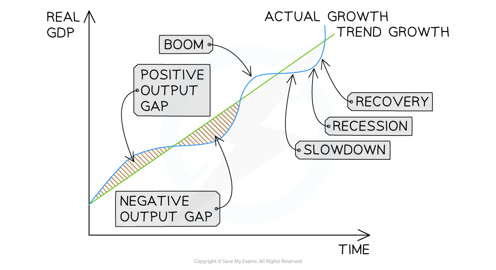
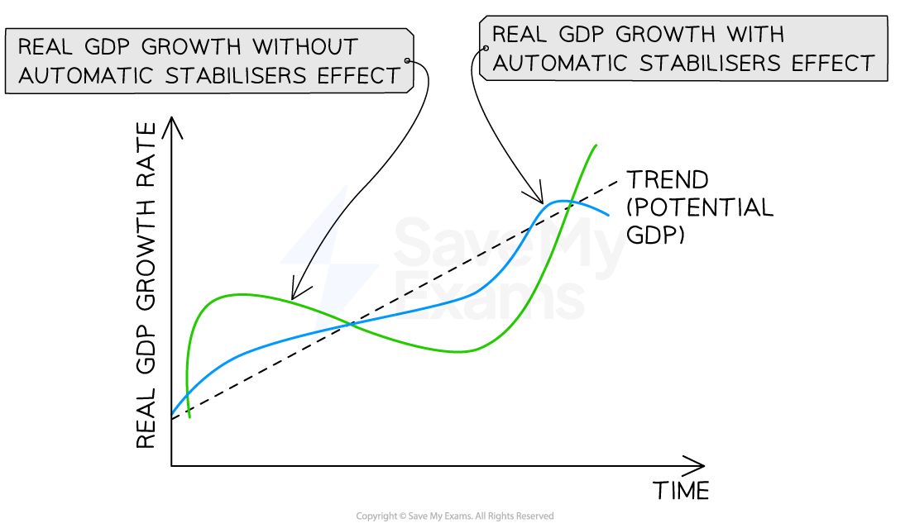

# The Business (Trade) Cycle

## The link to output gaps

> **Spec point** — `spcpt_6xgmHJ8QHgXxGk2K`

## The link to output gaps

## Phases of the cycle

> **Spec point** — `spcpt_x8HwhY9H77c8JKQk`

## Phases of the cycle

- **The business (trade) cycle describes the fluctuations of actual real GDP around the long-term trend rate of growth**

  - Four recognisable phases repeat over time: **boom, slowdown, recession **and **recovery**.

*The business cycle*

### Diagram analysis

- The straight rising line shows the **long-term actual growth trend** - the path real GDP follows on average over time as potential output expands
- The wavy curve shows **actual real GDP** fluctuating above and below this trend

  - The **positive output gap** zone is shaded above the trend line during the boom phase - actual real GDP is higher than the trend suggests it should be
  - The **negative output gap** zone is shaded below the trend line during the recession phase - actual real GDP is lower than the trend suggests
- The four phases follow a natural sequence: **boom → slowdown → recession → recovery**, then back to boom

  - The transition from boom to slowdown happens as the economy approaches capacity
  - The transition from recession to recovery is often moderated by **government intervention**
- The cycle is rarely symmetric in practice - recessions may be short and sharp or long and gradual, and booms may be of very different lengths

#### Characteristics of booms and recessions

- Each phase has distinctive qualitative features worth recognising in context:

| Recession | Boom |
|---|---|
| - Sustained period of negative economic growth, usually two consecutive quarters (6 months) | - Sustained period of above-trend growth |
| - Low confidence among firms and households | - High confidence and rising willingness to take on risk |
| - Businesses defer investment; households defer large purchases | - Strong investment and *consumer durables* spending |
| - Government *budget deficit* rises as spending rises and tax revenue falls | - Government budget deficit falls as tax revenue rises and benefit spending falls |
| - Political pressure for intervention and stimulus | - Political pressure for restraint and cooling measures |

## Causes of the cycle

> **Spec point** — `spcpt_3R28VNH3FXZDS3Nv`

## Causes of the cycle

- The business cycle has multiple interacting causes
- No single factor explains it alone — most recessions/booms reflect a combination of the following
- Useful distinction:

  - **Endogenous causes** — generated from within the economy itself
  - **Exogenous causes** — external shocks hitting the economy from outside

### 1. Multiplier–accelerator interaction (endogenous)

- Most important endogenous cause (links to 9.1)
- Upswing: rise in autonomous investment → raises Y via multiplier → induces further investment via accelerator → raises Y again via multiplier
- Downswing: slowdown in growth → induced investment falls sharply → Y falls via multiplier → induced investment falls further
- Can generate cyclical behaviour even in an otherwise stable economy

### 2. Changes in confidence (can be endogenous or exogenous)

- Consumer and business confidence — Keynes's "animal spirits" (instinctive optimism/pessimism driving economic decisions) — is volatile and self-reinforcing
- Optimism → raises autonomous C and I → boom
- Confidence shock (financial stress, political uncertainty, *public health crisis*) → collapse in AD → recession

### 3. Supply-side shocks (exogenous)

- Sudden changes in cost/availability of key inputs (esp. energy) shift SRAS leftward
- Can trigger recession even without a fall in AD
- Key examples: 1970s oil price shocks; 2022 energy price spikes following Russia–Ukraine conflict

#### 4. Monetary policy changes (can be endogenous or exogenous)

- Tightening *interest rates* to control *inflation* → deliberately slows economy, potentially into recession
- Loosening rates → helps economy recover from recession but may cause the next boom
- Policy-induced cycles common in economies with independent inflation-targeting central banks

### 5. External shocks and international transmission (exogenous)

- In open economies, recessions often imported through trade and financial linkages
- Recession in major trading partner → reduces exports
- Global financial crisis → disrupts credit and investment across borders
- Globalisation has tended to synchronise cycles across countries

#### How Phases Transition

- Phases do not end abruptly - they transition as cyclical drivers weaken, reverse, or are moderated by policy

**Main transition mechanisms:**

- **Exhaustion of cyclical drivers**

  - Factors starting a boom (rising confidence, easy credit, rising asset prices) weaken as the cycle matures; prolonged booms face capacity constraints, rising costs and diminishing investment opportunities
- **Reversal of the multiplier–accelerator**

  - Same mechanism that amplified the upswing reverses during the downswing; slowdown in Y growth → induced I falls sharply (accelerator) → Y falls (multiplier) → induced I falls further; self-reinforcing reversal explains why recessions can be severe and fast
- **Automatic stabilisers**

  - Tax and benefit system automatically reduces the severity of downturns and restrains upswings without any policy decision (see next section)
- **Discretionary policy response**

  - Central banks tighten monetary policy as inflation rises in a boom, loosen as recession deepens; governments may use expansionary fiscal policy in recession, contractionary in boom
- **Lags and timing**

  - Transitions rarely sudden because responses take time to take effect; monetary policy may take 12–18 months to affect AD; fiscal measures face implementation delays

> **Exam Hint**
> See the Keynesian vs Classical debate on whether gaps close automatically or require intervention

## Automatic stabilisers

> **Spec point** — `spcpt_z4JK4BRmDqMQq5B3`

## Automatic stabilisers

- **Automatic stabilisers are features of the tax and benefit system that dampen fluctuations in AD as the economy moves through the cycle - without any *****discretionary***** government action being required**
- The main stabilisers are ***progressive taxation*** and **unemployment benefits and other *****transfer payments***

*Automatic stabilisers*

### Diagram analysis

- The trend line represents **potential GDP** - the path the economy would follow at its sustainable growth rate
- The curve labelled "without automatic stabilisers" fluctuates widely above and below trend - recessions are deep and booms are pronounced
- The curve labelled "with automatic stabilisers" follows the same broad pattern but with a **smaller amplitude** - deviations from trend are reduced in both directions
- The two curves share the same trend line - stabilisers change the **amplitude** of the cycle, not the long-run potential growth rate
- The dampening is **symmetric**: stabilisers reduce the depth of recessions and the height of booms by the same mechanism operating in reverse

#### How stabilisers work in a recession

- Tax revenue falls automatically as incomes fall under progressive taxation
- Households retain more of their income, partially offsetting the fall in AD
- Unemployment benefits and transfer payments rise automatically as unemployment rises
- The recipients of these payments tend to have high MPCs, so the spending loss to the economy is smaller than it would otherwise be
- The combined effect is that real GDP falls by less than it would without stabilisers

#### How stabilisers work in a boom

- Tax revenue rises automatically as incomes rise and households move into higher tax brackets
- Households retain less of each additional £1 of income, restraining consumption growth
- Unemployment benefits and transfer payments fall automatically as unemployment falls
- The combined effect is a disinflationary restraint on AD, moderating *demand-pull inflation*
- Real GDP rises by less than it would without stabilisers

#### Limitations of automatic stabilisers

- Stabilisers dampen but cannot eliminate the cycle - severe shocks still produce recessions and booms
- Their strength depends on the progressivity of the tax system and the generosity of unemployment benefits

  - Economies with smaller public sectors (e.g. Singapore, Hong Kong) have weaker stabilisers than those with larger ones (e.g. France, Nordic countries)
- Stabilisers worsen government budget positions during recessions (automatic deficit rise) - politically difficult if public debt is already high
- They address demand-side fluctuations but do little for *supply-side shocks*

> **Exam Hint**
> The strongest answers on the cycle link causes to consequences through specific transmission mechanisms rather than listing factors generically. "A fall in confidence causes a recession" is a weak explanation; "a fall in business confidence reduces autonomous investment, which triggers a multiplier-accelerator downward spiral as induced investment also falls" shows the analytical depth examiners reward at Level 4.
> 
> Be precise about what automatic stabilisers do and do not do. They **dampen** the cycle, they do not **eliminate** it. They operate **automatically** without discretionary intervention, unlike active fiscal policy. And they are only as strong as the underlying tax and benefit system - a point worth making explicitly when comparing cycle volatility across different economies.
> 
> For evaluation, acknowledge that the business cycle is one of the most contested areas of macroeconomics. Keynesians emphasise demand-side causes and argue for active counter-cyclical policy; monetarists and new classical economists emphasise supply-side and policy-induced causes and are sceptical of discretionary intervention. Candidates who can frame their answer around this debate consistently reach the top band.
