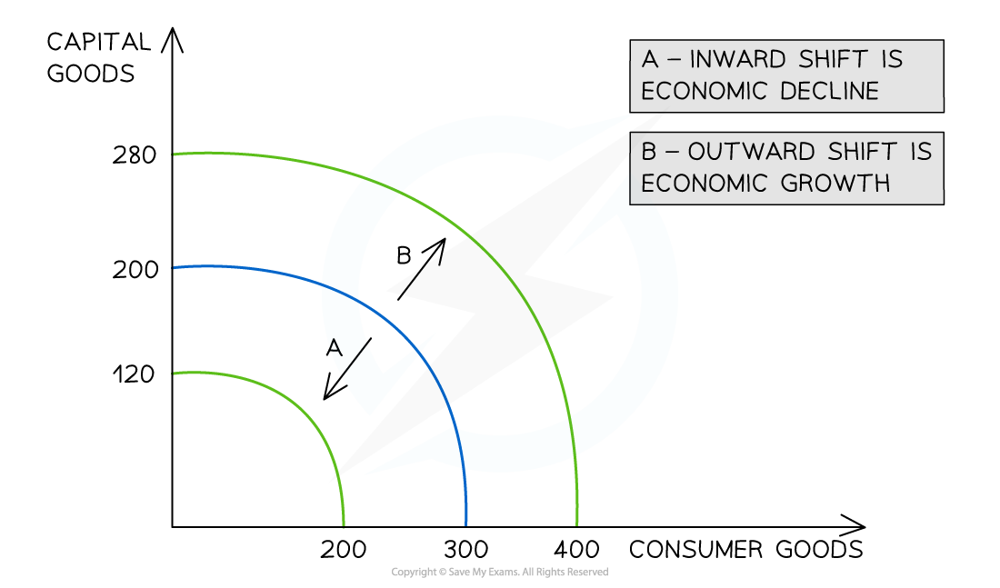
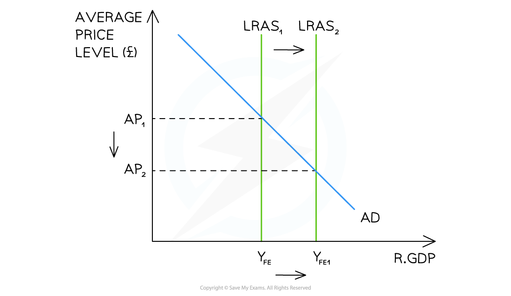

# Understanding Economic Growth

## The meaning of economic growth

> **Spec point** — `spcpt_Pmv2wZsXbKKy8bDN`

## The meaning of economic growth

- **Economic growth is an increase in the real output of goods and services produced by an economy over a period of time**

  - It is measured as the percentage change in** *****real GDP*** from one period to the next
- Economic growth can occur in two ways

### 1. Actual growth

- **Actual growth is an increase in real output using previously unemployed or underemployed resources** - the economy moves from a point inside the *PPF *towards the frontier

  - This occurs when spare capacity is brought back into use - for example during a recovery from *recession*
  - It does not increase the productive potential of the economy - the PPF does not shift

#### Diagram analysis

- Point X represents an economy operating **inside** the PPF - resources are unemployed or underemployed
- The movement from X to Y represents **actual growth** - real output increases as idle resources are brought back into production
- The PPF itself does not move - productive capacity is unchanged
- In AD/AS terms this is equivalent to a rightward shift of AD along the elastic section of the Keynesian LRAS - output rises but the price level remains stable while spare capacity exists

### 2. Potential growth

- **Potential growth is an increase in the productive capacity of the economy** - the maximum output the economy is capable of producing increases
- This is represented by an outward shift of the PPF
- It requires an increase in the quantity or quality of factors of production
- In AD/AS terms, potential growth is shown by a rightward shift of the LRAS curve

#### Diagram analysis

- The **outward shift** (A to B) represents an increase in productive capacity - caused by improvements in the quantity or quality of factors of production such as new technology, investment in capital, or an expansion of the labour force
- The **inward shift** represents economic decline - caused by destruction of capital, *emigration *of skilled workers, or *depletion *of natural resources

#### Diagram analysis

- The rightward shift from LRAS1 to LRAS2 increases the full employment level of output from YFE to YFE1
- At the same time the price level **falls** from AP1 to AP2 - potential growth is non-inflationary because productive capacity has increased
- This is the key distinction from an AD shift - demand-led growth raises prices; supply-led potential growth reduces them

## Measurement of economic growth

> **Spec point** — `spcpt_32qVtp3YXzQvGtVg`

## Measurement of economic growth

- **Economic growth is measured as the percentage change in real GDP between two time periods**

`Rate space of space economic space growth space left parenthesis percent sign right parenthesis space space equals space fraction numerator left parenthesis GDP space in space current space year space minus space GDP space in space previous space year right parenthesis over denominator GDP space in space previous space year end fraction space straight x space 100`

- Growth is typically measured on a **quarterly** basis (every three months) and reported as an **annual rate**
- A recession is technically defined as **two consecutive quarters of negative GDP growth**
- Long-run trend growth refers to the average rate at which an economy can grow without generating inflationary pressure - in the UK this is approximately 2-2.5% per year

> **Worked Example**
> In year 1, a country's real GDP was \$500 billion. In year 2, nominal GDP rose to \$577.5 billion and prices increased by 5%.
> 
> **What is the real GDP in year 2?**
> 
> A. \$4.76 billion
> 
> B. \$5 billion
> 
> C. \$476 billion
> 
> D. \$550 billion
> 
> **Final answer:** **Answer: D - \$550 billion**
> 
> **Worked solution:**
> 
> Real GDP strips out the effect of inflation from nominal GDP:
> 
> Real GDP = Nominal GDP / (1 + inflation rate)
> 
> **Step 1 - prices increased by 5%, so divide nominal GDP by 1.05:**
> 
> Real GDP = \$577.5 billion / 1.05 = **\$550 billion**
> 
> **Checking against year 1:** real GDP rose from \$500 billion to \$550 billion - a 10% increase in the volume of real output. The remaining 5% of the nominal GDP rise is explained entirely by higher prices.
> 
> **The trap** is option C (\$476 billion) - this results from multiplying by 1.05 rather than dividing. Always divide nominal GDP by the inflation adjustment to remove the price effect - multiplying would make the figure larger, not smaller, which cannot be correct when stripping out inflation.

## Distinction between nominal GDP and real GDP

> **Spec point** — `spcpt_fRSptZWR29xRVRjx`

## Distinction between nominal GDP and real GDP

- **Nominal GDP** is the total value of output measured at **current prices** - it makes no adjustment for inflation

  - Nominal GDP can rise simply because prices have risen, even if the actual volume of goods and services produced has not increased
  - It therefore **overstates** true economic growth in periods of inflation
- **Real GDP** is the total value of output measured at **constant prices** - it adjusts for inflation by using a base year price level

  - Real GDP strips out the effect of price changes, leaving only the change in the volume of output
  - It is the correct measure for assessing whether *living standards* have actually improved
- The difference between nominal and real GDP growth is explained by the rate of inflation:

Real GDP growth = Nominal GDP growth - Inflation rate

| Scenario | Nominal GDP growth | Inflation rate | Real GDP growth | What this means |
|---|---|---|---|---|
| Economy growing with moderate inflation | 5% | 2% | 3% | - Output is genuinely rising - prices are up but so is the volume of production |
| Economy not growing - inflation only | 4% | 4% | 0% | - All of the nominal GDP rise is explained by higher prices - no extra output has been produced |
| Economy shrinking despite rising prices | 2% | 5% | -3% | - The volume of output is actually falling even though nominal GDP appears to be rising |

- A country reporting strong nominal GDP growth may actually be experiencing **falling real output** if inflation is sufficiently high

  - This is why real GDP is always used when comparing economic performance over time or between countries

> **Exam Hint**
> Always use **real GDP** when discussing economic growth - nominal GDP figures are misleading because they include the effect of price changes. In the exam, if data is given in *nominal *terms and you are asked to assess growth, check whether an inflation figure is provided and adjust accordingly.
> 
> The distinction between actual and potential growth maps directly onto the AD/AS model - actual growth is a movement along the LRAS towards full employment; potential growth is a rightward shift of the LRAS itself. Using this framework in essay answers demonstrates the analytical depth CIE rewards at A Level.
