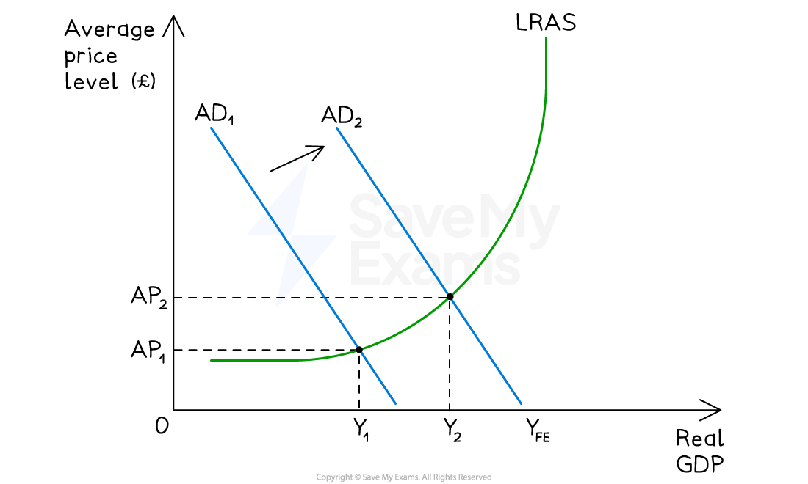

# Policies to Reduce Unemployment

## How to reduce unemployment

> **Spec point** — `spcpt_gKSw4K8n7xYftkvX`

## How to reduce unemployment

- The appropriate policy depends on the **type of unemployment**

  - **Cyclical unemployment** (demand-deficient) → primarily addressed with demand-side policies
  - **Structural, frictional and voluntary unemployment** → primarily addressed with supply-side policies
- Most real-world economies require a policy mix, with the balance depending on the state of the labour market

## Demand-side policies

> **Spec point** — `spcpt_RbBtTQF2Tmg4cYf8`

## Demand-side policies

### 1. Expansionary fiscal policy

- Increases in government spending (G) or cuts in taxation raise disposable income and AD
- Multiplier effect amplifies the initial impulse — firms hire more workers as output rises
- Most effective when economy has a **negative output gap** (spare capacity)

### 2. Expansionary monetary policy

- Cut in *interest rates* reduces the cost of borrowing, raising consumption (C) and investment (I)
- Currency may depreciate, raising net exports (X−M)
- *Quantitative easing* increases money supply when interest rates approach zero

*The impact of expansionary monetary policy*

#### Diagram analysis

- The economy is initially in macroeconomic equilibrium at **AP₁Y₁**

  - This is a position below full employment (YFE) with spare capacity on the highly elastic section of the Keynesian LRAS
- The *central bank* wants to boost economic growth and** lowers interest rates**
- Lower interest rates cause investment and consumption to increase, which are components of AD

  - Aggregate demand increases from **AD₁ → AD₂**
  - The economy reaches a new equilibrium at **AP₂Y₂**
  - This is a higher average price level and a greater level of national output, as the economy moves up the upward-sloping section of the LRAS
- **Employment rises** as firms hire more workers to meet the higher level of output

  - Unemployment falls as the economy moves closer to YFE

#### Evaluating each policy

| Policy | Targets | Strengths | Weaknesses |
|---|---|---|---|
| **Expansionary fiscal** | - Cyclical unemployment | - Direct and powerful - Multiplier amplifies impact | - Time lags - May cause budget deficit and rising national debt; inflationary at full employment - Cannot reduce unemployment below NRU |
| **Expansionary monetary** | - Cyclical unemployment | - Faster to implement - Independent central bank reduces political interference | - 12–18 month transmission lag - Liquidity trap at very low rates - Depends on confidence |

## Supply-side policies

> **Spec point** — `spcpt_cw8gmWdwx4SWdZNr`

## Supply-side policies

### 1. Market-based supply-side policies

- **Cuts in income tax and benefits** — raise incentive to work; reduce voluntary unemployment
- ***Trade union***** reform** — increases labour market flexibility; reduces disequilibrium unemployment
- ***Deregulation *****of labour markets** — easier hiring and firing encourages job creation
- **Cuts in *****corporation tax*** — encourages firms to invest and expand employment

### 2. Interventionist supply-side policies

- **Education and training** — reduces structural unemployment by improving skills match
- **Retraining programmes** — help displaced workers move into new occupations (links to 9.3.6)
- **Improved labour market information** — job centres and digital platforms reduce frictional unemployment
- **Subsidies to employers for hiring** — e.g. *wage subsidies* for young or long-term unemployed workers
- **Regional policy** — infrastructure investment in high-unemployment areas to reduce geographical immobility

#### Evaluating each policy

| Policy | Targets | Strengths | Weaknesses |
|---|---|---|---|
| **Market-based supply-side** | - Structural, frictional, voluntary | - Non-inflationary - Improves long-run productive capacity - Lowers NRU | - Long time lags - May raise inequality - Deregulation risks |
| **Interventionist supply-side** | - Structural, frictional | - Directly targets skills mismatch - Addresses market failures | - Expensive - large opportunity cost - Outcomes uncertain - Long payback period |

> **Case Study**
> **Spain's labour market reforms post-2008**
> 
> **The context**
> 
> The 2008 global financial crisis and the burst of Spain's *housing bubble* triggered a severe recession. Unemployment soared from around 8% in 2007 to a peak of **26.3% in 2013**  over 6 million Spaniards out of work, with construction and youth unemployment hardest hit.
> 
> **The policy response**
> 
> - **2012 labour market reforms** - market-based supply-side policy package:
> 
>   - Made firing cheaper and more flexible (reduced *severance payments*)
>   - Decentralised *collective bargaining*, allowing firm-level wage agreements
>   - Gave employers greater power to adjust working hours and wages
> - **Active labour market policies** - expanded retraining and job-matching services
> 
> **Outcomes**
> 
> 
> 
> - Unemployment fell from 26.3% (2013) to under **10% by late 2025** - the lowest level since 2008
> - Over 3 million jobs recovered; firms began hiring at lower rates of GDP growth than in previous cycles
> - *Exports *surged as unit labour costs fell
> 
> **Limitations**
> 
> - Rise in precarious *temporary contracts*
> - Long-term unemployment and structural issues remain
> - *In-work poverty* rose as wages stagnated
> 
> **Key lesson**
> 
> Supply-side labour market reforms can substantially reduce unemployment, but the distributional effects on job quality require parallel attention.

> **Exam Hint**
> When writing essays on policies to reduce unemployment, consider the following key evaluation points:
> 
> **Type of unemployment** - demand-side policies are ineffective against structural unemployment; supply-side policies cannot quickly address cyclical unemployment
> 
> **State of the economy** - demand-side policies cause inflation if economy is already at YFE (natural rate); only supply-side policies can sustainably reduce unemployment below the previous NRU
> 
> **Time horizon** - demand-side acts in months, supply-side in years or decades
> 
> **Country context** - high-income economies face different unemployment problems (often structural/technological) from low-income economies (often underemployment/informality)
> 
> **Policy conflicts** - reducing unemployment may worsen inflation (Phillips curve), current account balance, or government debt
> 
> **Policy mix** - most effective approach typically combines short-run demand-side stimulus with long-run supply-side reform
