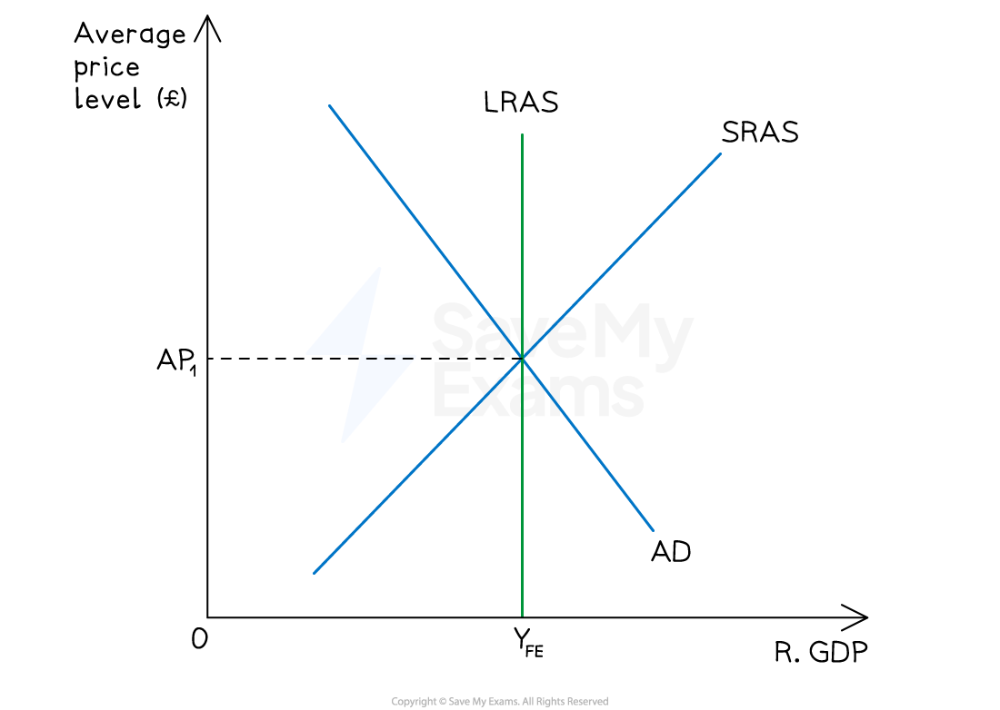
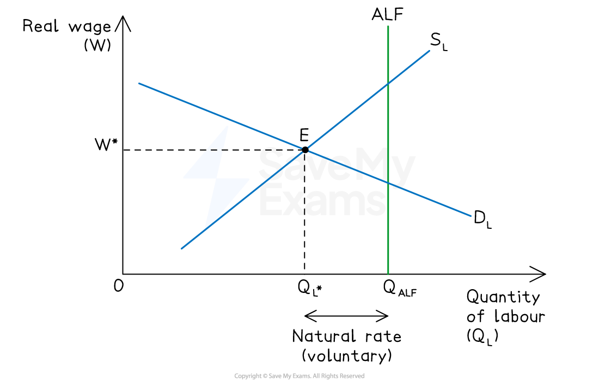
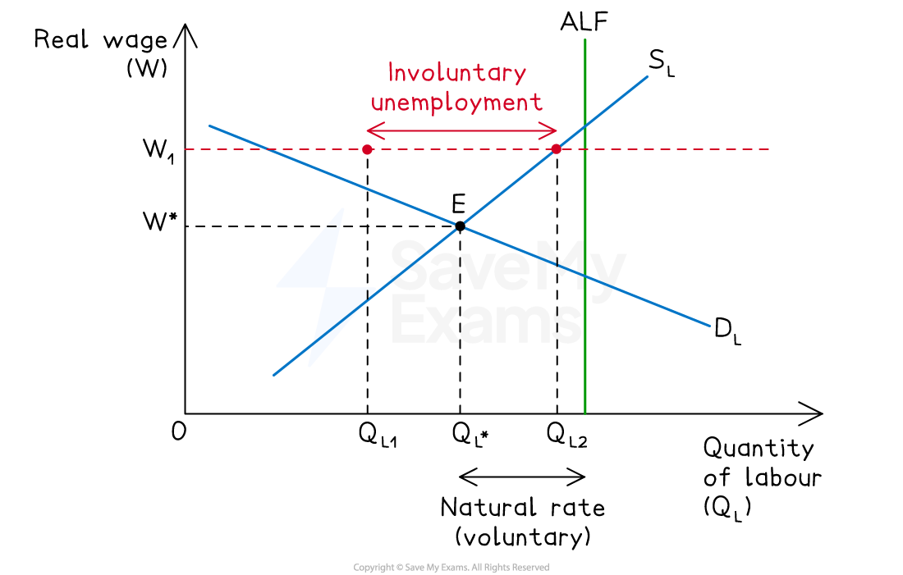

# Types of Unemployment and the Natural Rate

## Key terms

> **Spec point** — `spcpt_vybTnHMph39pHsnf`

## Key terms

- **Working-age population** - all people of employable age (typically 16–64)
- **Labour force (LF)** - those in the working-age population who are either employed OR actively seeking work

  - Excludes students, *retirees*, homemakers, and others not seeking work (the "economically inactive")
- **Employed** - people currently working for pay (full-time, part-time, or *self-employed*)
- **Unemployed** - people in the labour force who are not working but actively seeking work
- **Participation rate** - labour force as a % of working-age population
- **Unemployment rate** - unemployed as a % of labour force

$\mathrm{Unemployment} \mathrm{rate}=\frac{\mathrm{unemployed}}{\mathrm{labour} \mathrm{force}}x100$

## Full employment

> **Spec point** — `spcpt_GswXMjbpybHzNRZH`

## Full employment

- **Full employment is the level of employment at which everyone willing and able to work at the going wage rate is employed**
- Full employment does NOT mean zero unemployment

  - Some unemployment always remains due to *frictional*, *structural *and voluntary factors

*Full employment  can be seen on a LRAS diagram*

- At full employment, the only unemployment is the ***natural rate of unemployment (NRU)***

  - This corresponds to real output YFE on the vertical section of LRAS

## Equilibrium and disequilibrium unemployment

> **Spec point** — `spcpt_J32st7MQj8mSFrfJ`

## Equilibrium and disequilibrium unemployment

| Type | Cause | Examples |
|---|---|---|
| **Equilibrium unemployment** | - Labour market clears at the market wage    - Some workers are still unemployed | - Frictional, structural, *seasonal*, voluntary |
| **Disequilibrium unemployment** | - Labour market does NOT clear    - Real wage stuck above equilibrium | - *Cyclical *(demand-deficient), real-wage/classical |

### Equilibrium unemployment

*The equilibrium labour market*

#### Diagram analysis

- **D****L** (downward sloping) - firms hire more workers at lower wages
- **S****L** (upward sloping) - more workers willing to work at higher wages
- **LF** (vertical) - everyone who could potentially work (labour force)
- Equilibrium at **W*, Q****L*** - labour market clears
- Horizontal gap between SL and LF at W* = **natural rate of unemployment**

  - This is voluntary as workers are in the labour force but not willing to work at W*

#### Hysteresis

- **Hysteresis is the tendency of unemployment to persist at higher levels after a temporary shock has passed**

  - Long-term unemployed lose skills (human capital erodes)
  - Employers view them as less employable (signalling effect)
  - Discouraged workers stop searching
- **Consequence** - a cyclical shock can permanently raise the natural rate of unemployment unless addressed through active labour market policy

  - **Example** - European unemployment rose sharply after the 1980s oil shocks and remained elevated for over a decade, even after recovery

## Voluntary and involuntary unemployment

> **Spec point** — `spcpt_sGQqfCMc7cshVs2J`

## Voluntary and involuntary unemployment

| Type | Definition | Typical cause | Part of |
|---|---|---|---|
| **Voluntary** | - Workers choose not to work at current wage | - Reservation wage above market wage - Searching for better job - Welfare/benefit generosity | - Equilibrium unemployment (NRU) |
| **Involuntary** | - Workers willing and able to work at current wage but cannot find a job | - Wage rigidity (*minimum wage*, *trade unions*) - Demand deficiency - Structural mismatch | - Disequilibrium unemployment |

### Involuntary/disequilibrium unemployment

*Involuntary unemployment*

#### Diagram analysis

- The real wage is **stuck at W₁ above equilibrium W*** (e.g. due to minimum wage, union action, or sticky nominal wages)
- At W₁, firms demand only Q_L1 workers, but Q_L2 workers are willing to work
- Gap between QL1 and QL2 = **involuntary unemployment**

  - Workers are ready and able to work at W₁ but cannot find jobs

## The natural rate of unemployment (NRU)

> **Spec point** — `spcpt_Rs8NBw4M87sGF3Pk`

## The natural rate of unemployment (NRU)

- **The NRU is **the rate of unemployment when the labour market is in equilibrium

  - This corresponds to full employment output YFE
  - It comprises frictional + structural + voluntary unemployment
- The NRU cannot be reduced permanently by expansionary demand-side policy

  - Doing so only creates *inflation *(see [expectations-augmented Phillips curve](https://www.savemyexams.com/a-level/economics/cie/23/revision-notes/government-macroeconomic-intervention/government-macroeconomic-policy-objectives-a-level/the-phillips-curve/))

### Determinants of the NRU

| Factor | Effect on NRU |
|---|---|
| **Unemployment benefit generosity** | - Higher benefits raise reservation wages → higher NRU |
| **Labour market regulation** (unions, employment protection) | - Stronger protection → slower adjustment → higher NRU |
| **Skills and training** | - Better skills → lower structural mismatch → lower NRU |
| **Geographic and occupational mobility** | - Higher mobility → faster matching → lower NRU |
| **Job-matching efficiency** (job centres, technology) | - Better matching → lower NRU |
| **Rate of technological change** | - Faster change → more structural unemployment if retraining lags → higher NRU |

#### Policy implications

- **Demand-side policies** (fiscal, monetary) cannot reduce unemployment below the NRU in the long run - they only cause inflation
- Reducing the NRU requires **supply-side policies**:

  - Education and retraining to reduce structural mismatch
  - Job-search support and improved labour exchanges
  - Benefit reform to reduce disincentives
  - Increasing *labour mobility*

> **Exam Hint**
> Always distinguish equilibrium and disequilibrium unemployment clearly in your opening paragraph — equilibrium unemployment is voluntary (workers choosing not to work at W*) and forms the NRU; disequilibrium unemployment is involuntary (workers wanting work but unable to find it at a sticky wage).
> 
> Draw both labour market diagrams where the question demands a comparison - a single diagram cannot show both cases.
> 
> For questions on why expansionary demand-side policy cannot permanently reduce unemployment, link directly to the expectations-augmented Phillips curve - AD stimulus reduces unemployment below the NRU in the short run but raises inflation. Once workers adjust wage expectations upward, unemployment returns to the NRU at a higher inflation rate.
> 
> Hysteresis is a high-value AO3 evaluation point - it explains why recessions can have permanent effects and why active labour market policies (training, job-search support) are justified even after the immediate shock has passed.
