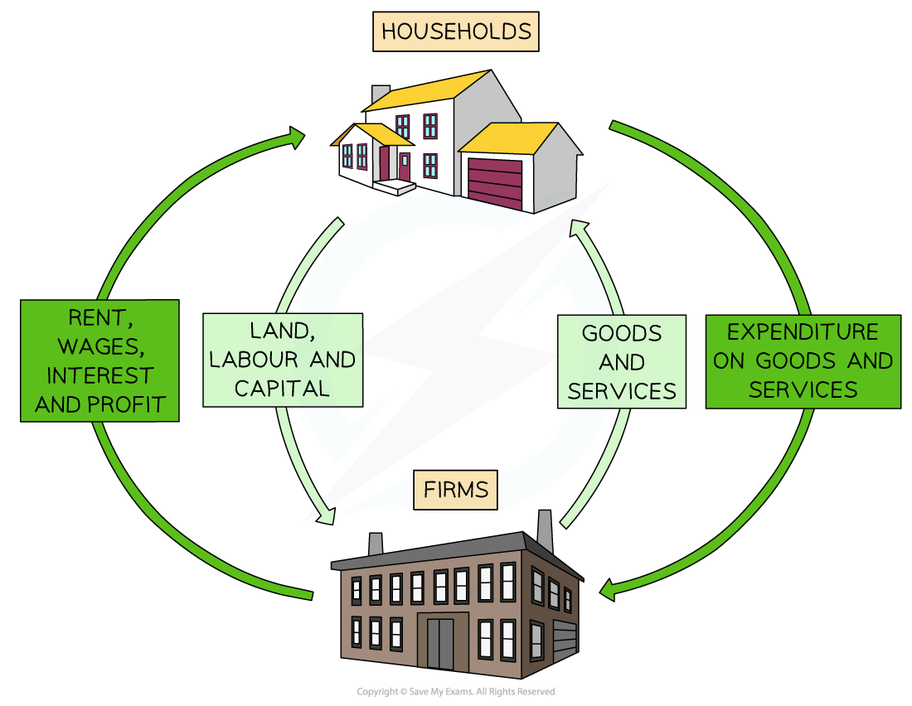
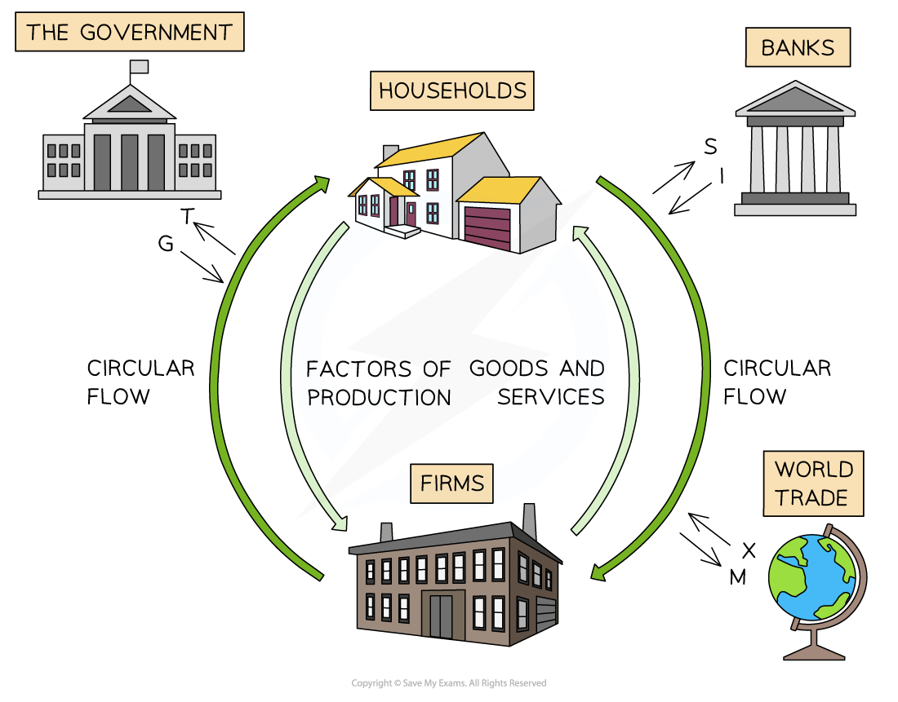

# What is the Circular Flow of Income?

## The closed circular flow of income model

> **Spec point** — `spcpt_myxdDd6XD3tfzmrN`

## The closed circular flow of income model

- **The circular flow of income model is used to illustrate national income and the flow of money, resources and goods in an economy**

  - There is a simple model which shows the money flows in a 'closed economy'
  
    - This shows **money flows **between **households** and **firms **
  - There is a **more complex mode**l which adds in other economic agents, including the **government**, **financial sector** and **foreign trade** (*net exports*)

### Circular flow in a closed economy

*The circular flow of income between households and firms in a closed economy*

#### Diagram analysis

- **Households** own the **wealth** in the economy

  - These are the ***factors of production***
- **Households supply** their factors of production to firms and **receive income** as a reward

  - They receive **rent** for land, **wages** for labour,** interest** for capital, and **profit** for enterprise
  - With this income, they purchase goods and services from firms
- **Firms **purchase factors of production from households

  - They use these resources to **produce goods and services**
  - They **sell the goods and services** to households and receive **sales revenue**

## The open circular flow of income model

> **Spec point** — `spcpt_K24dX63ZvPbmg5YF`

## The open circular flow of income model

- **An open circular flow of income demonstrates the relationship between all of the economic agents that interact in a global world**
- There are high levels of **interdependence** between households, firms, the government, the *financial sector*, and the foreign sector (foreign firms and households)

#### Diagram: Circular flow in an open Economy

*An open economy is one that trades with the world. North Korea is a closed economy*

### Diagram analysis

- **Households and firms** have been explained in the closed circular flow of income model above
- **Government: **The government** **influences the size of the circular flow through its taxation (T) and spending policies (G)
- **Financial sector:** The financial sector influences the size of the circular flow by providing funds for Investment (I) and a safe place for households and firms to store their savings (S)
- **Foreign sector:** Globalisation means that the level of exports (X) and imports (M) significantly affects the size of the circular flow of income in most countries

## Injections and leakages

> **Spec point** — `spcpt_43jPKVM7QFD6SpYt`

## Injections and leakages

- **Money** can **enter or leave** the circular flow of income in an economy

  - Injections represent **new income** in the economy
  - Withdrawals are the **leakage **of money from the economy
- **Injections** add **money** to the circular flow of income and **increase its size**

  - Increased government spending **(G)**
  - Increased investment **(I)**
  - Increased exports **(X)**
- **Leakages** (withdrawals) remove **money** from the circular flow of income and **reduce its size**

  - Increased savings by households **(S)**
  - Increased taxation by the government **(T)**
  - Increased *import *purchases **(M)**
- There are high levels of** interdependence** between households, firms, the government, the financial sector, and the foreign sector (foreign firms and households)

### Circular flow with Injections and leakages

*If the injections > leakages, national income will increase and the economy will grow *

#### Diagram analysis

- **Government: **Government spending (G) is an injection and taxation (T) is a leakage
- **Financial sector:** Investment (I) is an injection and savings (S) is a leakage
- **Foreign sector:** Exports (X) is an injection and imports (M) is a leakage
- The relative **size of the injections and withdrawals** impacts the size of the economy

  - Injections > withdrawals = economic growth and increase in national income
  - Withdrawals > injections = economic decline and a fall in national income
- **Changes to any of the factors** that influence government spending, investment, consumption and net exports will increase or decrease** **the relative size** **of the circular flow of income

  - E.g. An increase in **interest rates** will increase savings (withdrawal) and **reduce consumption** and investment

### Identifying injections and leakages from transaction descriptions

- In the exam, injections and leakages are not always labelled as G, I or X - instead they appear as **specific financial transactions** that must be classified correctly
- The test to apply is: **does this flow add money into the domestic circular flow from outside, or does it remove money from it?**

  - If money enters the domestic circular flow from outside the household-firm loop → **injection**
  - If money leaves the domestic circular flow → **leakage**
- **Common transactions that are injections:**

  - Government spending on goods, services or interest payments on bonds - all represent money flowing from government into the circular flow
  - Bank lending to firms for investment - money flows from the financial sector into the circular flow
  - Export revenues - money flows into the domestic economy from abroad
- **Common transactions that are leakages:**

  - Taxation of households or firms - money flows out to government
  - Household saving or firm repayment of bank loans - money flows out to the financial sector
  - *Dividends *or profits paid to foreign shareholders - money flows out of the domestic economy abroad
  - Import expenditure - money flows out to foreign producers
- **The direction trap**: always check which way the flow moves

  - Dividends *received from* abroad → injection
  - Dividends *paid to* foreign shareholders → leakage
  - The same transaction type can be either, depending on direction

> **Worked Example**
> **What represents an injection into a country's circular flow of income?**
> 
> A. Corporate taxes
> 
> B. Interest payments on *government bonds*
> 
> C. The payment of dividends to foreign shareholders
> 
> D. The repayment of bank loans
> 
> **Final answer:** **Answer: B — interest payments on government bonds**
> 
> **Worked solution:**
> 
> An injection is any spending that enters the circular flow from outside the household-firm loop - it adds to national income rather than withdrawing from it.
> 
> - **A. Corporate taxes ** - a leakage: money flows out of firms to the government ✗
> - **B. Interest payments on government bonds** - the government pays interest to bondholders, putting money into the circular flow - this is government spending, an injection ✓
> - **C. Dividends to foreign shareholders** - profits flowing out of the domestic economy to foreign residents - this is a leakage, reducing national income ✗
> - **D. Repayment of bank loans** - households or firms returning money to the financial sector - a leakage, not an injection ✗
> 
> The trap here is option C - dividends received *from* abroad would be an injection, but dividends *paid to* foreign shareholders flow out of the domestic circular flow.

## Equilibrium and disequilibrium in the circular flow

> **Spec point** — `spcpt_5n2rrVGWZzMBTdnm`

## Equilibrium and disequilibrium in the circular flow

### 1. Equilibrium national income

- **Equilibrium national income occurs when total injections equal total withdrawals - the size of the circular flow is stable and national income is neither rising nor falling**

Injections (I + G + X) = Withdrawals (S + T + M)

- At this point, the plans of all economic agents are consistent

  - Households, firms, government and the foreign sector are all satisfied with current income and spending levels

- Equilibrium does **not** require each individual injection to equal its corresponding leakage

  - Investment does not need to equal savings, nor exports equal imports - only the **totals** must balance

### 2. Disequilibrium national income

- **Disequilibrium occurs when total injections do not equal total withdrawals**

  - The circular flow is either expanding or contracting
- There are two possible states of disequilibrium:

| Condition | Effect on national income | Example trigger |
|---|---|---|
| Injections > withdrawals | - National income rises — the economy grows | - Government increases spending (G↑) |
| Withdrawals > injections | - National income falls — the economy contracts | - Households increase saving (S↑) |

- These changes are **self-reinforcing in the short run**

  - When injections exceed withdrawals, firms receive more revenue, hire more workers, pay more factor incomes, and households spend more - amplifying the initial change in income

#### Moving towards a new equilibrium

- Following a disequilibrium, national income adjusts until injections and withdrawals are equal again at a **new equilibrium level**

  - If government spending rises, national income expands until the additional income generated causes withdrawals (saving, tax, imports) to rise sufficiently to match the new higher level of injections
  - If households save more, national income contracts until withdrawals fall back into line with injections at a lower level of income
- This process of adjustment is what the ***multiplier**** *captures — though the size of the multiplier is not required at AS Level

> **Exam Hint**
> Equilibrium means **injections equal withdrawals in total** - not that each pair balances individually. A common error is assuming exports must equal imports, or investment must equal savings, for equilibrium to hold.
> 
> For disequilibrium questions, identify whether the policy change affects an injection or a withdrawal first, then apply the rule: injections > withdrawals means national income rises; withdrawals > injections means it falls.
> 
> The strongest evaluative point is that **equilibrium national income and full employment national income are not the same thing** — an economy can be in equilibrium with significant *unemployment*, which sets up the case for government intervention.
