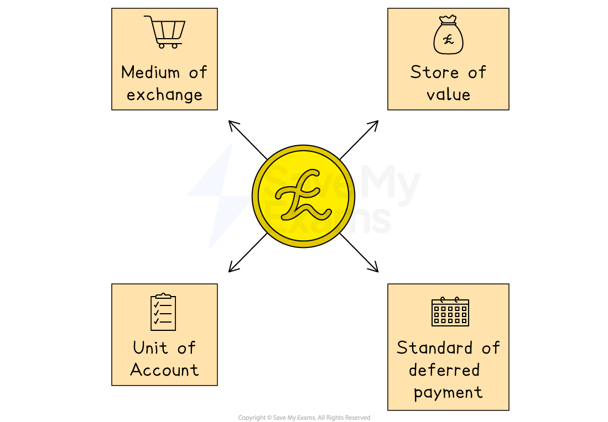
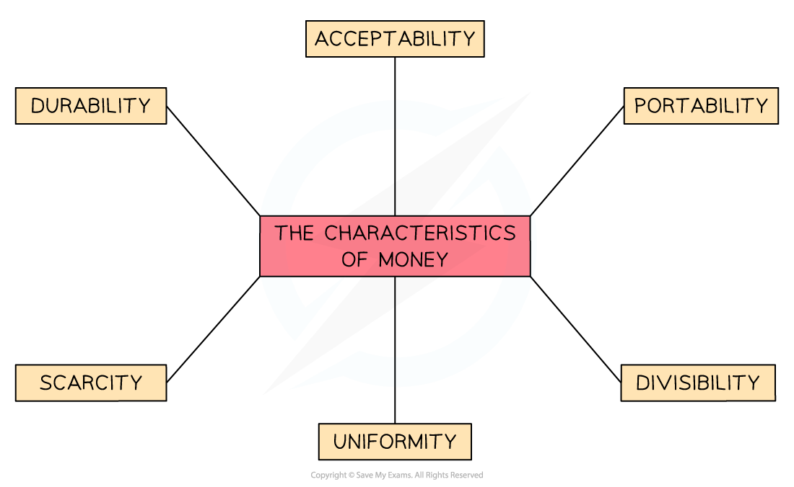

# Definition, Functions & Characteristics of Money

## The meaning of money

> **Spec point** — `spcpt_BPyk2JhDBfgt68vC` · The meaning of money

## The meaning of money

- Prior to the **creation of money**, individuals and firms had to accept other goods or services as payment, or be **self-sufficient** by producing everything required

  - Lacking self-sufficiency or driven by the **desire for a wider range** of goods and services, ***bartering ***became the norm but it too had problems
- As individuals and firms **trade** with each other in order to acquire goods or raw materials, they **require a means of exchange** that is acceptable and easy to use
- Modern **currency** fulfils this purpose

### The forms of money

1. **Cash** – coins and banknotes used for everyday transactions
2. **Bank deposits** – money held in bank accounts, accessible via *cheques*, *debit cards*, or online transfers
3. **Electronic money** – digital payments, mobile banking, and online currencies
4. **Near money** – near money is specifically assets that can be *quickly but not immediately* converted to cash (savings accounts, *government bonds*)

## The functions of money

> **Spec point** — `spcpt_47CmK8YKd7xRP9Gm` · The functions of money

## The functions of money

- In order to be effective, modern currency has to fulfil four uses (functions)

*The four functions of money*

### The four functions of money

#### 1. A medium of exchange

- Without money, it becomes necessary for buyers and sellers to **barter **(exchange goods)
- Bartering is problematic as it requires two people to want each other's goods **(double co-incidence of wants)**
- Money easily facilitates the **exchange **of goods, as no double co-incidence of wants is necessary

#### 2. A measure of value (unit of account)

- Money provides a means of **giving a value **to different goods and services
- Knowing the price of a good in terms of money allows both consumers and producers **to make decisions** in their best interests
- Without this measure it is difficult for buyers and sellers to arrange an **agreeable exchange**

#### 3. A store of value

- Money **holds its value** over time (of course ***inflation*** means that is not always true!)
- This means that money **can be saved**
- It remains **valuable in exchange** over long periods of time

#### 4. A method of deferred payment

- Money is an acceptable way to **arrange terms of credit **(loans) and to settle any **future *****debts***
- This allows producers and consumers to acquire goods in the **present** and pay for them in the **future**

## The characteristics of money

> **Spec point** — `spcpt_6dKzk3nPX5G4hk6z` · Characteristics of money

## The characteristics of money

- Many items were used for centuries as a **form of money,** such as gold, silver, shells, beer and tobacco
- However, each one of these items had some **characteristics** that made them less than ideal for exchange in certain circumstances
- ***Good money*** has a number of **essential characteristics **– and modern currency fulfils them all

*The six characteristics of good money*

**Divisibility**

- To be a valued medium of exchange, currency must be **divisible**. €50 notes can be exchanged for €10 euro notes or €1 coins

**Acceptability**

- The currency must be valued and widely accepted by society as a **valid way to pay** for goods/services

**Durability**

- The currency must be robust, not easily defaced or destroyed and last for a long period of time

**Scarcity**

- The supply of the currency should be such that it **remains desirable** and retains its value in the market. Oversupply would decrease its worth

**Uniformity**

- In order to be a **valid measure of value,** each denomination must be exactly the same, e.g., every \$50 note must be exactly the same

**Portability**

- Good currency is easy to carry or conceal

> **Exam Hint**
> The most common error is confusing **functions** of money (medium of exchange, store of value, unit of account, standard of deferred payment) with **characteristics** (durability, portability, divisibility, uniformity, acceptability, limited supply).
> 
> Mark schemes reward linking them - durability exists *because* money must store value; divisibility exists *because* it must work as a medium of exchange.
> 
> Evaluate how well modern forms perform each function. Electronic money is divisible and portable but depends on infrastructure trust; near money stores value well but is a weaker medium of exchange because it is not immediately liquid.
> 
> Do not treat cryptocurrency as a separate category - use it as illustrations of the standard framework (e.g. Bitcoin's volatility undermines its role as a unit of account)
