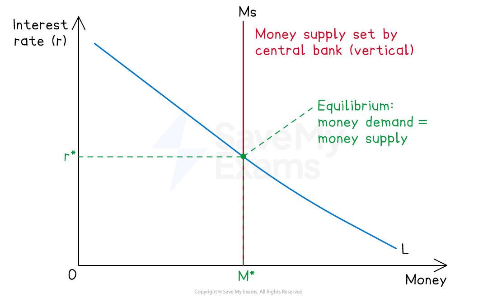
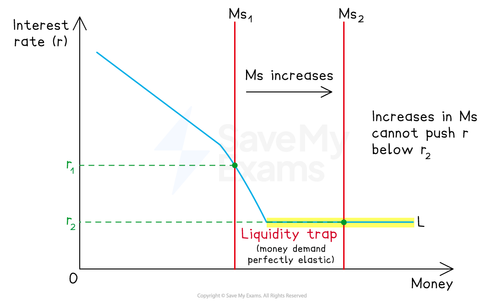

# Demand for Money & Interest Rate Determination

## The demand for money and interest rate determination

> **Spec point** — `spcpt_6rDKPcm96KWFdmsf`

## The demand for money and interest rate determination

- **The interest rate is the price of money, determined where demand meets supply.**

  - Keynes's liquidity preference theory explains interest rates through the demand for and supply of money itself
  - Classical loanable funds theory explains them through the demand for and supply of funds available for lending

## The demand for money: liquidity preference theory

> **Spec point** — `spcpt_bqFQGpBZHRycKs2b`

## The demand for money: liquidity preference theory

- **Liquidity preference is the desire to hold wealth in the form of money (the most liquid asset) rather than in less liquid financial assets such as bonds**
- Keynes identified three motives for holding money

#### The three motives

| Motive | Purpose | Sensitivity to interest rates |
|---|---|---|
| **Transactions** | - Money held to finance day-to-day purchases between income receipts | - Relatively insensitive    - Depends mainly on income; higher income generates more transactions and requires more money |
| **Precautionary** | - Money held as a buffer against unexpected events (job loss, emergency expenses, unplanned opportunities) | - Partly sensitive    - Higher rates make holding idle cash more costly; depends mainly on income, with richer households holding larger precautionary balances |
| **Speculative** | - Money held to take advantage of expected falls in bond prices (rises in interest rates) | - Highly sensitive    - When rates are high, bond prices are low and expected to rise, so speculative money demand falls; when rates are low, bond prices are high and expected to fall, so speculative money demand rises |

#### Total demand for money

*The liquidity preference curve slopes downwards. higher interest rates raise the opportunity costs of holding money*

- Adding the three motives together gives the **total demand for money curve** (L), which slopes downwards against the interest rate
- Higher interest rates increase the *opportunity cost* of holding money, reducing money demand
- Lower interest rates reduce the opportunity cost of holding money, increasing money demand

## Interest rate determination: liquidity preference theory

> **Spec point** — `spcpt_Nhgppbc8f7WVnRk4`

## Interest rate determination: liquidity preference theory

*The equilibrium interest rate r* is determined where money demand (L) equals money supply (Ms)*

- The supply of money (Ms) is set by the *central bank* and is usually drawn as **vertical**

  - It does not respond to the interest rate
- The equilibrium interest rate is where money demand equals money supply
- Changes in money supply or money demand shift the curves and change the equilibrium interest rate

### The liquidity trap

- **The liquidity trap is a situation in which interest rates are so low that money demand becomes perfectly elastic**

  - Any increase in money supply is absorbed into **idle balances** rather than reducing interest rates further

*The liquidity trap at low interest rates*

- At very low interest rates, everyone expects rates to rise and bond prices to fall - so no one wants to hold bonds
- Money supply increases have no effect on interest rates - the liquidity preference curve becomes horizontal
- Monetary policy loses its effectiveness in stimulating the economy - implications for central banks are significant, particularly during recessions
- The Bank of England faced this problem after the 2008 financial crisis, which is one reason *quantitative easing* was introduced

## Interest rate determination: loanable funds theory

> **Spec point** — `spcpt_s4pn26DmsG7XtxFm`

## Interest rate determination: loanable funds theory

- **Loanable funds theory is the classical view that the interest rate is determined by the demand for and supply of funds available for borrowing and lending in the financial market**

#### How does it work?

- **Supply of loanable funds** comes from savings - households with surplus income lend to borrowers

  - The higher the interest rate, the greater the reward for saving, so supply of loanable funds rises with the interest rate
- **Demand for loanable funds** comes from borrowers - firms seeking to invest and households seeking to borrow

  - The higher the interest rate, the higher the cost of borrowing, so demand for loanable funds falls as the interest rate rises
- Equilibrium interest rate is set where supply of savings equals demand for borrowing

#### Key implication

- In the loanable funds view, the interest rate coordinates saving and investment decisions over time
- A rise in saving pushes down interest rates and encourages investment — the classical mechanism by which economies self-correct

## Comparing the two theories

> **Spec point** — `spcpt_DdvhjZcmkhk5bMTh`

## Comparing the two theories

| Feature | Liquidity preference (Keynes) | Loanable funds (Classical) |
|---|---|---|
| What determines the interest rate | - Demand for and supply of money | - Demand for and supply of loanable funds (saving and investment) |
| Role of the central bank | - Central - controls money supply | - Peripheral - market determines rates |
| Role of saving | - Not directly relevant | - Central - saving is the source of loanable funds |
| Why people hold money | - Transactions, precaution, *speculation* | - Not relevant - focus is on saving vs borrowing |
| Implication for monetary policy | - Effective unless in a liquidity trap | - Interest rates respond to savings and investment, not central bank alone |
| Short run vs long run | - Short-run framework | - Long-run framework |

### Why the disagreement matters

- Keynes argued that the classical view misses the **speculative motive** for holding money

  - Saving is not automatically channelled into investment because some of it is held as *idle balances*
  - This is why Keynes believed an increase in saving could reduce aggregate demand without reducing interest rates enough to stimulate offsetting investment
- Modern economic thinking often treats the two theories as **complementary rather than mutually exclusive**

  - Liquidity preference explains short-run interest rate movements driven by monetary policy
  - Loanable funds explains long-run rates driven by real saving and investment decisions

> **Worked Example**
> Explain the role of liquidity preference in the determination of interest rates and assess its importance. [12 marks]
> 
> **Indicative answer structure**
> 
> - **AO1 Knowledge**: Define liquidity preference; identify the three motives for holding money (transactions, precautionary, speculative); state that the interest rate is determined where money demand equals money supply
> - **AO2 Analysis**: Explain why the liquidity preference curve slopes downwards -  higher interest rates raise the opportunity cost of holding money; explain how a change in money supply (vertical Ms curve) shifts the equilibrium interest rate; explain the liquidity trap as a special case where money demand becomes perfectly elastic
> - **AO3 Evaluation**: Liquidity preference matters for understanding short-run interest rate movements and the effectiveness of monetary policy; it explains why monetary policy can fail (liquidity trap); but it is not the only theory -  loanable funds theory emphasises the role of saving and investment in determining long-run rates. Contemporary central banks use liquidity preference insights when setting policy but recognise that real factors (productivity, demographics, global saving) also matter. The theory is important but not sufficient on its own

> **Exam Hint**
> In essays, treat the two theories as **explaining different aspects of interest rate determination**, not as one being right and the other wrong.
> 
> Strong answers present liquidity preference as the **short-run, monetary-policy-relevant** theory, and loanable funds as the **long-run, saving-investment-relevant** theory. Candidates who pick a side without acknowledging the other miss evaluation marks.
> 
> Diagrams are essential for this topic - particularly for liquidity preference. A correctly labelled liquidity preference diagram (L curve, vertical Ms, equilibrium r*) is expected and rewarded. For the liquidity trap, show the horizontal section at low interest rates explicitly.
> 
> Use the post-2008 quantitative easing episode as an evaluative anchor for the liquidity trap. Central banks faced near-zero interest rates and conventional monetary policy had stopped working - exactly the situation Keynes described. QE was the policy response. This links the theory directly to contemporary policy and strengthens evaluation.
