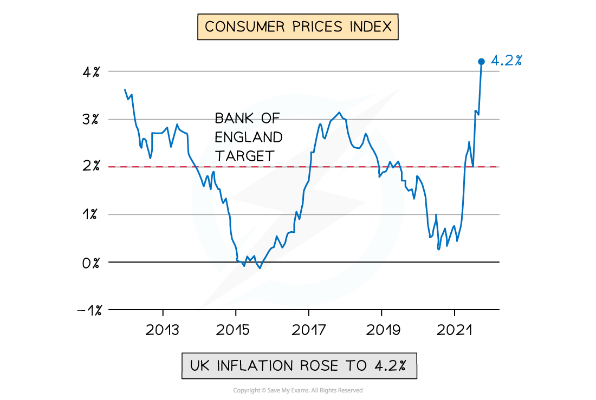

# Understanding Price Stability

## Inflation, deflation and disinflation

> **Spec point** — `spcpt_Nzmm7Qs28ZXHzwZ4`

## Inflation, deflation and disinflation

- **Inflation is the sustained increase in the average price level of goods and services in an economy  **
- **Deflation occurs when there is a fall in the average price level of goods and services in an economy**

  - Deflation is a **negative** rate of inflation, not simply a slowing rate
- **Disinflation occurs when the average price level increases but at a decreasing rate than before**

  - These figures demonstrate disinflation:  Y1 = 5%  Y2 = 4%  Y3 = 2%

#### UK inflation, disinflation and deflation

*Between 2013 and 2015, the UK experienced disinflation, with inflation falling from 3.5% to just on 0%. From 2021, it experienced sustained inflation, rising to 4.2%*

## The distinction between nominal and real data

> **Spec point** — `spcpt_bSQhTdG4jPNScg9S`

## The distinction between nominal and real data

- **Nominal values are measured in current prices**

  - They make no adjustment for inflation and therefore reflect both changes in the volume of output and changes in the price level
- **Real values are adjusted for inflation using a price index **

  - They strip out the effect of price changes and reflect only changes in the actual volume of goods and services
- The distinction matters because nominal figures can be **misleading** - a rise in nominal wages does not mean workers are better off if prices have risen by the same amount or more

  - A worker whose nominal wage rises by 3% when inflation is 5% has experienced a **fall in real wages** of approximately 2%
  - Real wages measure *purchasing power* - what the wage can actually buy
- Converting nominal to real values can be done using the following formula:

$\mathrm{Real} \mathrm{value}=\frac{\mathrm{Nominal} \mathrm{value}}{\mathrm{Price} \mathrm{index}}x100$

> **Worked Example**
> Calculate real GDP if nominal GDP is \$550 billion and the price index is 110
> 
> Step 1 - Substitute values into the formula
> 
> `Real space GDP space equals space fraction numerator Nominal space GDP over denominator Price space index end fraction space straight x space 100
> 
> Real space GDP space equals 550 over 110 space straight x space 100
> 
> Real space GDP space equals $ 500 bn`

| Measure | What it shows | Problem |
|---|---|---|
| Nominal wage | - Wage in current prices | - May overstate improvement in living standards if inflation is high |
| Real wage | - Wage adjusted for inflation | - True measure of purchasing power |
| Nominal GDP | - Total output in current prices | - Rises with inflation even if output is unchanged |
| Real GDP | - Total output in constant prices | - True measure of economic growth |

## Causes of inflation

> **Spec point** — `spcpt_n8nhQ9rQf29MWxYV`

## Causes of inflation

- An increase in the average prices in an economy can be caused by **demand pull **inflation or **cost push** inflation

### 1. Demand pull inflation

- Demand pull inflation is caused by **excess demand **in the economy
- **Aggregate demand (AD)** is the sum of all expenditure in the economy

  - AD = Consumption (C) + Investment (I) + Government spending (G) + Net Exports (X-M)

*An increase in aggregate demand (AD) raises the average price level in an economy *

#### Diagram analysis

- If any of the four components of **AD increase**, there will be a **shift to the right **of the AD curve from AD1 → AD2
- At the original price (AP1), there is now a condition of **excess demand **in the economy (extend the dotted line across until it hits the new demand curve to identify the excess demand)
- Prices for goods/services are **bid up** from AP1 → AP2
- Demand pull inflation has occurred
- If the ***Central Bank*** lowers the *base rate*, there is likely to be increased** borrowing** by firms and consumers

  - Lower interest rates - lower cost of borrowing - higher consumption and investment - AD shifts right - demand-pull inflation
  
    - This will result in an increase in **consumption **and **investment**

### 2. Cost push inflation

- Cost push inflation is caused by increases in the **costs of production** in an economy

*An increase in the costs of production raises the average price level in an economy, leading to cost push inflation *

#### Diagram analysis

- If any of the costs of production **increase** (labour, raw materials etc.), or if there is a fall in productivity, there will be a** shift to the left** of the SRAS curve from SRAS1→SRAS2
- At the original price (AP1), there is now a condition of **excess demand** in the economy
- As prices rise, there is a contraction of AD and an extension of SRAS
- Prices for goods/services are **bid up** from AP1→AP2
- Cost push inflation has occurred

> **Exam Hint**
> For the AD/AS diagram, always identify whether inflation is **demand-pull or cost-push before drawing** - the diagrams look different.
> 
> Demand-pull shows AD shifting right with both output and price level rising; cost-push shows SRAS shifting left with the price level rising but output falling. The output effect is the key distinction - demand-pull raises output while cost-push reduces it.

## The consequences of inflation

> **Spec point** — `spcpt_yy2r4WjG6mFQQX76`

## The consequences of inflation

- The consequences of inflation are different for **different stakeholders** in the economy
- The consequences are also dependent on the household level of **wealth and income**

### The impact of inflation on different stakeholders

| **Stakeholder** | ** Explanation of Impact** |
|---|---|
| **Firms** | - Rapid price changes create **uncertainty** and **delay investment** - **Shoe leather costs and menu costs **- Shoe leather costs (the cost of moving money around to minimise the impact of inflation) and menu costs (the cost to firms of constantly updating prices) increase |
| **Consumers** | - Decrease in **purchasing power** - Decrease in the real value of savings (as money will be worth less in real terms) - Fall in real income for those on **fixed incomes or *****pensions*** - Inflation is more harmful to **low income households** - **Redistribution effects** - inflation redistributes wealth from *creditors *to *debtors*, since the real value of debt falls |
| **Government** | - Inflation erodes **international competitiveness** of export industries, as the country's exports are now relatively more expensive - Economic growth may slow due to a **fall in exports** and a possible fall in consumption - **Trade-offs **involved in tackling inflation, e.g reducing inflation may increase unemployment and/or reduce economic growth |
| **Workers** | - **Demand higher wages **to compensate for reduced purchasing power - If wage increases ≠ inflation, **motivation **and **productivity may fall** |
