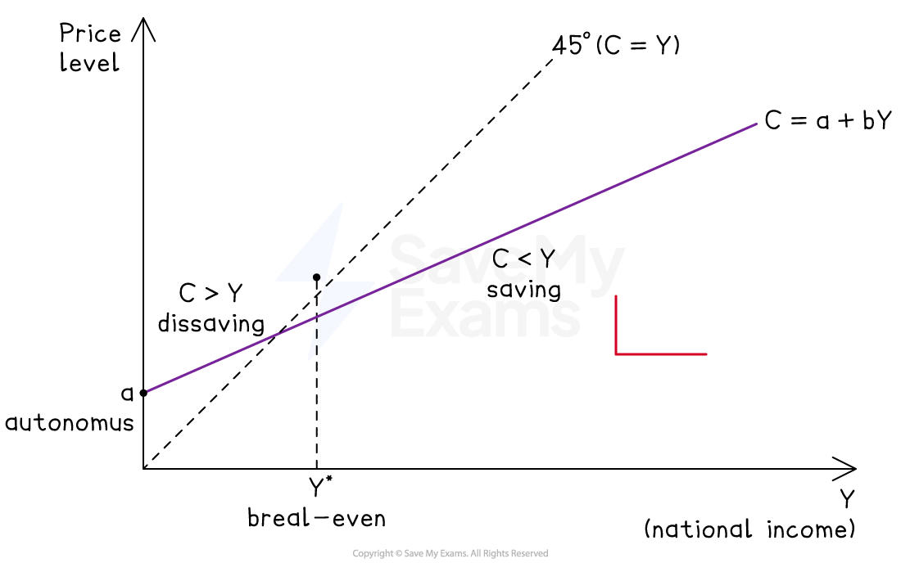
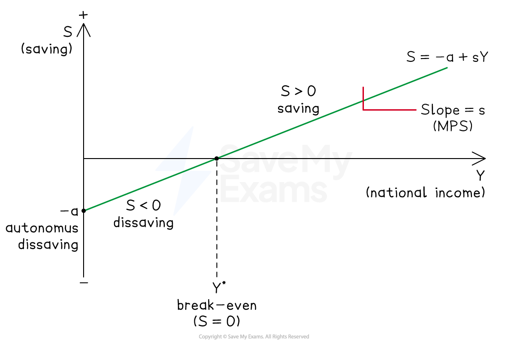
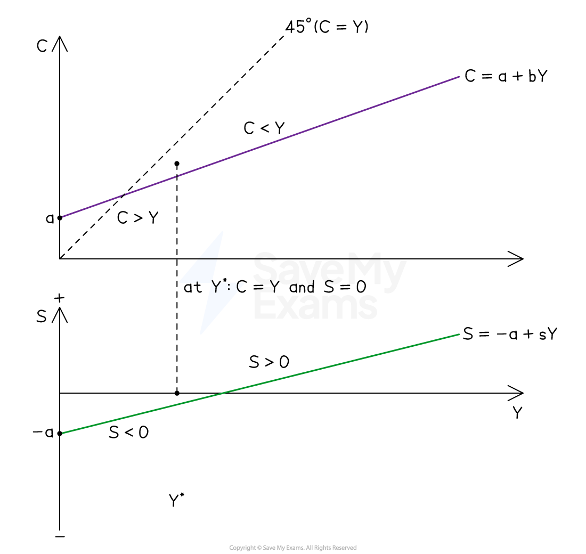

# Components of Aggregate Demand: Consumption & Saving

## Bridge from AS Level

> **Spec point** — `spcpt_tDHxyb2bJdtkSPC6`

## Bridge from AS Level

## Autonomous versus induced expenditure

> **Spec point** — `spcpt_zPcWHpYyMZhnvQMv`

## Autonomous versus induced expenditure

- A key distinction is between autonomous and induced spending:

  - **Autonomous spending** is independent of the current level of national income
  
    - It occurs even when Y = 0 and is driven by factors outside the income-expenditure model (interest rates, expectations, government policy)
  - **Induced spending** varies directly with national income
  
    - As Y rises, induced spending rises in proportion
- Every component of AD can be broken down into these two elements
- The distinction matters because **only induced spending** feeds back into the multiplier process, while autonomous spending is the initial injection that the multiplier acts upon

## The consumption function

> **Spec point** — `spcpt_2S9GCFMd5spZ7qmR`

## The consumption function

- The consumption function expresses total consumer expenditure as the sum of an autonomous component and an induced component:

**C = a + bY**

- Where:

  - **a** = autonomous consumption - the amount consumers spend when Y = 0, financed by *dissaving*, borrowing or running down wealth
  - **b** = the marginal propensity to consume (MPC) - the fraction of each additional £1 of income spent on consumption
  - **bY** = induced consumption - rises as income rises

*The consumption function*

### Diagram analysis

- The consumption function starts at a positive vertical intercept **a**, showing that consumption is positive even when income is zero (autonomous consumption financed by dissaving or borrowing)
- The function slopes upward with gradient **b** (the MPC), which is positive and less than 1 - each additional £1 of income raises consumption by less than £1
- The 45° line shows every point at which C = Y
- The consumption function crosses the 45° line at the **break-even level of income Y***, where consumption exactly equals income and saving is zero

  - To the left of Y*, the function sits **above** the 45° line - households consume more than their income and must dissave
  - To the right of Y*, the function sits **below** the 45° line - households consume less than their income and save the remainder

### Determinants of autonomous consumption (shifts in the function)

- Autonomous consumption changes when:

  - **Wealth** rises or falls (the wealth effect - a rise in house or asset prices raises a)
  - **Consumer confidence** shifts (optimism about future incomes raises a)
  - **Interest rates** change (lower rates make saving less attractive and borrowing cheaper, raising a)
  - **Availability of *****credit**** *expands or contracts

#### Determinants of the MPC (slope of the function)

- The slope b depends on:

  - **Income distribution** - lower-income households have a higher MPC than higher-income households, so redistribution towards the poor raises the aggregate MPC
  - **Expectations about future income** - if income rises are seen as permanent, MPC is higher than if they are seen as temporary
- The consumption function is central to the multiplier

  - The larger b, the smaller the leakage into saving and the larger the multiplier k = 1 ÷ (1 − b) in a closed economy with no government

## The savings function

> **Spec point** — `spcpt_NHcCKHdVDPfZXhwq`

## The savings function

- Saving is simply the residual of disposable income not spent on consumption. Because Y = C + S by definition in a closed economy with no government:

**S = −a + (1 − b)Y** or **S = −a + sY**

- where s = 1 − b is the marginal propensity to save (MPS).

  - **Autonomous saving** is negative (−a) - at Y = 0 households are dissaving to finance autonomous consumption
  - **Induced saving** (sY) rises with income - higher income means a larger absolute amount saved even at a constant MPS

*The savings function*

### Diagram analysis

- The savings function starts at a **negative vertical intercept −a**, showing that saving is negative when income is zero (households dissave to finance autonomous consumption)
- The function slopes upward with gradient **s** (the MPS), positive and less than 1 - each additional £1 of income adds less than £1 to saving
- The function crosses the horizontal axis at the **break-even level of income Y***, where saving is zero

  - To the left of Y*, saving is negative (dissaving)
  - To the right of Y*, saving is positive and rises with income

- The savings function is the mirror image of the consumption function: the two must sum to Y at every level of income. Any shift in the consumption function produces an equal and opposite shift in the savings function

### Determinants of saving

- The savings function shifts when:

  - **Interest rates** rise (raising the reward for saving, shifting S up)
  - **Confidence** falls (precautionary saving rises, shifting S up)
  - **Demographic structure** changes (ageing populations save differently from younger ones)
  - **Tax treatment of savings** changes (tax-advantaged savings accounts raise S)

> **Exam Hint**
> The most common error at A Level is treating the autonomous/induced distinction as a formality rather than using it. Every question on the multiplier or the determinants of consumer behaviour can be strengthened by identifying which element is autonomous (the initial cause of a change) and which is induced (the mechanism through which the change transmits).
> 
> Link the consumption function's slope (MPC) directly to the size of the multiplier in your evaluation. The stronger the MPC, the larger the multiplier, the greater the impact of any autonomous change in G, I or X on equilibrium Y. This connects the consumption function back to 9.1.1 and demonstrates understanding of the income-expenditure model as a whole.
> 
> Be precise with the savings function. Strong answers identify that S = −a at Y = 0 (dissaving), that S crosses zero at the break-even point of income, and that shifts in S are the mirror image of shifts in C. Examiners reward candidates who can explain this symmetry rather than treating C and S as independent.

## The mirror-image relationship

> **Spec point** — `spcpt_czbGNHjyWzS8ZTpp`

## The mirror-image relationship

- Because Y = C + S at every level of income, the consumption function and the savings function are mirror images of one another

  - Any shift in one produces an equal and opposite shift in the other, and both functions share the same break-even level of income Y*

*The mirror-image relationship*

### Diagram analysis

- The upper panel shows the consumption function; the lower panel shows the savings function; both share the same horizontal income axis
- At Y = 0, C = a (positive autonomous consumption) and S = −a (equal and opposite autonomous dissaving) - the two intercepts mirror one another
- At Y*, the consumption function crosses the 45° line **and** the savings function crosses the horizontal axis simultaneously - this is the single break-even level of income at which C = Y and S = 0

  - To the left of Y*: C > Y in the upper panel corresponds to S < 0 in the lower panel (dissaving finances the excess consumption)
  - To the right of Y*: C < Y in the upper panel corresponds to S > 0 in the lower panel (income exceeds consumption, producing positive saving)
- A rise in autonomous consumption (shift of C upward) must be matched by a fall in autonomous saving (shift of S downward) by the same amount
