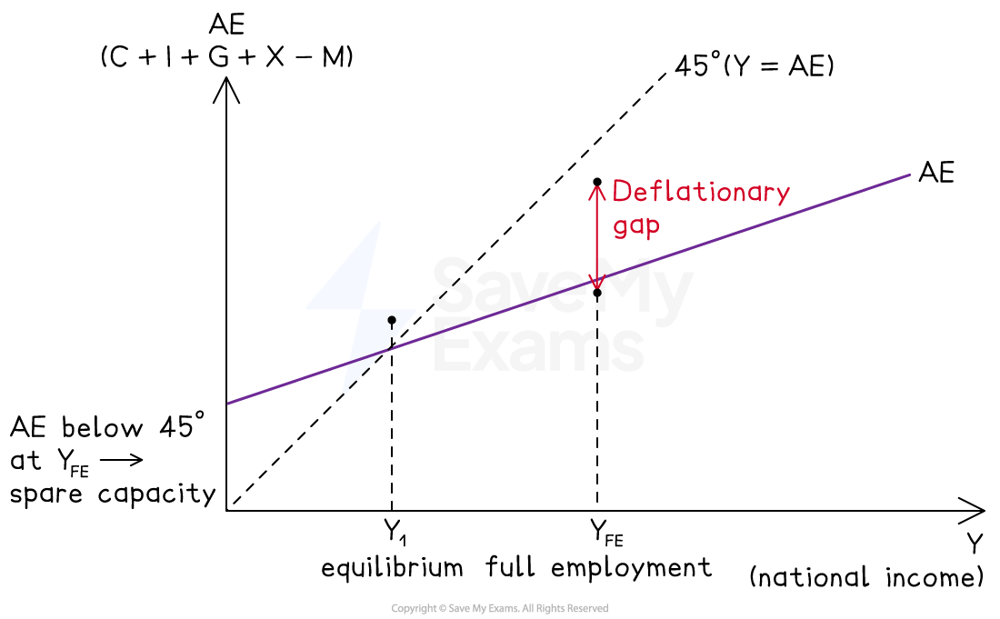
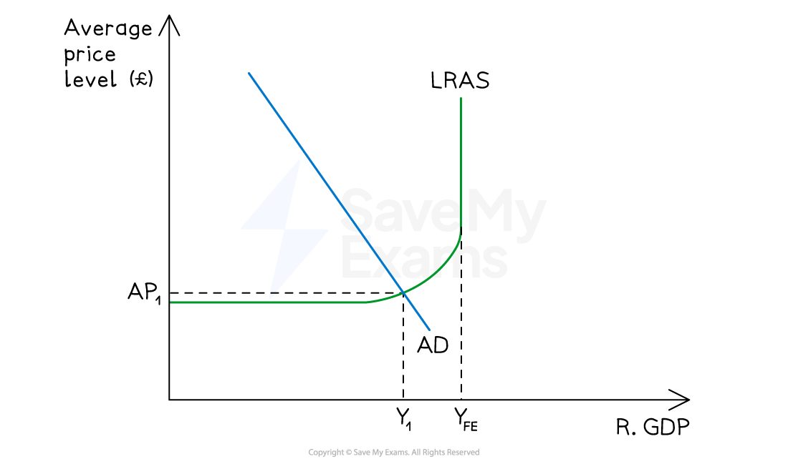
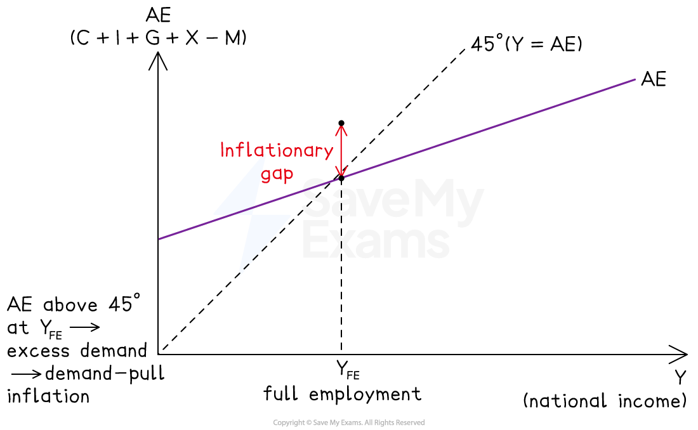
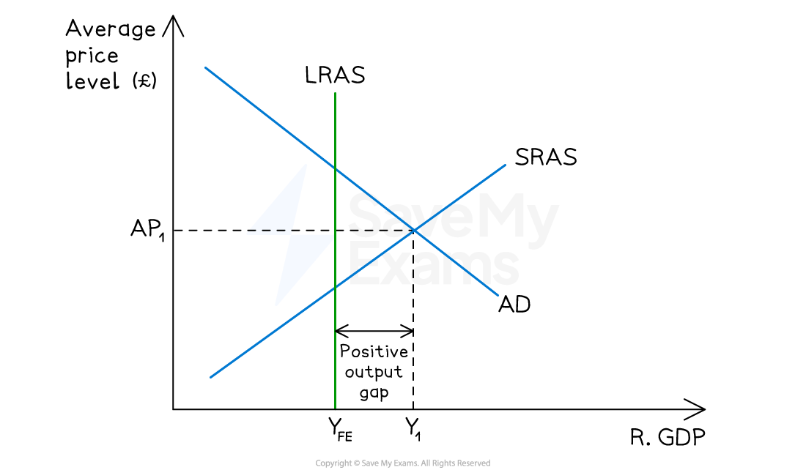

# Inflationary & Deflationary Gaps

## Bridge to the multiplier and components of AD

> **Spec point** — `spcpt_P9sHVfrXNJSF5WPW`

## Bridge to the multiplier and components of AD

- The multiplier process established how an injection changes equilibrium national income
- The components of AD explained what drives the level of autonomous and induced spending
- This topic connects those two ideas to a crucial distinction: the **equilibrium level of national income** (where AE = Y) is not the same as the **full employment level of national income** (where all available resources are employed)

  - The gap between them is measured as either an **inflationary gap** or a **deflationary gap**, and it determines what kind of policy response is appropriate

### Equilibrium income versus full employment income

- **Equilibrium national income (Y) is the level of output at which aggregate expenditure equals national income**

  - The economy settles here in the absence of policy changes
- **Full employment level of national income (Y_FE) is the level of output at which all the economy's resources are fully employed**

  - There is no *cyclical unemployment* and no spare capacity
- These two levels may coincide, but in general they do not

  - When equilibrium Y is below Y_FE there is a **deflationary gap**
  - When equilibrium AE exceeds what the economy can produce at Y_FE there is an **inflationary gap**

## The deflationary (recessionary) gap

> **Spec point** — `spcpt_wcKj6m3dhNm5h7h5`

## The deflationary (recessionary) gap

- A deflationary gap exists when the equilibrium level of national income lies **below** the full employment level

  - At Y_FE, aggregate expenditure is insufficient to buy all the output the economy is capable of producing

*A deflationary gap*

#### Diagram analysis

- Equilibrium national income is at **Y₁**, where the AE curve crosses the 45° line

  - The full employment level of income is at **Y_FE**, to the right of Y₁
- At Y_FE, aggregate expenditure is below the 45° line

  - Planned spending is less than the output the economy can produce at full employment
- The **deflationary gap** is the vertical distance between the 45° line and the AE curve at Y_FE

  - It measures the amount by which AE would need to **rise** to bring equilibrium Y up to Y_FE
- Because equilibrium Y is below Y_FE, the economy has spare capacity and cyclical unemployment
- Closing the deflationary gap requires an upward shift in AE, typically through *expansionary fiscal policy*, *expansionary monetary policy* or a rise in exports

### Deflationary gap on the AD/AS diagram: the negative output gap

- The same situation can be shown on an AD/AS diagram
- Where the deflationary gap measures the shortfall in planned expenditure, the negative output gap measures the resulting shortfall in real output

*Deflationary gap*

#### Diagram analysis

- The potential (full employment) output of the economy is at **Y_FE**, shown by the vertical LRAS curve
- Short-run equilibrium is at **AP₁Y₁**, where AD intersects SRAS to the left of Y_FE
- The **negative output gap** is the horizontal distance Y₁ − Y_FE, showing actual output is below potential output
- The economy has spare capacity in the short run - firms can expand output without significant pressure on prices
- This situation typically arises when AD has fallen, for example due to a collapse in consumer confidence, a tightening of credit or a fall in exports
- Rising unemployment and slow economic growth are indicators that a negative output gap is widening

## The inflationary gap

> **Spec point** — `spcpt_n2kgYczCKt4SjmdJ`

## The inflationary gap

- An inflationary gap exists when **aggregate expenditure exceeds the output the economy can produce at full employment**
- Equilibrium Y cannot physically rise above Y_FE, so the excess demand instead generates *demand-pull inflation*

*An inflationary gap*

#### Diagram analysis

- The full employment level of income is at **Y_FE**
- At Y_FE, the AE curve lies **above** the 45° line

  - Planned expenditure exceeds the output the economy is capable of producing
- The **inflationary gap** is the vertical distance between the AE curve and the 45° line at Y_FE

  - It measures the amount by which AE would need to **fall** to eliminate excess demand
- Because the economy cannot produce more than Y_FE, the excess demand pushes up the average price level rather than raising real output

  - This is demand-pull inflation
- Closing the inflationary gap requires a downward shift in AE, typically through *contractionary fiscal policy*, *contractionary monetary policy* or measures that reduce net exports

### Inflationary gap on the AD/AS diagram: the positive output gap

- On an AD/AS diagram, the inflationary gap corresponds to a short-run equilibrium at which real output temporarily exceeds the economy's sustainable capacity

*Positive output gap*

#### Diagram analysis

- The potential output of the economy is at **Y_FE**, shown by the vertical LRAS curve
- Short-run equilibrium is at **AP₁Y₁**, where AD intersects SRAS to the **right** of Y_FE
- The **positive output gap** is the horizontal distance Y_FE − Y₁, showing actual output is above sustainable potential output
- The economy is operating beyond its long-run capacity in the short run

  - Workers may be working *overtime*, machines operating at unsustainable intensity, and unemployment below the natural rate
  - This situation is **not sustainable**: rising costs and input shortages push SRAS leftward until the positive output gap is eliminated
- Rapidly rising prices are a key indicator that a positive output gap is developing

## Keynesian and Classical views on how gaps close

> **Spec point** — `spcpt_DM3htgKg6PQ67fvX`

## Keynesian and Classical views on how gaps close

- The two schools disagree on whether gaps close automatically without policy intervention

| View | Deflationary gap | Inflationary gap |
|---|---|---|
| Classical | - Closes automatically in the long run as wages and prices fall, restoring output to Y_FE at a lower price level | - Closes automatically as wages and prices rise, restoring output to Y_FE at a higher price level |
| Keynesian | - Wages and prices are sticky downward    - The economy may remain stuck in a deflationary gap for a long period without policy intervention | - Closes as capacity constraints force prices up, but only after significant inflation |

- The policy implication is significant

  - If the Keynesian view is correct, a deflationary gap requires active government intervention (expansionary fiscal and monetary policy) rather than being left to self-correct

### Difficulties in measuring gaps

- Both types of gap are hard to measure accurately because:

  - The true full employment level of national income Y_FE cannot be directly observed
  
    - It must be estimated from indicators such as unemployment rates, *capacity utilisation* and inflation
  - Estimates of Y_FE are revised regularly as new data emerge
  - Rapidly rising prices can indicate a positive output gap is developing, but may also reflect cost-push pressures unrelated to demand
  - Rising unemployment and a slowdown in growth can indicate a widening negative output gap, but may also reflect structural changes in the economy
- This measurement uncertainty means that policymakers face a real risk of responding to the wrong diagnosis

  - Tightening policy when the economy actually has spare capacity, or loosening policy when the economy is already overheating

> **Exam Hint**
> The most common error is confusing the size of the gap with its direction. A **deflationary gap** needs AE to **rise** to close it; an **inflationary gap** needs AE to **fall**.
> 
> Writing "deflationary gap" and then describing excess demand (or vice versa) is a guaranteed loss of marks. Anchor the terminology to what the economy needs: deflationary means AE is too deflated (too low), inflationary means AE is too inflated (too high).
> 
> Be precise about the two levels of Y. Strong answers distinguish clearly between the **equilibrium level** (where AE = Y, which the economy reaches on its own) and the **full employment level** (where all resources are employed). A gap exists precisely because these two levels differ - stating this explicitly frames the rest of the answer cleanly.
> 
> For top-band evaluation, acknowledge the Keynesian-Classical divide on how gaps close. The policy implication - whether intervention is needed or whether the economy self-corrects - is o**ne of the most important debates in macroeconomics** and connects directly to topic 10 on macroeconomic intervention. Candidates who can identify which view underpins a particular policy recommendation consistently reach Level 4.
