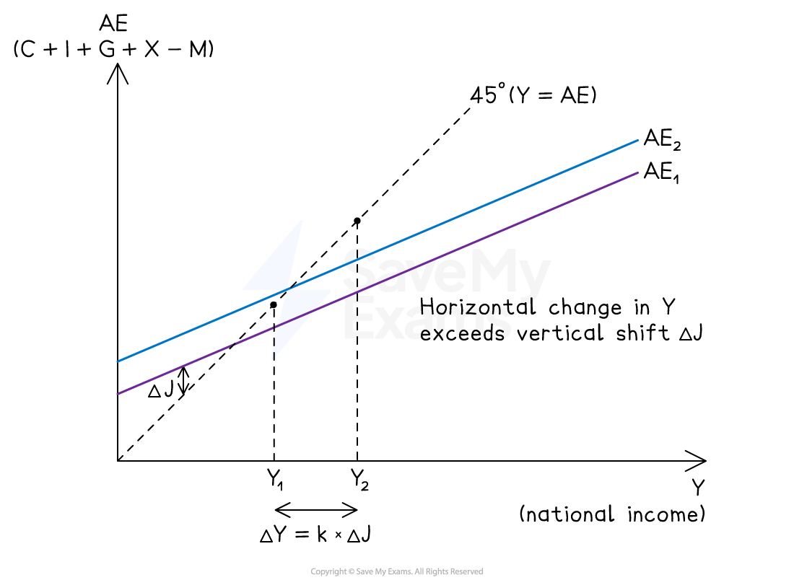
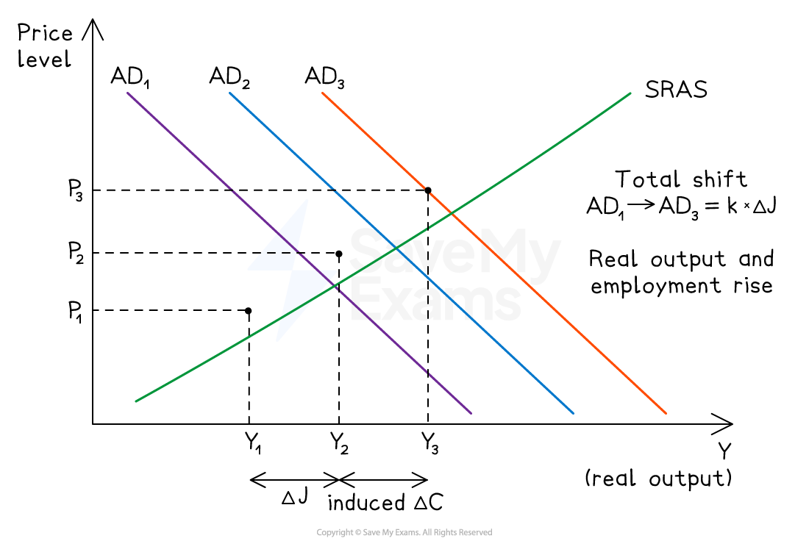

# The Effect of the Multiplier on National Income

## National income determination with the multiplier process

> **Spec point** — `spcpt_d3MPfCbYvRj3pr4R`

## National income determination with the multiplier process

- You are required to understand two complementary approaches for showing the multiplier's effect on national income:

  - The **income-expenditure approach** (Keynesian 45-degree diagram) - shows *why* the change in income is a multiple of the initial injection
  - The **AD/AS approach** - shows *what* that multiplied change means for real output, the price level and employment

### Income-expenditure (45-degree) approach

- This diagram plots:

  - National income (Y) on the horizontal axis
  - Aggregate expenditure (AE = C + I + G + (X − M)) on the vertical axis
  - A **45-degree reference line** where Y = AE, representing every possible point at which total planned spending equals total output

*Aggregate expenditure*

#### Diagram analysis

- Equilibrium national income occurs at **Y₁**, where the AE curve crosses the 45-degree line

  - At this point, planned expenditure equals output and there is no pressure for income to change
- A rise in any injection (investment, government spending or exports) shifts the AE curve **vertically upward** by the size of the injection, ΔJ

  - The new equilibrium forms at **Y₂**, further along the 45-degree line
  - The **horizontal change** in income (ΔY) is larger than the vertical shift (ΔJ) because each round of additional spending creates further rounds of income
  - The ratio ΔY ÷ ΔJ is the multiplier k
  - Provided spare capacity exists, firms raise output from Y₁ to Y₂ and **employment** rises
- This is the graphical form of ΔY = k × ΔJ, and shows the multiplier mechanism most directly - the vertical shift is the cause, the horizontal change is the multiplied effect

### AD/AS approach

- The same multiplier process can be shown on an AD/AS diagram, using two successive rightward shifts of AD

*Impact of the multiplier demonstrated using an AD/AS approach*

#### Diagram analysis

- Initial equilibrium is at **P₁Y₁**, where AD₁ intersects SRAS
- The initial injection shifts AD from **AD₁ to AD₂**, a rightward shift equal to ΔJ
- The multiplier process then plays out through successive rounds of induced consumer spending, shifting AD further right from **AD₂ to AD₃**

  - The **total** horizontal shift from AD₁ to AD₃ equals **k × ΔJ** - the multiplied change in national income
  - At the new equilibrium **P₃Y₃**, real output is higher, **employment** has risen as firms expand to meet demand, and the price level has risen
- The balance of output versus price effects depends on the slope of SRAS: with significant spare capacity, the gain is mostly in real output and employment

  - near full capacity most of the effect becomes *inflationary* with limited employment gains

## Calculating the effect of changing AD on national income

> **Spec point** — `spcpt_RjCx9xnnMJSkVwTH`

## Calculating the effect of changing AD on national income

- Any change in a component of aggregate demand (C, I, G or X − M) feeds through the multiplier to produce a larger change in national income. The core calculation is:

ΔY = k × ΔJ

> **Worked Example**
> #### change in national income and employment
> 
> An open economy with a government has MPS = 0.1, MRT = 0.2, MPM = 0.1. The government announces a \$50bn increase in infrastructure spending.
> 
> - **Step 1:** Calculate the multiplier
> 
> $\mathrm{k} = \frac{1}{( 0.1 + 0.2 + 0.1 )} 
> \mathrm{k} = \frac{1}{0.4} = 2.5$
> 
> - **Step 2:** Calculate the change in national income
> 
> ΔY = 2.5 × \$50bn = **\$125bn**
> 
> - **Step 3:** Interpret in AD/AS terms
> 
>   - AD shifts right by the full multiplied amount of \$125bn, raising the equilibrium level of real output, raising the price level (if the economy has spare capacity, the price effect is smaller), and raising **employment** as firms hire to meet the higher demand

## Evaluation and limitations

> **Spec point** — `spcpt_76y7TwQNvkkqPJKP`

## Evaluation and limitations

- The multiplier is a powerful tool but rests on the following strong assumptions:

  - **Assumes a stable MPC** - in reality, MPC varies with income level, confidence and the phase of the *economic cycle*
  - **Assumes spare capacity** - if the economy is at or near full employment, the multiplied increase in AD translates into *inflation* rather than output growth
  - **Ignores time lags** - the full multiplier effect takes several quarters to work through; it is not instantaneous
  - **Ignores crowding out** - if the initial injection is government spending financed by borrowing, higher *interest rates* may reduce private investment, partially offsetting the multiplier
  - **Small open economies have small multipliers** - countries like Singapore or Ireland have very high MPMs, so domestic multipliers are close to 1; fiscal stimulus leaks abroad
  - **The reverse multiplier** amplifies downturns - a fall in exports or investment reduces national income by a multiple of the initial fall, which is why *recessions* deepen rapidly

### Why do multiplier estimates vary internationally

- IMF estimates of fiscal multipliers typically range from **0.5 to 2.5** depending on country and conditions. Multipliers tend to be larger in:

  - Large economies with low import dependence (e.g. the USA)
  - Economies in recession with significant spare capacity
  - Economies where monetary policy does not offset fiscal expansion
- Multipliers tend to be smaller in:

  - Small, highly open economies (Singapore, the Netherlands)
  - Economies at or near full employment
  - Economies with high public debt where consumers save extra income in anticipation of future tax rises (Ricardian equivalence)
- This variation is why blanket claims about fiscal policy effectiveness are rarely correct - the multiplier is **context-dependent**
