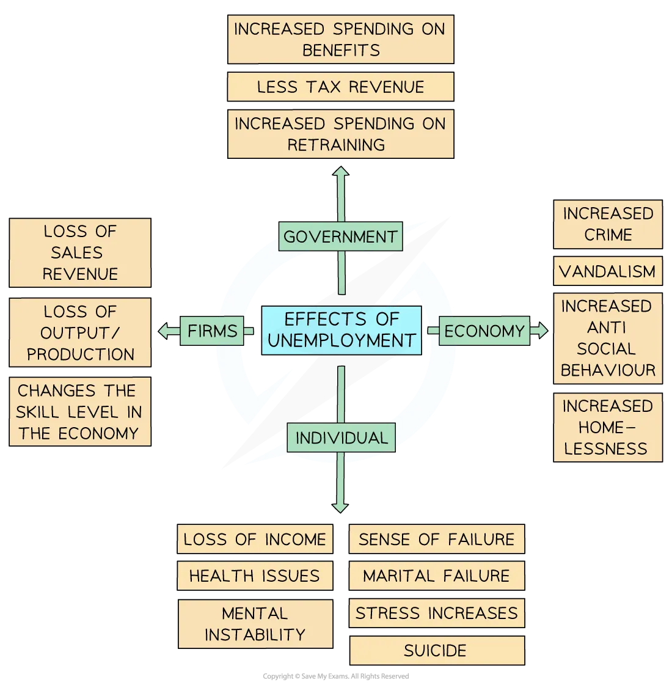

# Understanding Unemployment

## The meaning of unemployment

> **Spec point** — `spcpt_yFMH794FYhdDXVCd`

## The meaning of unemployment

- **Unemployment occurs when individuals who are willing and able to work at the current wage rate are unable to find employment**
- The unemployed are part of the **labour force** (also called the working population)

  - They are actively seeking work but do not currently have a job
- Unemployment is distinct from **economic inactivity** - those who are neither employed nor actively seeking work, such as full-time students, stay-at-home parents, or those who have given up looking for work, are not counted as unemployed
- The **unemployment rate** is expressed as a percentage of the labour force:

`Unemployment space rate space left parenthesis percent sign right parenthesis space equals space fraction numerator number space unemployed space over denominator labour space force end fraction space straight x space 100`

> **Worked Example**
> The table shows labour market data for a country.
> 
> |   | Number of people (millions) |
> |---|---|
> | Employed | 28.4 |
> | Unemployed | 1.6 |
> | Economically inactive | 8.0 |
> 
> **Calculate the unemployment rate. Show your working.** [2]
> 
> - Labour force = employed + unemployed = 28.4 + 1.6 = **30 million** **[1]**
> - Unemployment rate = (1.6 / 30) × 100 =** ****5.3%** **[1]**
> 
> **Worked solution**
> 
> **Step 1 - identify the labour force**
> 
> Labour force = employed + unemployed
> 
> = 28.4 + 1.6 = 30 million
> 
> The economically inactive (8.0 million) are **not** included - they are neither working nor actively seeking work, so they are not part of the labour force.
> 
> **Step 2 - calculate the unemployment rate**
> 
> Unemployment rate = (number unemployed / labour force) × 100
> 
> = (1.6 / 30) × 100 = **5.3%**
> 
> **The trap** is dividing by the total population including the economically inactive (8 million) rather than the labour force (30 million). The unemployment rate is always expressed as a percentage of the **labour force**, not the total population - including the economically inactive would understate the true rate of unemployment among those who are available for work.

## Measures of unemployment

> **Spec point** — `spcpt_98QZBZVJZ3xz4Cm4`

## Measures of unemployment

### 1. The claimant count

- **The claimant count measures unemployment by counting the number of people claiming *****unemployment-related benefits*** - in the UK this is Universal Credit

  - It is cheap and straightforward to compile as the data is automatically generated by the benefit system

#### Difficulties with the claimant count

- **Understates** true unemployment - not all unemployed people claim benefits; some do not qualify due to savings, a partner's income, or *immigration status*
- **Overstates** true unemployment - some claimants may be working in the *informal economy* while claiming
- Changes in **eligibility rules** affect the count independently of actual unemployment levels - making comparisons over time unreliable
- Does not count those working part-time who want full-time work (**underemployment**)

### 2. The Labour Force Survey (LFS)

- **The LFS measures unemployment using a household survey based on the International Labour Organisation (ILO) definition** - a person is unemployed if they are without work, available to start work within two weeks, and have actively sought work in the past four weeks

  - It is internationally standardised, **allowing comparisons between countries**

#### Difficulties with the LFS

- Based on a **sample** - subject to *sampling error* and may not accurately reflect the full population
- Relies on **self-reporting** - respondents may misrepresent their situation
- Does not capture **underemployment** - those in part-time or low-skilled work who want more or better-paid employment
- The ILO definition excludes **discouraged workers** - those who have stopped looking for work because they believe no jobs are available, even though they want to work

## Causes and types of unemployment

> **Spec point** — `spcpt_ZjbJVks8pdnvsMb5`

## Causes and types of unemployment

### 1. Frictional unemployment

- **Frictional unemployment occurs when workers are between jobs**

  - They have left one job and are searching for another
- It is **short-term and voluntary** in nature - the worker is employable but the process of job search takes time
- It exists in all economies because information about job vacancies and available workers is not perfect
- Example: a marketing manager who has *resigned *and is searching for a new role

### 2. Structural unemployment

- **Structural unemployment occurs when there is a mismatch between the skills workers have and the skills employers demand**

  - Caused by long-run changes in the structure of the economy
- It arises when declining industries shed workers whose skills are not *transferable *to growing industries
- It tends to be **long-term and geographically concentrated** in areas dependent on a single industry
- Example: former steel workers in South Wales or coal miners in northern England whose skills have little value in a service-based economy

> **Case Study**
> **Structural unemployment - the decline of manufacturing in Detroit, USA**
> 
> **The context**
> 
> Detroit was the centre of the American automotive industry throughout the 20th century, employing hundreds of thousands of workers in car manufacturing.
> 
> From the 1970s onwards, competition from Japanese and German manufacturers, *automation *and *offshoring *caused a dramatic contraction - employment in the automotive sector fell from approximately 300,000 in the 1950s to under 20,000 by 2010.
> 
> 
> 
> *Detroit motor factory in ruins*
> 
> **Actions taken**
> 
> - The US government provided an \$80 billion *bailout *to General Motors and Chrysler in 2009 to prevent total industry collapse
> - Federal and state retraining programmes were introduced to help displaced workers acquire skills in healthcare and technology
> - Detroit filed for *bankruptcy *in 2013 - the largest municipal bankruptcy in US history
> 
> **Outcomes**
> 
> - Structural unemployment rose sharply - Detroit's unemployment rate reached over 20% in 2009, far above the national average
> - Former assembly line workers' skills had limited transferability to growing service and technology sectors, creating a severe skills mismatch
> - The city's population fell from 1.8 million in 1950 to under 700,000 by 2013 as workers relocated in search of employment elsewhere - illustrating how structural unemployment concentrated in a single industry can cause long-run economic and social damage well beyond the labour market itself

### 3. Cyclical unemployment

- **Cyclical unemployment (also called demand-deficient unemployment) occurs when there is insufficient aggregate demand in the economy to employ all those willing and able to work**

  - It rises during *recessions *as firms cut output and lay off workers, and falls during periods of economic growth
- It is the most economically damaging type - large numbers of workers can become unemployed simultaneously
- In AD/AS terms it occurs when the economy is operating below full employment output on the Keynesian LRAS

### 4. Seasonal unemployment

- **Seasonal unemployment occurs when demand for labour falls at certain times of year due to the seasonal nature of some industries**

  - It is predictable and temporary - workers in affected industries expect periods of unemployment
- Example: agricultural workers after harvest, ski resort staff outside the winter season, or tourism workers in off-peak periods

### 5. Technological unemployment

- **Technological unemployment occurs when workers are displaced by new technology that replaces human labour in the production process**

  - It is a form of structural unemployment - the skills of displaced workers may not be transferable to the new jobs created by technological change
  - For example: automation of manufacturing assembly lines, self-service checkouts replacing retail workers, or AI tools reducing demand for routine data processing roles

#### A summary of unemployment types

| Type | Cause | Duration | Policy response |
|---|---|---|---|
| Frictional | - Job search between employment | - Short-term | - Better job matching information |
| Structural | - Skills mismatch from industrial change | - Long-term | - Retraining and education |
| Cyclical | - Deficient aggregate demand | - Medium-term | - Expansionary *fiscal *or *monetary policy* |
| Seasonal | - Seasonal fluctuations in labour demand | - Predictable/recurring | - Seasonal work schemes |
| Technological | - Displacement by automation or technology | - Long-term | - Retraining and *supply-side policy* |

> **Worked Example**
> **What would be the most likely reason for a decrease in frictional unemployment?**
> 
> A. More *capital-intensive* manufacturing
> 
> B. More demand for *public sector workers*
> 
> C. More government spending on education
> 
> D. More information on labour market vacancies
> 
> **Final answer:** **Answer: D - more information on labour market vacancies**
> 
> **Worked solution**
> 
> Frictional unemployment arises because of **imperfect information** - workers between jobs take time to find new employment because they do not have complete knowledge of all available vacancies, and employers do not have complete knowledge of all available workers.
> 
> - **A. More capital-intensive manufacturing** - this would reduce the demand for labour overall, potentially increasing structural and cyclical unemployment - not frictional
> - **B. More demand for public sector workers ** - this increases labour demand in one sector but does not reduce the time taken to match workers with jobs - frictional unemployment persists regardless of overall demand levels
> - **C. More government spending on education** - this improves the quality of labour and may reduce structural unemployment over the long run, but does not address the information problem that causes frictional unemployment

> **Exam Hint**
> Always identify the **type** of unemployment before recommending a policy response - different types require different solutions.
> 
> Expansionary fiscal policy is appropriate for cyclical unemployment (deficient AD) but is ineffective for structural or frictional unemployment, which require supply-side responses such as retraining or improved job matching. Prescribing the wrong policy is one of the most common errors in unemployment essay questions.
> 
> For evaluation, the strongest point is **hysteresis** - cyclical unemployment can become structural if workers are unemployed for long enough that their skills deteriorate and they become detached from the labour market.
> 
> This means the long-run costs of a recession can significantly exceed the short-run output loss, strengthening the case for early policy intervention.

## Consequences of unemployment

> **Spec point** — `spcpt_SddXh9hHkm8xGn7G`

## Consequences of unemployment

*The consequences of unemployment*

### Consequences for individuals

- **Loss of income** - unemployment reduces household income, lowering *living standards* and potentially pushing individuals into poverty
- **Skills deterioration** - prolonged unemployment leads to the depreciation of human capital as skills become outdated or underused
- **Mental and physical health** - unemployment is associated with increased rates of anxiety, depression and poor physical health
- **Hysteresis** - long-term unemployment makes individuals less *employable *over time, as employers interpret prolonged unemployment as a negative signal

### Consequences for the economy

- **Lost output** - unemployed workers are a wasted productive resource; the economy produces below its potential, creating a *negative output gap*
- **Reduced tax revenues** - fewer people in work means lower *income tax* and *National Insurance* receipts for the government
- **Higher government spending** - unemployment benefit payments rise, increasing pressure on public finances
- **Multiplier effects** - unemployed workers have lower incomes and spend less, reducing aggregate demand and potentially causing further unemployment - a self-reinforcing downward spiral

### Consequences for society

- **Increased inequality** - unemployment disproportionately affects lower-skilled workers, widening income and wealth inequality
- **Social costs** - higher unemployment is associated with increased crime rates, family breakdown and *social unrest* in affected communities
- **Regional disparities** - structural and technological unemployment tends to concentrate in specific regions, creating persistent geographical inequality
