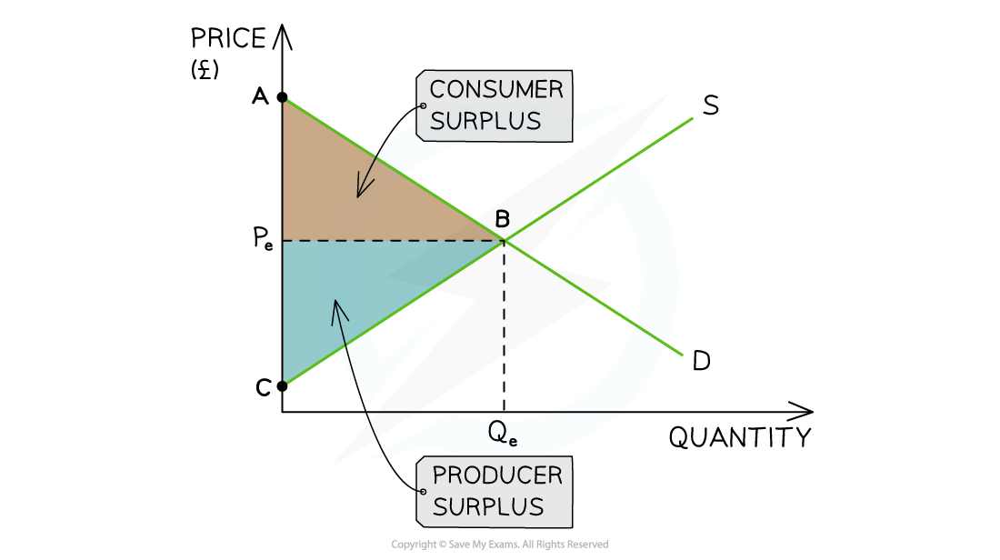

# Understanding Economic Surplus

## What consumer surplus means

> **Spec point** — `spcpt_Qqmqpdt7RzQ8PNph`

## Consumer surplus

- **Consumer surplus** is the difference between the amount the **consumer is willing to pay** for a product and the price they **actually pay**

  - For example, if a consumer is willing to pay £18 to watch a movie and the price is £15, their **consumer surplus** is £3

## What producer surplus means

> **Spec point** — `spcpt_BY7Wfk5N4j58WB6m`

## Producer surplus

- **Producer surplus** is the difference between the amount that the **producer is willing to sell** a product for and the price they **actually receive**

  - For example, if a producer is willing to sell a laptop for £450 and the price is £595, their **producer surplus** is £145

*A market diagram illustrating consumer and producer surplus*

### Diagram analysis

- The area between the horizontal **equilibrium price** line and the **demand curve** represents the **consumer surplus** in the market (ABPe)

  - **The consumer surplus** lies underneath the demand curve
- The area between the horizontal **equilibrium price **line and the **supply curve** represents the **producer surplus** in the market (CBPe)

  - Producer surplus lies **above the supply curve**
- When the market is at** equilibrium **the producer and consumer surplus are **maximised**
- Consumer surplus + producer surplus = **social/community surplus**

  - Any ***disequilibrium*** reduces the social surplus

## How market changes affect producer & consumer surplus

> **Spec point** — `spcpt_tmXhY46kwVPcC4Gx`

## How market changes affect producer and consumer surplus

- Any change to the condition** of supply or demand** will cause a shift in the relevant curve
- This shift will change the **consumer and producer surplus** in the market

### An increase in supply

#### Diagram analysis

- **Prior to the change** in the condition of supply

  - **Consumer surplus **was equivalent to ACE and **producer surplus** was equivalent to ACF
  - **Social surplus** was equivalent to ECF
- **After the change**, supply increased S1→S2

  - **Consumer surplus** was equivalent to BED and **producer surplus **was equivalent to BDG
  - **Social surplus** was equivalent to DEG
- **Both** the consumer surplus and producer surplus have **increased **as a result of the increased supply in the market

### An increase in demand

*The condition of demand has changed and the diagram on the left shows the resulting change to producer surplus while the diagram on the right shows the change to consumer surplus*

#### Diagram analysis

- **Prior to the change** in the condition of demand

  - **Producer surplus **was equivalent to ACE and **consumer surplus** was equivalent to ACF
  - **Social surplus** was equivalent to ECF
- **After the change**, demand increased D1→D2

  - **Producer surplus** was equivalent to BED and **consumer surplus **was equivalent to BDG
  - **Social surplus** was equivalent to DEG
- **Both** the producer surplus and consumer surplus have **increased **as a result of the** increased demand** in the market

> **Exam Hint**
> You can **refer to these concepts** when evaluating dynamic markets and the impacts on **different stakeholders. **It demonstrates excellent economic knowledge and analysis

## Economic surplus and elasticity

> **Spec point** — `spcpt_HW7KQGss7s4m3qBk`

## Economic surplus and elasticity

### Consumer surplus and the PED

- The impact of a **rise in price **on the change in consumer surplus depends on how sensitive consumers are to price changes:

  - **Inelastic Demand:** If demand is relatively unresponsive to price changes, **the loss in consumer surplus is smaller**
  
    - For instance, if the price of contact lenses rises slightly, many users may still buy them because they are **essential **so the drop in surplus is limited
  - **Elastic Demand:** If demand is highly responsive, a price increase leads to a bigger percentage drop in quantity demanded and a **larger loss in consumer surplus**
  
    - Imagine a sudden rise in the price of bubble tea from £4 to £6. Many consumers might stop buying it altogether, causing** a sharp fall in consumer surplus**

### Producer surplus and the PES

When** market prices rise**, producer surplus tends to grow, but the extent of that growth depends on how responsive supply is:

- **Inelastic supply:** If prices rise, firms cannot instantly produce more because production takes time and skill. The limited increase in quantity means the** gain in producer surplus is smaller**, even though the price has gone up

  - For instance, building new houses takes time and skill. If house prices rise, the ability to sell new houses is limited in the short run
- **Elastic supply**: This is when producers can quickly increase output in response to rising prices. The result is **a large increase in producer surplus**

  - For example, if the price of reusable water bottles increases, manufacturers can ramp up production using existing machinery and materials. Since many producers were already willing to sell at lower prices, the higher market price boosts their earnings significantly
