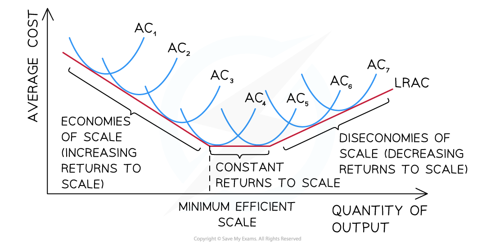

# Long-Run Production

## Long-run production

> **Spec point** — `spcpt_kfY7vQgSt4HwTVxz`

## Long-run production

- In the **long run**, firms can vary **all factors of production**, including labour, capital, land and enterprise
- This allows firms to **change the scale of production**, for example by expanding factories, investing in new machinery or adopting new technologies
- **The long-run production function shows the relationship between inputs and output when all factors of production are variable**

  - Firms can adjust the **quantity of every input**
  - This allows them to choose the **most efficient scale of production**
  - The long run therefore focuses on how output changes when **all inputs increase**

#### Choosing the best factor combination

- Firms aim to produce a given level of output using the **most cost-effective combination of inputs** The choice of inputs depends on:

  - The **price of each factor of production** (e.g. wages, rent, cost of machinery)
  - The **productivity of each factor** (how much output each input produces)
- To compare inputs, firms consider the **marginal product generated per unit of cost**

$\frac{\mathrm{Marginal} \mathrm{Product}(\mathrm{additional} \mathrm{output} \mathrm{from} \mathrm{adding} \mathrm{one} \mathrm{more} \mathrm{factor})}{\mathrm{Price} \mathrm{of} \mathrm{the} \mathrm{factor}}$

- Efficiency is achieved when the **marginal product per unit of cost is equal across inputs**
- For example, a technology firm deciding whether to hire more engineers or invest in cloud infrastructure will compare:

  - The **additional output generated by each option**
  - The **cost of each input**
- The firm will allocate resources toward the input that generates the **highest output relative to its cost**

## Returns to scale

> **Spec point** — `spcpt_387NKpFYZgSscxjK`

## Returns to scale

- Returns to scale describe how **output changes when all inputs increase proportionally**
- Three outcomes are possible

### 1. Increasing returns to scale

- Output increases **more than proportionally** compared to the increase in inputs
- This occurs because firms experience **economies of scale**
- Production becomes **more efficient as the firm expands**

### 2. Constant returns to scale

- Output increases **in the same proportion** as inputs
- Production efficiency **remains unchanged**

### 3. Decreasing returns to scale

- Output increases **less than proportionally** compared to the increase in inputs
- This occurs due to **diseconomies of scale**
- Production becomes **less efficient as the firm becomes very large**

### Increasing and decreasing returns to scale

- The diagram below illustrates how the **long-run average cost (LRAC) curve** reflects different returns to scale

  - At low levels of output, firms experience ***economies of scale***, so average costs fall
  - At moderate levels of output, firms may experience **constant returns to scale**
  - At very high levels of output, ***diseconomies of scale*** cause average costs to rise

*As a firm grows, economies of scale help it reach its minimum efficient scale, before diseconomies raise the cost/unit again*

### Diagram analysis

- In the ***short-run***, the firm operates on its short-run average cost curve
- In the long-run, the firm will increase its capacity (e.g. build a new factory), and then operate for a period of time on a new short-run cost curve

- Each subsequent short-run average cost (SRAC) curve **represents growth** and an increase in size
- **Output increases** with each period of growth
- Initially, firms experience ***increasing returns to scale*** as a result of the ***economies of scale***
- At a certain level of output, the firm will reach the **minimum efficient scale **where it experiences ***constant returns to scale***
- If it continues to grow beyond that level of output, the firm will experience ***decreasing returns to scale*** as ***diseconomies of scale*** occur
