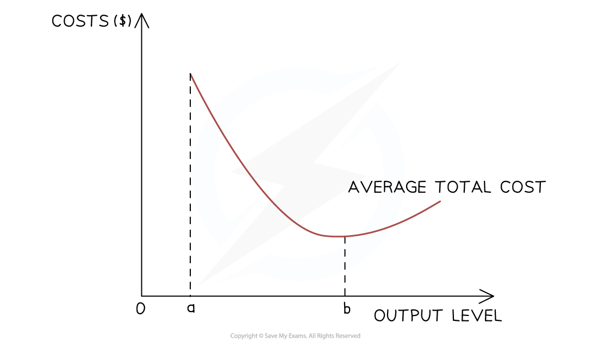
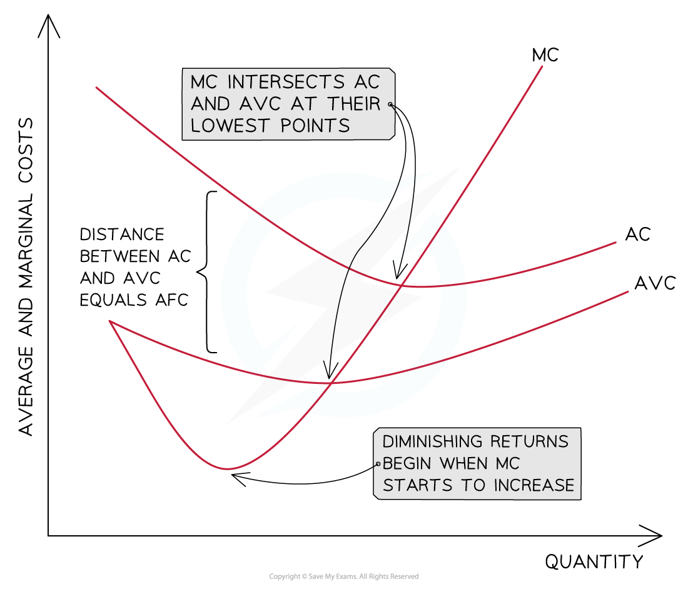

# Short-Run Costs

## Types of short-run costs

> **Spec point** — `spcpt_VbDpsBSS9vNSxDwD`

## Types of short-run costs

- In the **short run**, some factors of production such as factory space or machinery are **fixed**, while others, such as labour or raw materials can be varied
- This creates two types of costs:

  - **Fixed costs**, which do not change with output
  - **Variable costs**, which change as production increases
- These together form the **short-run cost structure of a firm**

### Fixed and variable costs

#### 1. Fixed costs (FC)

- Fixed costs are expenses that **do not change with the level of output. **They must be paid even if the firm produces nothing

  - Examples include **rent for premises, insurance premiums, and salaries of permanent staff**
  - A cinema pays rent and licensing fees whether it screens films or not
  - On a graph, **total fixed costs appear as a horizontal line,** since they remain constant regardless of output
- Firms operating in industries with **high fixed costs **such as hotels or airlines often **aim to maximise output**
- This helps to **spread these costs **over more units, thereby reducing the **average fixed cost** per unit

#### 2. Variable costs (VC)

- Variable costs **change directly with the level of production**

  - These include expenses such as **wages for temporary staff, electricity used in production, and the cost of raw materials**
  - For example, a bakery’s flour and sugar costs rise as more cakes are baked.
  - Variable costs **increase with output **and are crucial for calculating total cost

#### 3. Total cost (TC)

- Total cost represents the **overall cost of producing a given level of output**
- It is the sum of fixed and variable costs

$\mathrm{TC}=\mathrm{TFC}+\mathrm{TVC}$

- Where:

  - **TFC** = total fixed costs
  - **TVC** = total variable costs
- As output increases, **total cost rises** because variable costs increase

### Average costs

- Average costs measure the **cost per unit of output**

#### 1. Average total cost (ATC)

- Average total cost shows the **total cost of producing each unit of output**

$\mathrm{ATC}=\frac{\mathrm{TC}}{Q}$

- Where:

  - **TC** = total cost
  - **Q** = quantity of output

### 2. Average fixed cost (AFC)

- Average fixed cost measures the **fixed cost per unit of output**

$\mathrm{AFC}=\frac{\mathrm{TFC}}{Q}$

- As output increases, **average fixed cost falls** because the fixed costs are spread across more units

  - This is sometimes called **'spreading overheads' or 'fixed cost spreading'**

### 3. Average variable cost (AVC)

- Average variable cost measures the **variable cost per unit of output**

$\mathrm{AVC}=\frac{\mathrm{TVC}}{Q}$

- AVC may initially fall due to **better use of variable inputs**, but eventually rises due to the ***law of diminishing returns***

### Marginal cost (MC)

- Marginal cost is the **increase in total cost caused by producing one more unit of output**

$\mathrm{MC}=\frac{\mathrm{ΔTC}}{\mathrm{ΔQ}}$

- Because fixed costs do not change with output in the short run, marginal cost can also be calculated using:

$\mathrm{MC}=\frac{\mathrm{ΔTVC}}{\mathrm{ΔQ}}$

- Marginal cost typically:

  - **Falls at first**, due to increasing productivity
  - Then **rises as diminishing returns occur**
- This creates the **U-shaped marginal cost curve**
- The **MC curve intersects the ATC and AVC curves at their minimum points**

> **Worked Example**
> **Cost calculations using the above formulas**
> 
> Assume:
> 
> - **Total fixed cost (TFC) = \$200**
> - **Variable costs rise at an increasing rate** as output increases
> - This reflects the **law of diminishing returns**, where additional workers become less productive and production becomes more expensive
> 
> This means:
> 
> - **Total variable cost (TVC)** increases at an increasing rate
> - **Marginal cost (MC)** eventually rises
> 
> **Short-run cost calculations example**
> 
> | Output (Q) | TFC | TVC | **TC = **$\mathrm{TFC}+\mathrm{TVC}$ | MC =  $\frac{\Delta\mathrm{TC}}{\DeltaQ}$ | **AFC = **$\frac{\mathrm{TFC}}{Q}$ | **AVC = **$\frac{\mathrm{TVC}}{Q}$ | **ATC = **$\frac{\mathrm{TC}}{Q}$ |
> |---|---|---|---|---|---|---|---|
> | 0 | 200 | 0 | 200 | – | – | – | – |
> | 1 | 200 | 50 | 250 | 50 | 200 | 50 | 250 |
> | 2 | 200 | 90 | 290 | 40 | 100 | 45 | 145 |
> | 3 | 200 | 140 | 340 | 50 | 66.67 | 46.67 | 113.33 |
> | 4 | 200 | 200 | 400 | 60 | 50 | 50 | 100 |
> | 5 | 200 | 280 | 480 | 80 | 40 | 56 | 96 |
> | 6 | 200 | 380 | 580 | 100 | 33.33 | 63.33 | 96.67 |
> | 7 | 200 | 520 | 720 | 140 | 28.57 | 74.29 | 102.86 |
> | 8 | 200 | 700 | 900 | 180 | 25 | 87.5 | 112.5 |
> 
> **What this table demonstrates**
> 
> - **TFC remains constant** at \$200 because fixed costs do not change with output
> - **TVC increases at an increasing rate** due to the **law of diminishing returns**
> - **MC initially falls**, then rises as diminishing returns begin
> - **AFC always falls** as fixed costs are spread over more output
> - **ATC falls initially**, then rises as increasing marginal costs dominate

## Drawing and interpreting cost diagrams

> **Spec point** — `spcpt_8WhBfs8gf5rjwb6f`

## Drawing and interpreting cost diagrams

### Fixed costs (FC)

- The firm must pay its fixed costs **even if output is zero**
- Fixed costs **do not change with the level of output**

### Variable costs (VC)

- Initially, variable costs may increase slowly as labour becomes more productive
- As more variable factors are added to fixed factors, the **law of diminishing returns causes variable costs to rise at an increasing rate**

### Total cost (TC)

- The **total cost** is the sum of the variable and fixed costs
- The total costs **cannot be 0,** as all firms have some level of fixed costs

### Average fixed cost (AFC)

- If the **fixed costs** of a firm are \$1,000 and it produces 1 unit of output, then its **AFC is \$1,000** (\$1,000/1)
- If the firm increases its output to 1000 units, then the **AFC is \$1 per unit **(\$1000/1,000)
- The **more units** a firm produces, the **lower its AFC** will be
- This is one reasons why large levels of output help to increase the **profit per unit**

### Average total cost (ATC)

- As a firm grows, it is able to increases its **scale of output **generating efficiencies that lower its **average total costs (AC)** of production
- As a firm continues increasing its **scale of output**, it will reach a point where its **average total costs (AC)** start to **increase**
- ATC is U-shaped mainly because of:

  - **increasing returns initially**
  - **diminishing returns later**

### Marginal costs (MC)

- The **distance **between the** AVC and AC = the AFC**

  - AVC converges towards AC as the **AFC continuously decreases** with an increase in output
  - AVC decreases as **additional workers are added** and each worker produces additional product
- **Marginal costs (MC) **decrease initially as additional workers are added and the ***marginal product*** is increasing
- **Diminishing returns** begin when the MC starts to increase
- MC will cross the AVC and AC curves at their **lowest point**

  - As long as the **cost **of producing the next unit (MC) is **lower than the average**, it will pull down the average
  - When the **cost** of producing the next unit (MC) is **higher than the average**, it will pull up the average
