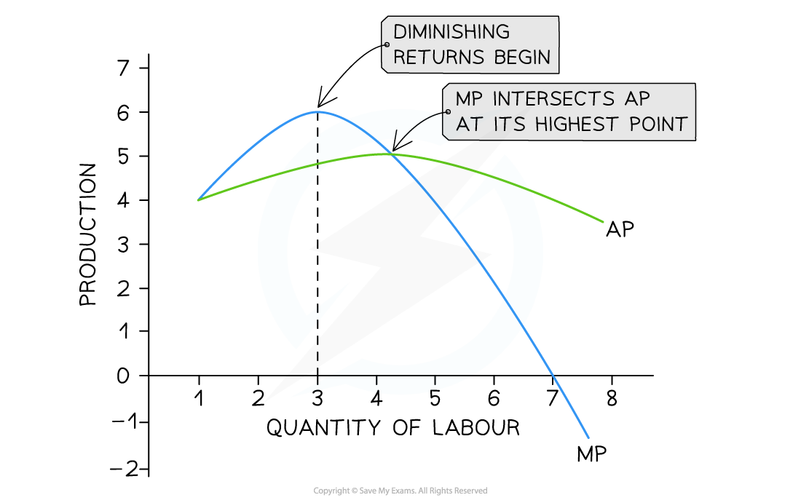

# Short-Run Production

## Short-run production function

> **Spec point** — `spcpt_jr8YJWS3pHyPCv76`

## Short-run production function

- **The production function shows the relationship between inputs used in production and the level of output produced**

  - In the **short run**, at least one factor of production is **fixed**, meaning it cannot be changed quickly
  - Firms increase output mainly by adjusting **variable factors**
- When additional **variable factors** are added to **fixed factors**, output changes according to the **production function**

### Fixed factors of production

- Inputs that **cannot be changed in the short run**
- Their quantity remains constant as output changes
- Examples include:

  - Machinery
  - Buildings
  - Land
  - Large equipment

### Variable factors of production

- Inputs that **can be changed in the short run**
- Firms adjust these to increase or decrease production
- Examples include:

  - Labour
  - Raw materials
  - Energy inputs

### Types of product

#### 1. Total product (TP)

- **Total product (TP)** is the **total quantity of output produced** using a given amount of labour and other inputs
- For example:

  - A bakery produces **100 loaves of bread with one baker**
  - With **two bakers**, output increases to **180 loaves**
- As more workers are added, **total output increases**, although the rate of increase may change

#### 2. Marginal product (MP)

- **Marginal product (MP)** is the **additional output produced by employing one more unit of labour**
- Formula:

$\mathrm{MP}=\frac{\mathrm{ΔTP}}{\mathrm{ΔQL}}$

- Where:

  - ΔTP = change in total product
  - ΔQL = change in quantity of labour
- For example:

  - Output increases from **100 loaves to 180 loaves** when a second worker is hired
  - The **marginal product of the second worker is 80 loaves**
- Marginal product shows how much **extra output** each additional worker produces

#### 3. Average product (AP)

- **Average product (AP)** measures the **output produced per worker**
- Formula:

$\mathrm{AP}=\frac{\mathrm{TP}}{\mathrm{QL}}$

- Where:

  - TP =  total product
  - QL =  quantity of labour
- For example:

  - If **three bakers produce 240 loaves**, then

$\mathrm{AP}=\frac{\mathrm{TP}}{\mathrm{QL}}\,\mathrm{AP}=\frac{240}{3}\,\mathrm{AP}=80$

- So the **average product is 80 loaves per worker**

## The law of diminishing returns

> **Spec point** — `spcpt_v4JJYSkv3Q322CXn`

## The law of diminishing returns

- The **law of diminishing returns** (also called the **law of variable proportions**) states that:

  - **When increasing amounts of a variable factor are added to a fixed factor, the marginal product of the variable factor will eventually fall**
- This occurs because the fixed factor becomes a **constraint on production**.

  - For instance, in a small coffee shop:
  
    - The first barista works efficiently alone
    - A second barista improves output, but not as dramatically
    - By the time a sixth barista is hired, they may be crowding each other, leading to minimal gains in output
    - Eventually, adding more workers does not increase total output significantly and may even reduce efficiency

#### Short-run production in a coffee shop

| Workers | Total Product | Marginal Product | Average Product |
|---|---|---|---|
| 1 | 100 | 100 | 100 |
| 2 | 180 | 80 | 90 |
| 3 | 240 | 60 | 80 |
| 4 | 280 | 40 | 70 |
| 5 | 300 | 20 | 60 |

- This table shows how output increases with each additional worker, but at a decreasing rate
- Eventually, output plateaus, illustrating diminishing returns

### Stages of production

- The law of diminishing returns leads to **three stages of production**
- Firms usually operate in **Stage 2**, where production is still increasing but diminishing returns have begun

#### Stage 1: Increasing returns

- Marginal product **increases**
- Workers specialise and production becomes more efficient

#### Stage 2: Diminishing returns

- The marginal product **begins to fall**
- Additional workers still increase output but **at a decreasing rate**

#### Stage 3: Negative returns

- The marginal product becomes **negative**
- Too many workers cause **crowding and inefficiency**
- Total output may begin to fall

#### Diagram analysis

- A small food van selling burgers at a music festival increases productivity up to the **third worker** as workers specialise and the grill is used more efficiently
- After this point, workers begin to **get in each other's way** and there is limited grill space (capital), so the **marginal product of labour begins to fall**
- Hiring additional workers still **increases total product**, but at a **diminishing rate**
- When the **7th worker is hired**, the **marginal product becomes negative**, causing **total product to fall**

### Understanding the short-run production function helps firms

- Decide how many workers to hire
- Estimate the cost of increasing output
- Identify the point at which adding more labour becomes inefficient
- It also supports broader economic analysis of resource allocation, productivity, and cost structures in different industries
