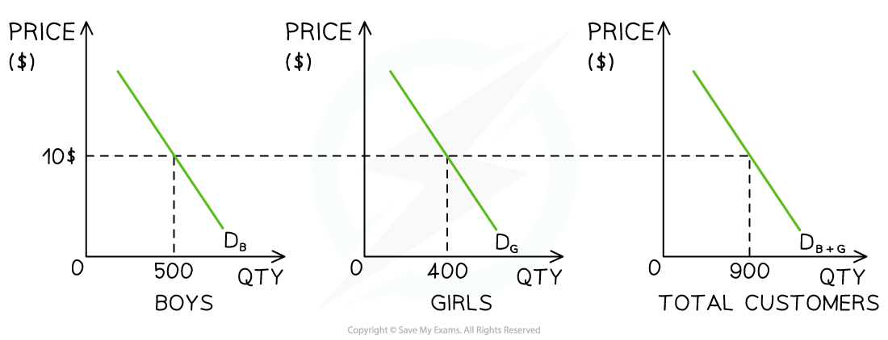
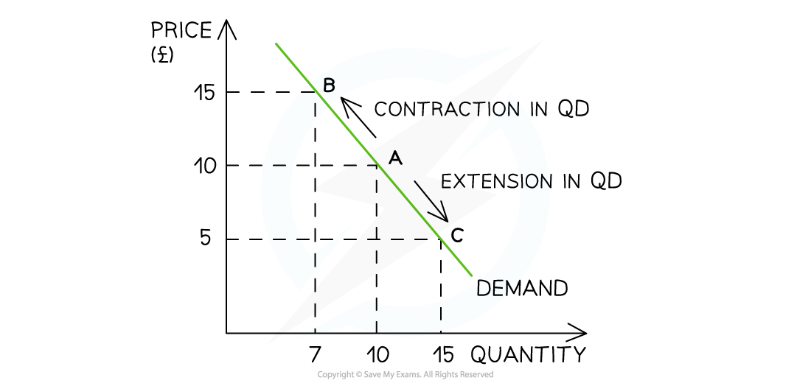
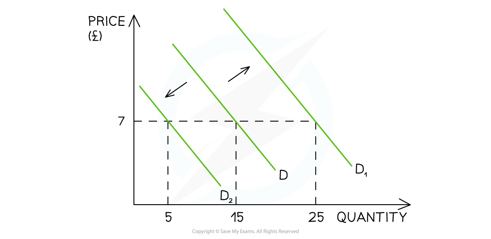

# Demand Curves

## An introduction to demand

> **Spec point** — `spcpt_w7RbGnYcRZ7YW89j`

## An introduction to demand

- **Demand** **is the amount of a good or service that a consumer is willing and able to purchase at a given price in a given time period**

  - **Effective demand **is demand supported by the necessary purchasing power (the **ability** to pay)
  - If a consumer is willing to purchase a good, but cannot afford to, it is **not effective demand**
- A **demand curve** is a graphical representation of the **price** and **quantity demanded (QD)** by consumers

  - If the data were plotted, it would be an **actual curve.  **Economists, however, use straight lines so as to make analysis easier
- **The law of demand **states that there is an inverse relationship between price and quantity demanded (QD), ***ceteris paribus***

  - When the price rises, the QD falls
  - When the price falls, the QD rises

### Individual and market demand

- **Market demand** is the combination of all the **individual demand** for a good or service

  - It is calculated by adding up the individual demand at each price level

**The Monthly Market Demand for Newspapers in a Small Village**

| **Customer 1** | **Customer 2** | **Market Demand** |
|---|---|---|
| **8** | **12** | **20** |

- **Individual and market demand** can also be represented graphically

#### Market demand for children's swimwear

*Boys, girls and total customer demand curves for children's swimwear in July  *

#### Diagram analysis

- A shop sells both boys' and girls' swimwear.
- In July, at a price of \$10, the demand for boys' swimwear is 500 units and girls' is 400 units
- At a price of \$10, the shop's **market demand** during July is 900 units

## Movements along the demand curve

> **Spec point** — `spcpt_sfzNBctQnc7YKTMF`

## Movements along the demand curve

- **If price is the only factor that changes (*****ceteris paribus*****), there will be a change in the quantity demanded (QD)**

  - This change is shown by a **movement along the demand curve**

#### Movement along the demand curve

*A demand curve shows a contraction in quantity demanded (QD) as prices increase and an extension in quantity demanded (QD) as prices decrease*

### Diagram analysis

- An **increase** in price from £10 to £15 leads to a movement **up** the demand curve from point A to B

  - Due to the **increase** in price, the QD has** fallen** from 10 to 7 units
  - This movement is called a **contraction** in QD
- A **decrease **in price from £10 to £5 leads to a movement **down** the demand curve from point A to point C

  - Due to the **decrease** in price, the QD has **increased** from 10 to 15 units
  - This movement is called an **extension** in QD

## The determinants of demand

> **Spec point** — `spcpt_Jn8hscYDgpfmZSJB`

## The determinants of demand

- There are numerous factors that will **change the demand **for a good or service, **irrespective of the price level**
- Collectively, these factors are called the **determinants of demand **and include

  - Changes in real income
  - Changes in tastes/preferences/fashion/trends
  - Advertising and branding
  - Changes in the price of related goods (substitutes and complements)
  - Changes in the population size and structure
  - Future price expectations

### Shifts of the entire demand curve

- Changes to each of the determinants of demand **shift the entire demand curve** (as opposed to a movement along the demand curve)

*A graph that shows how changes to any of the conditions of demand shifts the entire demand curve left or right, irrespective of the price level*

- For example, if a firm **increases** their **Instagram advertising**, there will be an** increase in demand** as more consumers become aware of the product

  - This is a **shift in demand **from D to D1. The price remains unchanged at £7 but the **demand has increased** from 15 to 25 units

## Illustrating changes to the determinants of demand

> **Spec point** — `spcpt_5pDctTptzD5hTYB3`

## Illustrating changes to the determinants of demand

### 1. A change in real income

- ***Real Income*** determines how many goods/services can be enjoyed by consumers
- In most cases, there is a **direct** relationship between income and demand for **goods and services**

*A graph that shows how changes to any of the conditions of demand shifts the entire demand curve left or right, irrespective of the price level*

- **If income increases**

  - Demand increases and shifts right (D→D1)
- **If income decreases**

  - Demand decreases and shifts left (D→D2)

### 2. Change in consumer tastes and preferences

- If goods and services become more fashionable, then demand for them increases
- There is a **direct relationship** between changes in consumer preferences and demand

*A graph that shows how changes to any of the conditions of demand shifts the entire demand curve left or right, irrespective of the price level*

- **If preference for a product increase**

  - Demand increases and shifts right (D→D1)
- **If preference for a product decrease**

  - Demand decreases and shifts left (D→D2)

### 3. Improved advertising and branding

- If more money is spent on **advertising **or ***branding***, then demand for goods and services will increase as more consumers become aware of the product
- There is a **direct** relationship between **branding or advertising** **and demand**

*A graph that shows how changes to any of the conditions of demand shifts the entire demand curve left or right, irrespective of the price level*

- **If advertising or brand awareness of a product increases**

  - Demand increases and shifts right (D→D1)
- **If advertising or brand awareness of a product decreases**

  - Demand decreases and shifts left (D→D2)

### 4. Changes in the prices of substitute goods

- Changes in the price of **substitute goods** will influence the demand for a product/service
- There is a **direct relationship** between the **price of good A** **and** **demand for good B**

  - For example, the price of a Sony 60" TV increases so the **demand** for LG 60" TV increases

*A graph that shows how changes to any of the conditions of demand shifts the entire demand curve left or right, irrespective of the price level*

- **If the price of good A increases**

  - Demand for good B increases and shifts right (D→D1)
- **If the price of good A decreases**

  - Demand for good B decreases and shifts left (D→D2)

### 5. Changes in the prices of complementary goods

- Changes in the price of **complementary goods** will influence the demand for a product or service
- There is an **inverse relationship** between the **price of good A** **and demand for good B**

  - For example, the price of printer ink increases so the **demand** for ink printers decreases

*A graph that shows how changes to any of the conditions of demand shifts the entire demand curve left or right, irrespective of the price level*

- **If the price of good A increases**

  - Demand for good B decreases and shifts left (D→D2)
- **If the price of good A decreases**

  - Demand for good B increases and shifts right (D→D1)

### 6. Changes in population size or distribution

- If the **population size** of a country changes over time, then **demand** for goods and services will also change
- There is a **direct relationship** between the changes in population size and demand
- Demand will also change if there is a change to the ***age distribution*** in a country, as different ages **demand different goods and services**

  - For example, an ageing population will buy more hearing aids

*A graph that shows how changes to any of the conditions of demand shifts the entire demand curve left or right, irrespective of the price level*

- **If the population increases**

  - Demand increases and shifts right (D→D1)
- **If the population decreases**

  - Demand decreases and shifts left (D→D2)

> **Exam Hint**
> The difference between a **movement along the demand curve** and a **shift in demand** is essential to understand
> 
> When **price changes** (ceteris paribus), there is a movement along the demand curve resulting in a change to **quantity demanded, **which is a **contraction **or **extension**
> 
> When a **condition of demand changes,** there is a **shift** of the entire demand curve, resulting in a **change to demand**,** **which is an** increase **or  a **decrease in demand**
