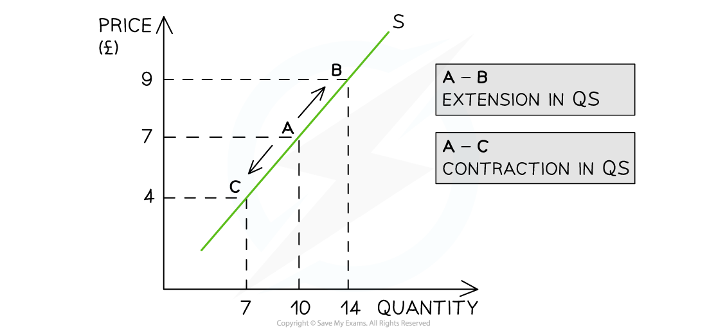

# Supply Curves

## An Introduction to supply

> **Spec point** — `spcpt_dDbT85NqbC9YVZfb`

## An introduction to supply

- **Supply** **is the amount of a good or service that a producer is willing and able to supply at a given price in a given time period**
- A **supply curve** is a graphical representation of the **price** and **quantity supplied** by producers

  - If the data were plotted, it would be an actual curve. Economists, however, use straight lines so as to make analysis easier
- The supply curve is** upward sloping, **as there is a **positive relationship** between the price and quantity supplied (QS)

  - Rational **profit maximising producers** would want to supply more as prices increase in order to **maximise** their profits
- **The law of supply** states that there is a positive (direct) relationship between quantity supplied and price, ***ceteris paribus***

  - When the price rises, the QS rises
  - When the price falls, the QS falls

### Individual and market supply

- **Market supply** is the combination of all the **individual supply** for a good or service

  - It is calculated by adding up the individual supply at each price level

**The Monthly Market Supply of Bread from 4 Bakeries in a Small town**

| **Bakery 1** | **Bakery 2** | **Market Supply** |
|---|---|---|
| **500** | **400** | **900** |

#### Individual and market supply curves

*Market supply for smart phones in December is predominantly a combination of iPhone and Samsung supply*

#### Diagram analysis

- In New York City, the market supply for smartphones in December is predominantly a combination of iPhone and Samsung supply
- **At a price of \$1000,** the supply of iPhones is 300 units and the supply of Samsung phones is 320 units
- At a price of \$1,000, the **market supply **of smartphones in New York City during December is 620 units

## Movements along the supply curve

> **Spec point** — `spcpt_v5BhFQ9D4GbjT8yq`

## Movements along the supply curve

- If **price** is the only factor that changes (***ceteris paribus***), there will be a change in the **quantity supplied (QS)**

  - This change is shown by a **movement along the supply curve**

*There is an extension in quantity supplied (QS) as prices increase and a contraction in quantity supplied (QS) as prices decrease*

### Diagram analysis

- An **increase** in price from £7 to £9 leads to a **movement** **up** the supply curve from point A to B

  - Due to the **increase** in price, the quantity supplied has** increased** from 10 to 14 units
  - This movement is called an **extension in QS**
- A **decrease **in price from £7 to £4 leads to a **movement down** the supply curve from point A to C

  - Due to the **decrease** in price, the quantity supplied has **decreased** from 10 to 7 units
  - This movement is called a **contraction in QS**

## Determinants of supply

> **Spec point** — `spcpt_mPc9HRGkSJbCVdp4`

## Determinants of supply

- There are several factors that will **change the supply** of a good or service, **irrespective of the price level**
- Collectively, these factors are called the** determinants of supply and include:**

  - Changes to the costs of production
  - Changes to indirect taxes and subsidies
  - Changes to technology
  - Changes to the number of firms
  - Weather events
  - Future price expectations
  - Goods in joint and competitive supply

- Changes to any of the conditions of supply **shift the entire supply curve** (as opposed to a movement along the supply curve)

*A graph that shows how changes to any of the conditions of supply shift the entire supply curve left or right, irrespective of the price level*

### Diagram analysis

- If a firm's cost of production increases due to the increase in price of a key resource, then there will be a** decrease in supply** as the firm can now only afford to produce fewer products
- This is a **shift in supply **from S to S1. The price remains unchanged at £7 but the **supply has decreased** from 10 to 2 units

## Illustrating changes to the determinants of supply

> **Spec point** — `spcpt_CpKz8kvTR83hs7FD`

## Illustrating changes to the determinants of supply

### 1. Changes to the costs of production

- If the price of **raw materials** or other **costs of production** change, firms respond by changing supply.

*Changes to the conditions of supply shift the entire supply curve*

- **If costs of production increase**

  - Supply decreases and shifts left (S→S1)
  - For example, rising aluminium prices increase bicycle production costs in Malaysia, causing supply to fall
- **If costs of production decrease**

  - Supply increases and shifts right (S→S2)

### 2. Changes to indirect taxes

- Any change to **indirect taxes** changes the **cost of production **for a firm and impacts supply

*Changes to the conditions of supply shift the entire supply curve*

- **If indirect taxes increase**

  - Supply decreases and shifts left (S→S1)
  - For example, a higher sugar tax in Thailand raises costs for soft drink producers, reducing supply
- **If indirect taxes decrease**

  - Supply increases and shifts right (S→S2)

### 3. Changes to subsidies

- Changes to ***producer subsidies*** directly impact the **cost of production** for the firm

*Changes to the conditions of supply shift the entire supply curve*

- **If subsidies increase**

  - Supply increases and shifts right (S→S2)
- **If subsidies decrease**

  - Supply decreases and shifts left (S→S1)
  - For example, the removal of farming subsidies in Argentina reduces agricultural output

#### 4. Changes to the state of technology

- New technology increases ***productivity*** and **lowers costs** of production
- **Ageing technology** can have the opposite effect

*Changes to the conditions of supply shift the entire supply curve*

- **If technology improves**

  - Supply increases and shifts right (S→S2)
  - For example, new irrigation systems in Morocco help farmers produce more crops with less water
- **If technology worsens**

  - Supply decreases and shifts left (S→S1)

### 5. Change in the number of firms in the industry

- The **entry and exit** of firms into the market has a direct impact on the supply
- If ten new firms start selling building materials in Hanoi, the supply of building material will **increase**

*Changes to the conditions of supply shift the entire supply curve*

- **If the number of firms increases**

  - Supply increases and shifts right (S→S2)
- **If the number of firms decreases**

  - Supply decreases and shifts left (S→S1)
  - For example, several electronics factories close in South Africa due to constant power outages, reducing supply

### 6. Weather events

- Droughts or flooding can cause a **supply shock** in agricultural markets
- A drought will cause **supply to decrease**
- Unexpectedly good growing conditions can cause supply to increase

*Changes to the conditions of supply shift the entire supply curve*

- **If the weather is good**

  - Supply increases and shifts right (S→S2)
  - For example, ideal monsoon rains boost rice production in India
- **If the weather is bad**

  - Supply decreases and shifts left (S→S1)
  - For example, severe drought in Kenya reduces the coffee harvest, lowering supply

### 7. Future price expectations

- If firms expect the price of a good or service to **increase in the future**, they will **hold back supply now** to sell later at a higher price
- If firms expect the price of a good or service to **decrease in the future**, they will **sell more now** before prices fall

*Changes to the non-price determinants of supply shift the entire supply curve*

- **If prices are expected to rise in the near future**

  - Supply decreases and shifts left (S→S1)
- **If prices are expected to fall in the near future**

  - Supply increases and shifts right (S→S2)

> **Exam Hint**
> Make sure that you explain each condition as its own point before linking it to the **cost of production,** e.g. a change in indirect taxation
> 
> A common error by students is to explain that a **subsidy** shifts the demand curve for electric vehicles to the right. A subsidy will shift the **supply curve** to the right. The lower price, will cause a **movement along the demand curve** (extension of quantity demanded) to create a new market equilibrium
