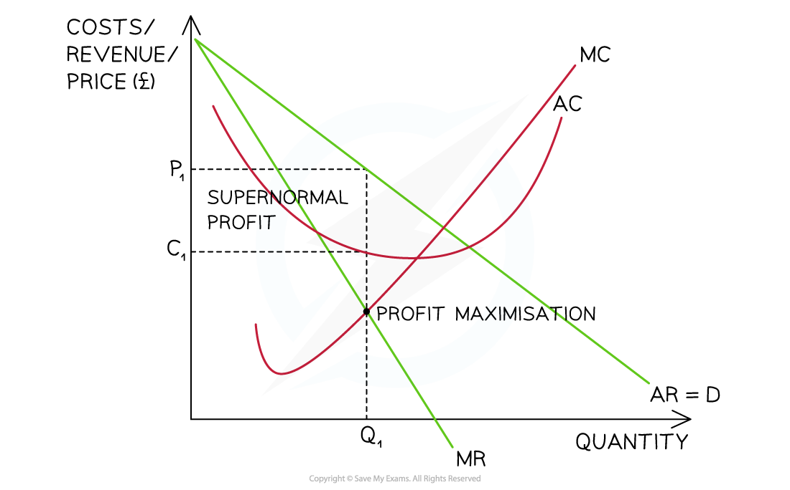
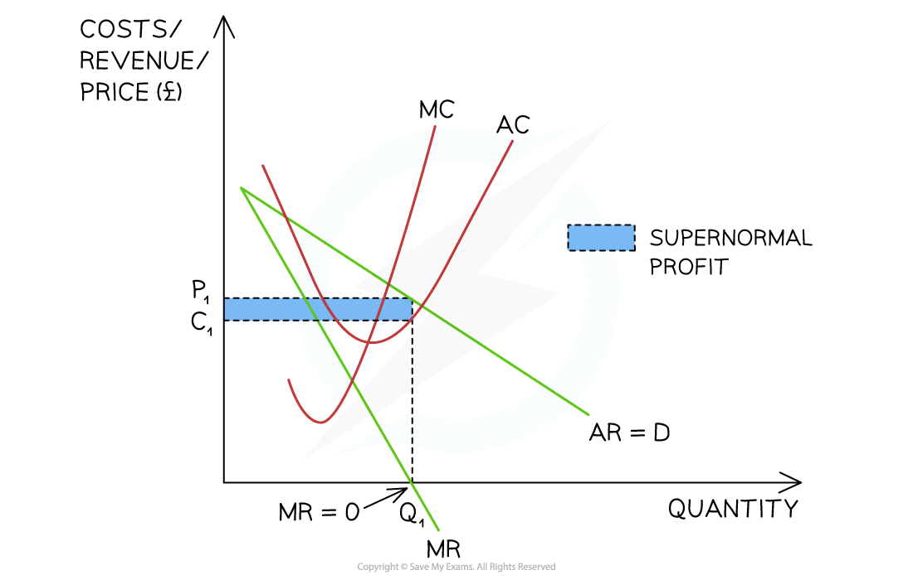
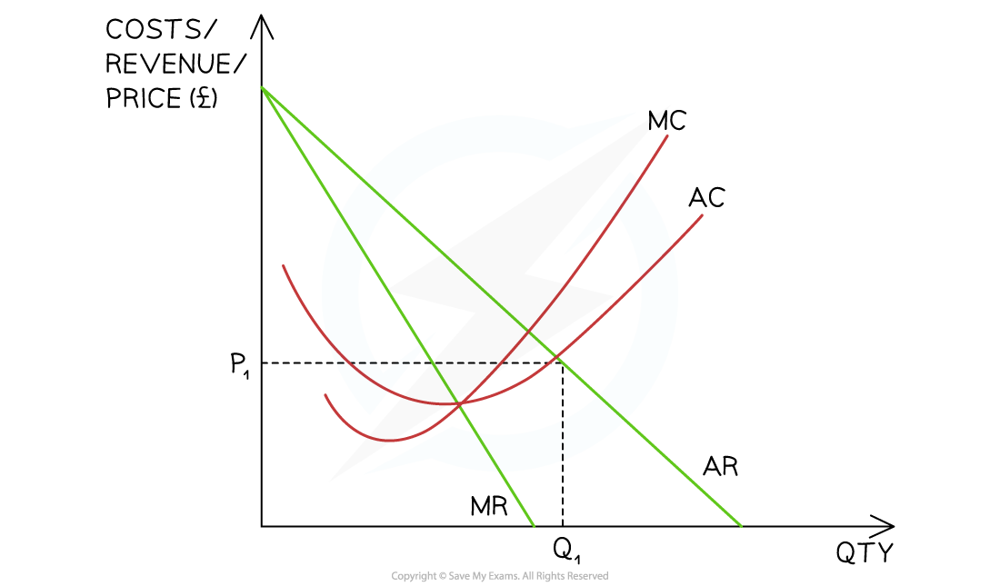

# Differing Objectives of Firms

## Profit maximisation

> **Spec point** — `spcpt_KxHGq4mDkBTwYSWn`

## Profit maximisation

- Most firms have the **rational** business objective of **profit maximisation**

  - Profits benefit shareholders as they receive ***dividends*** and also increase the underlying share price
  
    - An increase in the underlying share price increases the **wealth** of the shareholder
- To achieve profit maximisation, firms follow the ***profit maximisation rule***

  - When ***marginal cost (MC)*** = ***marginal revenue (MR)*** then no additional profit can be extracted by producing another unit of output
  - When MC < MR additional profit can still be extracted by producing an additional unit of output
  - When MC > MR the firm has gone beyond the profit maximisation level of output
  
    - It is making a marginal loss on each unit produced beyond the point of output where **MC = MR**
- In reality, firms may find it difficult to produce at the **profit maximisation level of output**

  - They may not know where this level is because it is difficult to calculate
  - In the short term they may not adjust their prices if the **marginal cost** changes
  
    - Marginal costs can change regularly and **regular price changes** would be disruptive to customers
  - In the long-term firms will seek to **adjust prices** to the profit maximisation level of output
  - Firms may be forced to change prices by the **Competition Commission**
  
    - The profit maximisation level of output often results in **high prices** for consumers
    - Changing prices changes the **marginal revenue**

*The profit maximisation level of output occurs at Q1 where MC = MR resulting in a market price of P1*

#### Diagram analysis

- This firm has **market power** as the MR and **average revenue (AR)** curve are downward sloping
- At the profit maximisation level of output (MC = MR)

  - The selling price is P1
  - The average cost is C1
  - The ***supernormal profit*** = $(P_{1}-C_{1})\timesQ_{1}$

## Revenue maximisation

> **Spec point** — `spcpt_T6Jx9YH5MNb9TyZB`

## Revenue maximisation

- Some firms have the business objective of **revenue maximisation**

  - This often occurs due to the ***principal agent problem***
  
    - Sales managers often receive **commission** on sales as part of their wages and this **incentivises** them to maximise sales
    - Profit maximisation for shareholders becomes a secondary objective for the sales managers
  - Firms will also **maximise revenue** in order to increase output & benefit from ***economies of scale***
  - In the short term, firms may use this strategy to **eliminate the competition **as the price is lower than when focusing on profit maximisation
- **To achieve revenue maximisation firms produce up to the level of output where MR = 0**

  - **When MR > 0, producing another unit of output will increase total revenue**

*The revenue maximisation level of output occurs at Q1 where MR = 0 resulting in a market price of P1*

### Diagram analysis

- This firm has **market power** as the MR and **average revenue (AR)** curve are downward sloping
- At the revenue maximisation level of output **(MR = 0)**

  - The selling price is P1
  - The average cost is C1
  - The ***supernormal profit*** = $(P_{1}-C_{1})\timesQ_{1}$
  - The supernormal profit is less than when the firm follows the ***profit maximisation rule***

> **Exam Hint**
> Profit and revenue maximisation is all about the quantity of output
> 
> To determine the level of profit:
> 
> 1. identify where MC = MR and then **extend the dotted line upwards** to the point where it hits the AR curve – this is your selling price
> 2. Where this line crosses the **average cost curve (AC)** represents the cost per unit at this level of output
> 3. The profit is the difference between the selling price and the average cost

## Sales maximisation & satisficing

> **Spec point** — `spcpt_4PvTRpHgsSp9c4kF`

## Sales maximisation & satisficing

### 1. Sales maximisation

- Some firms have the business objective of **sales maximisation**

  - This occurs at the level of output where **AC = AR (normal profit/breakeven)**
  - In the short term, firms may use this strategy to **clear stock during a sale**
  
    - They sell remaining stock without making a** loss per unit**

*The sales maximisation level of output occurs at Q1 where AC = AR resulting in a market price of P1*

#### Diagram analysis

- This firm has **market power** as the MR and **average revenue (AR)** curve are downward sloping
- At the sales maximisation level of output **(AC = AR)**

  - The selling price is P1
  - The average cost is also at P1
  - The firm is breaking even (normal profit)

### 2. Satisficing

- Some firms have the business objective of ***satisficing***
- This often occurs as a result of the ***principal agent problem***

  - Rationally, managers know **shareholders want to profit maximise**
  - Rationally, **managers want to maximise sales** or revenue so as to increase their wages
  - Managers (who control the business) settle for a level of output somewhere **between profit and sales** maximisation
  
    - This increases their wages and **reduces potential conflict **with shareholders
