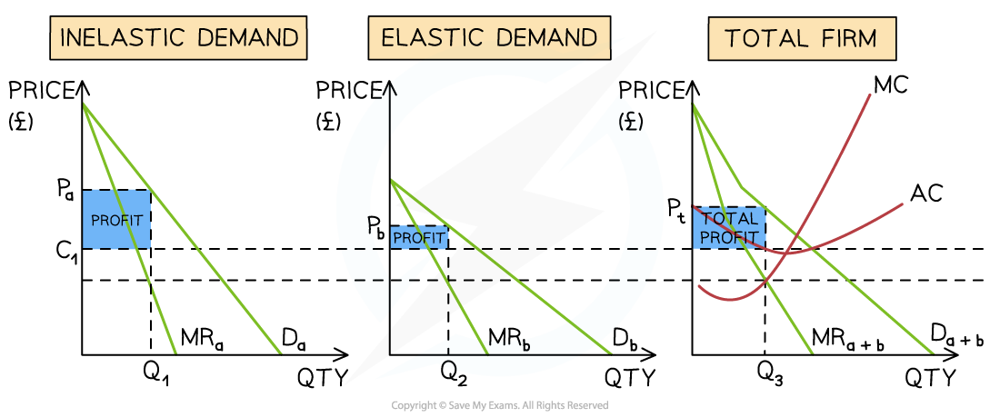

# Price Discrimination

## Conditions for effective price discrimination

> **Spec point** — `spcpt_6gyXQ8V43sr7gGKY`

## Conditions for effective price discrimination

- **Price discrimination occurs when a firm charges a different price for the same good or service in order to maximise its revenue**

  - There are different **types (degrees) of price discrimination**

### 1. First-degree price discrimination

- **Occurs when a firm separates consumers based on their ability to pay**

  - E.g market traders can often easily identify high-worth customer and double the price of the product offered – especially in situations where the product prices are not displayed

### 2. Second-degree price discrimination

- Occurs when a firm gives discounts for bulk buying, e.g., 3 for 2 offers

### 3. Third-degree price discrimination

- Occurs when a firm charges **different prices to** **different consumers **for the **same good or  service, **e.g., rail fares are priced differently depending on the time of travel
- **Third-degree markets** are often **sub-divided** based on time, age, income and geographic location

  - Some airline ticket portals **charge higher prices** to customers using an **Apple computer,** as they are likely to have higher income

#### Conditions required for price discrimination to occur

| **Market power** | **Varying consumer price elasticity of demand (PED)** | **Ability to prevent resale of tickets** |
|---|---|---|
| - The firm must have the ability to **change prices** and it works best when there are no/few **substitutes** | - Some consumers must be **willing to pay more,** and the firm must be able to identify these different c**onsumer groups **i.e.** **split the market into sub-markets | - It must be able to **prevent consumers** buying in the low-price sub-market and reselling in the higher ones |

> **Case Study**
> **Context**
> 
> In South Korea, train operators use **third-degree price discrimination**, charging different fares to different groups of passengers based on **time of travel**
> 
> 
> 
> *KTX uses price discrimination to maximise revenue*
> 
> **Price discrimination**
> 
> - Peak fares are charged during **busy periods**, while **off-peak fares** are offered during quieter times
> - **Business travellers** often pay **40–50% higher peak fares**
> - **Students and seniors** may receive **off-peak discounts of around 30–40%**
> 
> **Outcome**
> 
> This pricing strategy allows operators to **increase revenue** from passengers with ***inelastic demand***
> 
> It also helps fill spare capacity by offering lower fares to passengers with **more *****elastic demand***

## Illustrating third-degree price discrimination

> **Spec point** — `spcpt_nGzBjYPtmDRM6T6B`

## Illustrating third-degree price discrimination

- In order to illustrate **third-degree price discrimination** diagrammatically, the different sub-market diagrams are placed side by side
- The total market diagram is a combination of the sub-market diagrams

  - The **total profit** is a combination of profits from the sub-markets
- The diagram below illustrates the **market for rail travel** in the UK, where inelastic demand is **'peak'** hour demand and elastic demand is any other time of the day, i.e., 'off-peak'.

### Third-degree price discrimination

*A third-degree price discrimination diagram demonstrates a market that has been divided based on price inelastic (peak travel) & price elastic demand (off-peak travel). Following the revenue rule, prices are raised for peak demand & lowered for off-peak demand*

#### Diagram analysis

- Each train route has an effective **monopoly provider**
- The overall firm is producing at the **profit-maximising level of output,** where **MC=MR**

  - This point is **extrapolated to both sub-markets** on the left by using the lower dotted line
  - The average cost is extrapolated across both sub-markets using the **upper dotted line (C****1****)**
- A **higher price for peak travel** has been set at Pa & a** lower price for off-peak travel** has been set at Pb
- Following the revenue rule, **total revenue increased** in both markets
- The profit for **sub-market A = (P****a****-C****1****) * Q****1**
- The profit for **sub-market B = (P****b****-C****1****) * Q****2**
- The firm's total profit is the average selling price minus the average costs

  - **Total profit = (P****t****-C****1****) * Q****3**
- The firms' **total profits are higher **than if they had charged a single price to all customers

## Consequences of price discrimination

> **Spec point** — `spcpt_w4WSyVWNZ8P7B4Dq`

## Consequences of price discrimination

- Price discrimination redistributes *consumer surplus* and profit between consumers and firms

| Consequence | Explanation | Example |
|---|---|---|
| **Higher profits for firms** | - Firms capture more **consumer surplus** by charging different prices to different groups | - Airlines charge higher prices to **business travellers** with inelastic demand |
| **Different prices for different consumers** | - Consumers with **inelastic demand pay higher prices**, while those with **elastic demand pay lower prices** | - Peak rail tickets are more expensive than **off-peak tickets** |
| **Possible increase in output** | - Firms may sell to consumers who would not buy at a single monopoly price | - **Student discounts** allow cinemas to fill seats that would otherwise remain empty |
| **Redistribution of consumer surplus** | - Some consumers lose surplus because they pay higher prices, while others gain from discounted prices | - Leisure travellers benefit from **cheaper off-peak flights** |
| **Potential efficiency gains** | - If output increases, ***deadweight welfare loss***** may fall** compared with a single monopoly price | - Price discrimination allows airlines to **sell more seats** |
