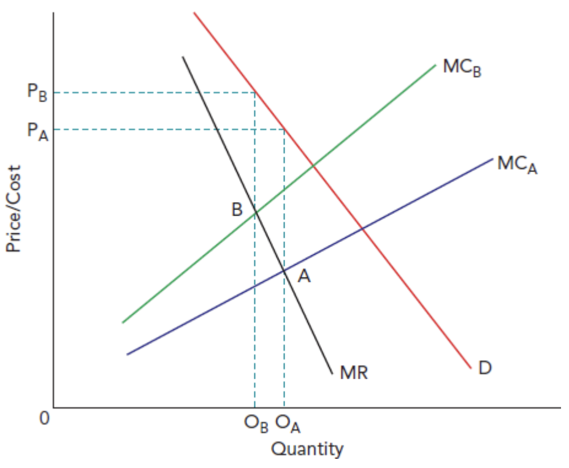

# Other Pricing Policies

## Limit pricing

> **Spec point** — `spcpt_gp5YmCkSTwkk6CTg`

## Limit pricing

- **Limit pricing occurs when a firm sets a price below the short-run profit-maximising level to deter new firms from entering the market**

  - Common in **monopolies and oligopolies**

### Why do firms use limit pricing?

- Prevents entry by making the market appear **unprofitable**
- Protects **long-run supernormal profit**
- Acts as a **barrier to entry**

#### Key features

- The price is set **low enough to discourage entry**, but **high enough to still earn profit**
- Firms often:

  - Increase **output**
  - Exploit **economies of scale**
- More effective when:

  - **Barriers to entry are already high**
  - Incumbent firms have **cost advantages**

#### Limitations

- Firms sacrifice **short-run profit**
- May not work if:

  - New firms have **lower costs**
  - Market demand is **growing rapidly**
- Difficult to sustain in the long run

## What is price leadership?

> **Spec point** — `spcpt_zYTWJdj2QJXy2wts`

## What is price leadership?

- **Price leadership occurs when one dominant firm (price leader) sets the price, and other firms (followers) adjust their prices accordingly**

  - Common in **oligopolistic markets**

### Types of price leadership

- **Dominant firm leadership** → largest firm sets price
- **Barometric leadership** → most informed firm sets the price
- **Collusive leadership** → firms informally agree on a leader

#### Key characteristics

- Firms avoid **price wars**
- Prices are relatively **stable**
- Competition shifts to:

  - **Non-price factors** (branding, quality, advertising)

#### Diagram analysis

- The **price leader (Firm A)**:

  - Produces where **MCₐ = MR**
  - Sets price at **Pₐ** from the demand curve
- The **follower (Firm B)**:

  - Has higher costs → its profit-maximising price would be **Pᵦ**
  - But must **match Pₐ** to remain competitive
- Therefore:

  - Firm B earns **lower profit** (or may make losses)
  - Firm A gains a **cost advantage**

#### Evaluation of price leadership

| **Advantages** | **Disadvantages** |
|---|---|
| - Reduces uncertainty in pricing decisions - Maintains **industry stability** - Can increase **joint profits** | - Smaller firms may be **squeezed out** - May lead to **higher prices for consumers** - Can resemble **collusion** (legal risk) |

## Predatory pricing

> **Spec point** — `spcpt_v7sXJTqjXHX8HSMK`

## Predatory pricing

- **Predatory pricing occurs when a firm deliberately sets a very low (often below cost) price to force competitors out of the market**

### Why do firms use predatory pricing?

- Eliminate **existing competitors**
- Deter **potential entrants**
- Increase **market power**

#### Key features

- Prices may fall **below average cost (AC)**
- Firms make **short-run losses**
- After rivals exit:

  - Firm raises prices
  - Earns **supernormal profit**

#### Limitations

- Very **expensive strategy** (requires financial reserves)
- Competitors may:

  - Survive (e.g. government support)
  - Retaliate with price cuts
- Often **illegal** under competition law
- Hard to prove in practice

> **Case Study**
> **Context**
> 
> In the 2010s, **Uber** expanded rapidly into global ride-hailing markets, including the US, India, and Southeast Asia. It faced strong local competitors such as **Lyft (US)** and **Grab (SE Asia). **Markets were highly competitive with **low switching costs for consumers**
> 
> **Strategy**
> 
> - Uber used **predatory pricing tactics** by:
> 
>   - Offering **heavily discounted fares**
>   - Providing **driver incentives and bonuses**
> - Prices were often set **below cost**, leading to large short-run losses
> - The aim was to:
> 
>   - **Undercut rivals**
>   - Gain **market share quickly**
>   - Force weaker competitors to exit
> 
> **Outcome**
> 
> Several competitors were **driven out or acquired**
> 
> - Uber sold its Southeast Asia operations to **Grab (2018)** after intense losses
> 
> In markets where competition weakened:
> 
> - Prices began to **rise**
> - Uber moved closer to **profitability**
> 
> However
> 
> - Regulators have investigated Uber for **anti-competitive behaviour**
> - The strategy proved **costly and risky**, with sustained financial losses

> **Exam Hint**
> An excellent evaluation point in essays for questions that include predatory pricing is 'Predatory pricing may eliminate competition in the short run, but it involves significant losses and regulatory risk'
