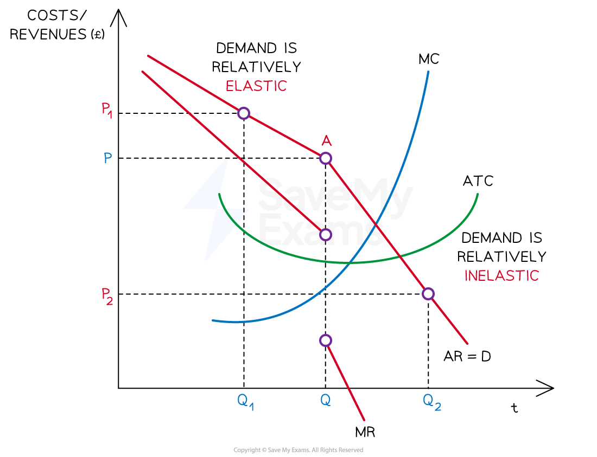

# The Relationship Between PED & Revenue

## PED & total revenue

> **Spec point** — `spcpt_Z9Sc5RZfgMWHcMsr`

## PED & total revenue

- **The total revenue rule states that in order to maximise *****revenue*****, firms should increase the price of products that are price inelastic in demand and decrease prices on products that are elastic in demand **

- The benefits of this rule can be illustrated using a demand curve

  - A shallow curve represents a price-elastic product
  - A steep curve represents a price-inelastic product

*An illustration of price elastic demand where a small decrease in price from P1→P2 causes a large increase in quantity demanded from Q1→ Q2*

#### Elastic diagram analysis

- When a good/service is **price elastic in demand,** there is a greater than proportional increase in the quantity demanded to a decrease in price
- A small decrease in price leads to a larger increase in QD
- **TR is higher **once the price has been **decreased**

  - $(P_{2}\timesQ_{2})>(P_{1}\timesQ_{1})$

*An illustration of price inelastic demand where a large increase in price from P1→P2 causes a small decrease in quantity demanded from Q1→ Q2*

#### Inelastic diagram analysis

- When a good/service is **price inelastic in demand,** there is a smaller than proportional decrease in the quantity demanded to an increase in price
- A large increase in price leads to a smaller decrease in QD
- **TR is higher **once the price has been **increased**

  - $(P_{2}\timesQ_{2})>(P_{1}\timesQ_{1})$

## PED & revenue in a kinked demand curve model

> **Spec point** — `spcpt_t9HKjbqcZSVvzMrw`

## PED & revenue in a kinked demand curve model

- **The kinked demand curve provides one explanation of why prices are stable in oligopolistic competition**
- **Rival firms** react to price changes initiated by a competitor

#### The kinked demand curve

*Prices are rigid at P. Competitors will not raise their price above this price.  If the firm sets its price lower, all competitors will follow suit, and there will be little change to market share *

### Diagram analysis

- A firm produces a quantity of Q and sells at price P
- Total revenue falls for both price increases and price decreases

#### Elastic section (above point A)

- If a firm **increases** its price from **P to P****1**, it is unlikely that rival firms will follow the price increase

  - The firm will lose consumers to rival firms if they charge a higher price
- This means that a small increase in price leads to a greater than proportionate decrease in quantity demanded, resulting in an overall **fall in market share and total revenue**

  - This section of the demand curve is ***elastic***

#### Inelastic section (below point A)

- If a firm **decreases** its price from **P to P****2**, it is likely that rival firms will **respond by also decreasing price**

  - **All firms** in the market will offer the new lower price
  - Market share remains the same. However, **total revenue falls and profits are likely to fall**
- This means that a decrease in price leads to a less than proportionate increase in quantity demanded, resulting in an overall **fall in total revenue**

  - This section of the demand curve is ***inelastic***

- The change in elasticities, brings about a kink in the demand curve at a price level of **P**

  - This creates **price rigidity**,** **as firms tend not to change price due to the anticipated behaviour of competitors (**mutual interdependence)**
- To avoid a price war, firms focus on **non-price competitio**n strategies to increase sales

  - This is why there is a high level of expenditure on **research** and **advertising** in oligopolistic industries
