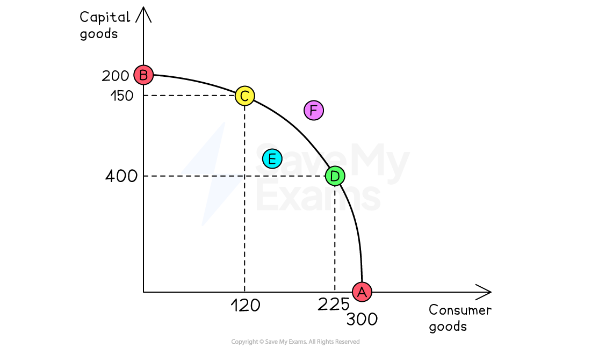
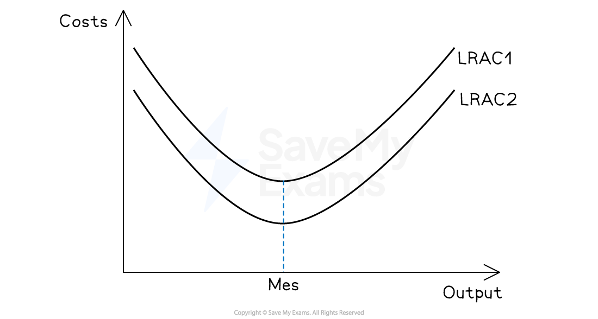

# Allocative & Dynamic Outcomes

## Pareto efficiency

> **Spec point** — `spcpt_2N8gfHKdVVVhHk5m`

## Pareto efficiency

- **Pareto optimality/efficiency **describes a situation where resources are allocated in such a way that it is** impossible to make one person better off without making someone else worse off**
- It represents the **most efficient outcome in terms of resource use and individual welfare**.

### Pareto optimality on a production possibility curve

*A PPF for an economy demonstrating the use of its resources to produce capital or consumer goods*

### Diagram explanation

- This concept is often illustrated using a **Production Possibility Curve (PPC)**, which shows the maximum combinations of two goods that an economy can produce using all available resources efficiently

  - **Any point on the PPC, like A, B, C or D** is considered **Pareto optimal**
  
    - **Increasing the output of consumer goods from C to D would** require **reducing the number of capital goods **produced **by 50**. This **trade-off means resources are still fully utilised**
  - **Any point inside the PPC, like E, **is **Pareto inefficient**
  
    - This means the economy **could produce more of one or both goods without sacrificing the other**
    - For instance, if land is underused or workers are unemployed, the country **could increase production of both goods **without any trade-off

### Pareto improvement

- A **Pareto improvement** occurs when at least one person becomes better off without making anyone else worse off
- These improvements are **desirable because they increase overall welfare **without causing harm

  - If a city **upgrades its public transport system using underutilised funds**, commuters **benefit from faster travel while no one else is negatively affected**

### Real-World trade-offs

- In practice, **achieving Pareto optimality can be difficult**. Many decisions involve winners and losers, even if overall efficiency improves
- Consider the construction of a new **high-speed rail line**:

  - Passengers and businesses **benefit from quicker travel **and better connectivity.
  - However, **some residents may lose their homes **due to land clearance, and others may **experience increased noise or disruption**
  - Although the project may improve national transport efficiency, **it is not Pareto optimal unless those negatively affected are compensated in a way that restores their welfare**

## Dynamic efficiency

> **Spec point** — `spcpt_8vkG7Nfy2DYJZyZX`

## Dynamic efficiency

- **'Dynamic efficiency' refers to improvements in productive efficiency that occur over time**

  - This is a **long-term efficiency** as a result of innovation from a firm **reinvesting its profits**
  - It results in improvements which lower both the **short-run and long-run average total costs**
  - It involves firms **adapting, innovating, and investing **in better methods **to produce more output using fewer resources**
- **Unlike static efficiency**, which focuses on current cost minimisation, dynamic efficiency is about** long-term progress and responsiveness to change**

### How do firms achieve dynamic efficiency?

- Firms often reinvest profits into **research and development, new technologies, or improved training**
- These investments allow them to:

  - Lower production costs
  - Increase output
  - Respond to consumer needs more effectively
  - Stay competitive in evolving markets
  
    - A company producing smartphones may invest in **automated assembly lines** and **AI-driven quality control systems**. Over time, this leads to faster production, fewer defects, and lower costs per unit

#### Visualising dynamic efficiency

- Economists often show dynamic efficiency using **long-run average cost curves**

- Initially, a firm operates on a higher cost curve (LRAC₁)
- **After innovation and investment**, it **shifts to a lower cost curve (LRAC₂)**
- This shift means that **at MES the firm’s costs fall **

#### Example

Consider the **renewable energy sector:**

- **A wind turbine manufacturer **may begin with basic designs and manual assembly
- Over time, it invests in **robotic blade construction**, **advanced materials**, and **predictive maintenance software**
- These **changes reduce costs**, increase reliability, and **allow the firm to produce more turbines with fewer inputs**
- Consumers benefit from **cheaper electricity**, and the economy benefits from **cleaner energy and lower emissions**
