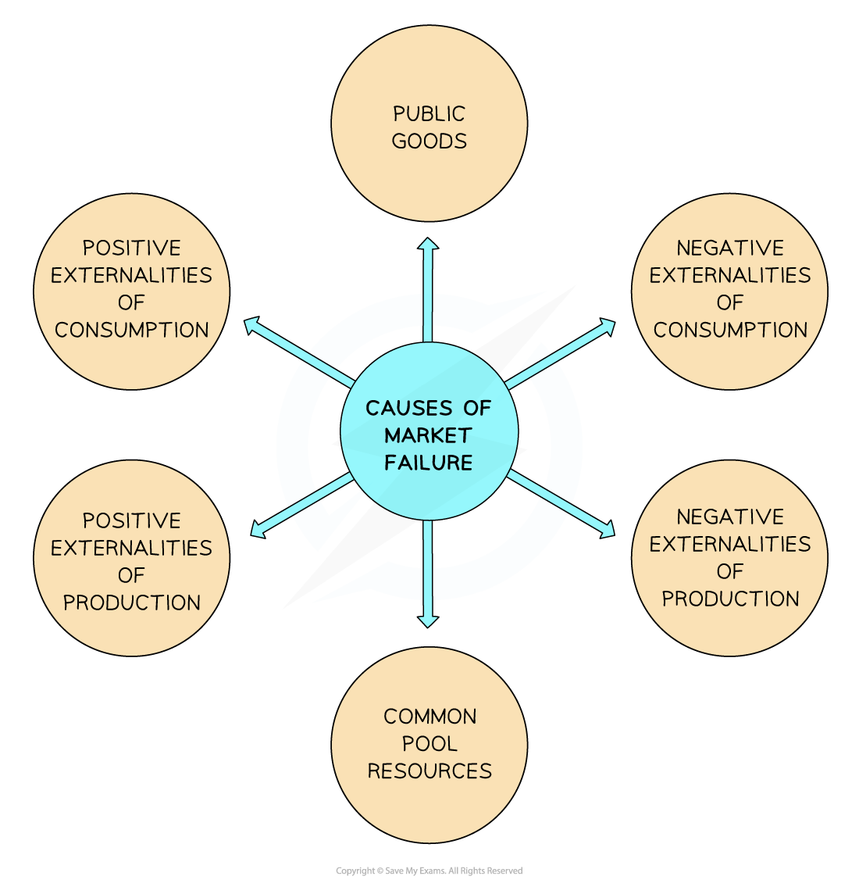

# Market Failure

## What market failure is

> **Spec point** — `spcpt_ybXvn99WMddGsb3B`

## Understanding market failure

- **Market failure occurs when the free market fails to allocate resources efficiently, meaning the quantity of goods produced does not maximise social welfare**
- In a **free marke**t, the price mechanism determines the most **efficient allocation** of scarce resources in response to the competing wants and needs in the marketplace

  - **Scarce resources** are the **factors of production** (land, labour, capital, enterprise)
  - **Free markets** often work very well
- Market failure occurs when markets fail at delivering efficiency

  - Often, there is a **less-than-optimum** allocation of resources from the** point of view of society**
- There are several factors that cause markets to fail

- **From society’s point of view**, in each of these cases, there is a **lack of efficiency in the allocation of resources**

  - Sometimes there is an** over-provision **of goods or services which are harmful ***(demerit goods)*** and therefore an **over-allocation** of the resources (factors of production) used to make these goods/services e.g. cigarettes
  - Sometimes there is an** under-provision **of the goods or services which are beneficial (***public goods*** and ***merit goods***) and therefore an **under-allocation** of the resources (factors of production) used to make these goods or services e.g. education
  - In the case of common pool resources, there is **an overuse **of a finite resource
