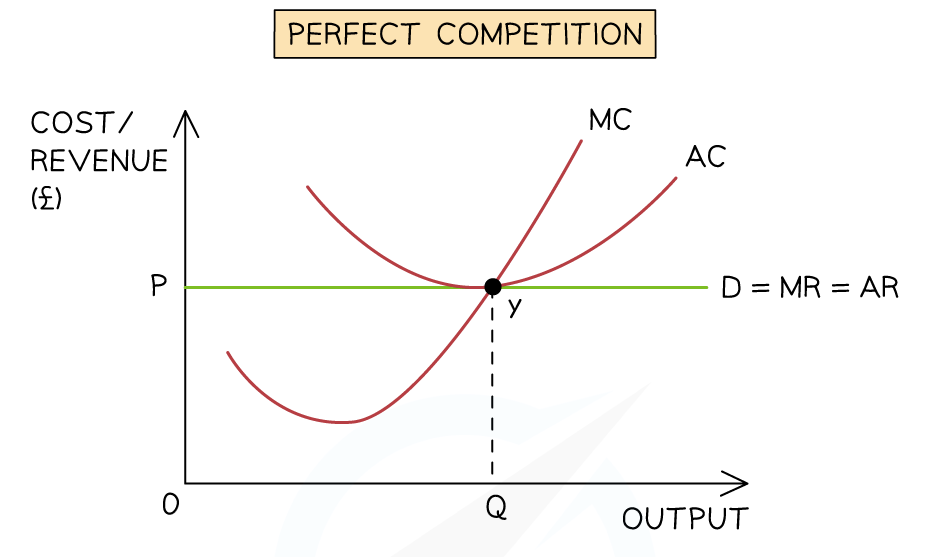

# Productive & Allocative Efficiency

## What efficiency means

> **Spec point** — `spcpt_TBBpc66fZTyCX8QP`

## Introduction to economic efficiency

- 'Economic efficiency' refers to the optimal use of scarce resources
- It involves producing the right goods at the lowest possible cost
- There are two main types: **productive efficiency** and **allocative efficiency**

### 1. Productive efficiency

- Occurs when firms produce at the **lowest possible average cost**
- This happens where **MC = AC**
- At this point, average costs are minimised
- There is **no waste of scarce resources**

*Productive efficiency occurs when firms produce at a level where MC = AC*

- Productive efficiency occurs at the **minimum point of the AC curve**
- This is where **MC intersects AC from below**

> **Exam Hint**
> In long-run analysis, productive efficiency occurs at the **minimum point of the LRAC curve**
> On a **PPC**, productive efficiency occurs at any point on the frontier (full use of resources)

### 2. Allocative efficiency

- Occurs when output reflects **consumer preferences**
- This happens where **price = marginal cost (P = MC)**
- At this point, social welfare is maximised
- There is **no excess demand or excess supply**

*Allocative efficiency occurs where P = MC*

- Demand (AR) represents consumer willingness to pay
- MC represents cost of producing the last unit
- Allocative efficiency occurs where **AR = MC**

> **Exam Hint**
> If P ≠ MC, there is a **welfare loss (deadweight loss)**

### Summary Comparison

| Productive efficiency | Allocative efficiency |
|---|---|
| - MC = AC | - P = MC |
| - Lowest possible cost | - Right goods produced |
| - No resource waste | - Maximum social welfare |
| - Technical efficiency | - Welfare efficiency |

## Global economic efficiency

> **Spec point** — `spcpt_rvvpSYQVQTzcYj6S`

## Global economic efficiency

- Global efficiency is reached when resources across countries are used in the best possible way
- This often involves **international trade,** where nations **specialise** in what they produce most efficiently

  - If Brazil focuses on exporting coffee while Germany **specialises **in engineering equipment, both countries benefit from trade
  - However, **protectionist policies**, such as tariffs or quotas, can disrupt this balance and reduce global efficiency by limiting access to cheaper or better-quality goods

### Examples

- **Lithium**: As demand for electric vehicles grows, efficient extraction and recycling of lithium becomes essential to avoid shortages and environmental damage
- **Freshwater**: In regions facing drought, efficient irrigation systems and water-saving technologies help preserve this vital resource
- **Digital bandwidth**: With rising online activity, efficient use of data networks ensures smoother streaming, communication, and cloud services
- **Trade agreements**: Deals like the UK’s partnership with Australia aim to reduce barriers and improve the flow of goods, enhancing efficiency across borders
