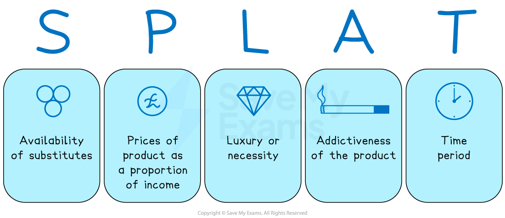
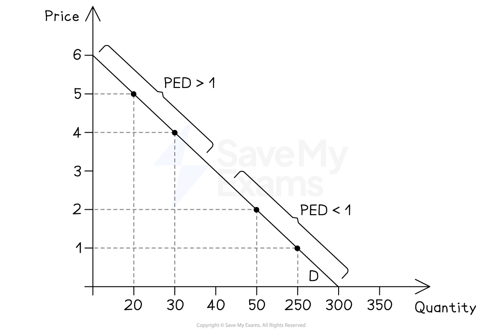

# Price Elasticity of Demand (PED)

## Defining and calculating PED

> **Spec point** — `spcpt_yrzfJbJCcP2GVmJV`

## Defining and calculating PED

- The **law of demand** states that when there is an increase in price, there will be a fall in the quantity demanded

  - Economists are interested **by how much** the **quantity demanded will fall**

- **Price elasticity of demand** reveals how **responsive** the change in **quantity demanded** is to a change in **price**

  - The responsiveness is different for different types of products

### Calculating PED

- **PED can be calculated** using the following formula:

$\text{PED = } \frac{\% \text{change} \text{in} \text{quantity} demanded}{\% \text{change} \text{in} price} = \frac{\% \Delta \text{in} QD}{\% \Delta \text{in} \mathrm{P} }$

- **To calculate a % change**, use the following formula:

$\% \text{Change} = \frac{new \text{value} - \text{old} value}{old value} \times 100$

> **Worked Example**
> A firm **raises** the price of its products from \$10 to \$15. Its **sales fall** from 100 to 40 units per day. Calculate the **PED** of its products
> 
> **Step 1:  Calculate the % change in QD**
> 
> **  **$\% \Delta \text{QD} = \frac{40 - 100}{100} \times 100
> 
> \% \Delta \text{QD} = - 60 \%$** **
> 
> **Step 2: Calculate the % change in P**
> 
> $\% \Delta \mathrm{P} = \frac{15 - 10}{10} \mathrm{x} 100
> 
> \% \Delta \mathrm{P} = 50 \%$
> 
> **Step 3: Insert the above values in the PED formula**
> 
> $\text{PED} = \frac{\% \Delta \text{in} QD}{\% \Delta \text{in} \mathrm{P} } 
> 
> \text{PED} = \frac{- 60}{ 50} 
> 
> \text{PED} = - 1.2
>$
> 
> **Step 4: Final answer** = -1.2

> **Exam Hint**
> If you are given the PED value and the %Δ in Price  and then asked to find the %Δ in Qd, follow the standard maths procedure as follows:
> 
> 1. Substitute the values provided into the equation
> 2. Substitute X for %Δ in Qd
> 3. Solve for X
> 
> Remember the phrase 'Ducks on the Pond' so that you always put the percentage change in demand (D for ducks) on top of the percentage change in price (P for pond)

> **Worked Example**
> The price elasticity of demand for smartphones is -2. It can be concluded that a 10% reduction in their price would be a percentage change in demand of:
> 
> A. -7.4%
> 
> B. -20.0%
> 
> C. +7.4%
> 
> D. +20.0%
> 
> **Step 1: Substitute the values provided into the equation**
> 
> $\text{PED} = \frac{\% \Delta \text{in} QD}{\% \Delta \text{in} \mathrm{P} }$
> 
> **Step 2: Substitute X for %Δ in Qd**
> 
> $+ 2 = \frac{ \mathrm{X} }{- 10 \%}$
> 
> **Step 3. Solve for X**
> 
> **   **$X = 20 \%$
> 
> Quantity demanded increases by 20%

## Interpreting PED values

> **Spec point** — `spcpt_f32xhHN5Zssxj6Hy`

## Interpreting PED values

- The results of the price elasticity of demand calculation tell us **how responsive consumers are to a change in price**

### 1. Price elastic demand

- The value of PED: -**1 → ∞**
- The percentage change in quantity demanded is **more than proportional** to the percentage change in price

*Consumers are very responsive to price changes*

- Consumers are **very responsive** to price changes

  - For example, a small price cut on airline tickets in Malaysia can lead to a large rise in bookings

### 2. Price inelastic demand

- The value of PED: **0 → -1**
- The percentage change in quantity demanded is **less than** proportional to the percentage change in price

*Price inelastic demand*

- Consumers are relatively unresponsive to price changes

  - They may consider the product to be a **necessity**
- For example, cigarette sales in Indonesia fall only slightly when prices rise – demand is inelastic

### 3. Perfectly elastic demand

- The value of PED: **∞**
- The quantity demanded will **fall to zero** with any percentage change in price (highly theoretical elasticity)

*Perfectly elastic demand*

- Buyers will only purchase at **one price**, and any change causes demand to drop to zero
- For example, on global stock markets, traders may **only buy a share at a specific price**, not higher

### 4. Perfectly inelastic demand

- The value of PED: **0**
- The quantity demanded is **completely unresponsive** to a change in price (very theoretical value)

*Consumers are entirely unresponsive to a change in price*

- For example, a patient needing life-saving insulin in India will buy it regardless of price

### 5. Unitary elasticity

- The value of PED: **1**
- The percentage change in quantity demanded is **exactly equal** to the percentage change in price

*Consumer respond proportionally to any price changes*

- A 5% rise in the price of a basic mobile plan in Egypt causes a 5% drop in subscriptions

> **Exam Hint**
> The PED value will **always be negative,** so the answer must clearly state this. However, to explain the degree of elasticity, ignore the minus sign to apply the values
> 
> When the PED value is **closer to zero, **it is becoming **very inelastic**, e.g., (-)0.1. The **higher the value is above 1**, the more elastic demand becomes. e.g., (-)5

## The determinants of PED

> **Spec point** — `spcpt_jVxdm56w639nMk5F`

## The determinants of PED

- Some products are more responsive to **changes in prices** than other products
- The factors that determine responsiveness are called the **determinants of PED** and include

*SPLAT - An acronym to help recall the determinants of PED*

### S – Availability of substitutes

- Good availability of substitutes results in a **higher value of PED** (relatively elastic)

### P – Price of product as a proportion of income

- The lower the proportion of income the price represents, the** lower the PED value will be**
- Consumers are less responsive to price changes on cheap products (relatively inelastic)

### L – Luxury or necessity

- Luxury goods are more elastic because they are not essential, while necessities are more inelastic because consumers have no choice but to buy them.

### A - Addictiveness of the product

- Addictiveness turns products into necessities, resulting in a **low value of PED** (relatively inelastic)

### T – Time period

- In the short term, consumers are less responsive to price increases, resulting in a **low value of PED **(relatively inelastic)
- Over a longer period of time, consumers may feel the price increase more and will then look for substitutes, resulting in a **higher value of PED** (relatively elastic)

## Variation in PED along a straight line curve

> **Spec point** — `spcpt_CPysN3wfkmyr55Nd`

## Variation in PED along a straight-line curve

- PED **varies along the length of a straight-line demand curve**
- The **slope is constant**, but **elasticity changes**

*The PED varies along a straight line curve*

### Diagram analysis

#### Top of the demand curve

- Demand is **price elastic**
- PED > 1
- Small price changes cause large percentage changes in quantity demanded

#### Middle of the demand curve

- Demand is **unit elastic**
- PED = 1
- Percentage change in price equals percentage change in quantity demanded

#### Bottom of the demand curve

- Demand is **price inelastic**
- PED < 1
- Price changes cause relatively small percentage changes in quantity demanded

> **Exam Hint**
> Do not confuse **slope** with **elasticity**
> 
> Same slope ≠ same elasticity
