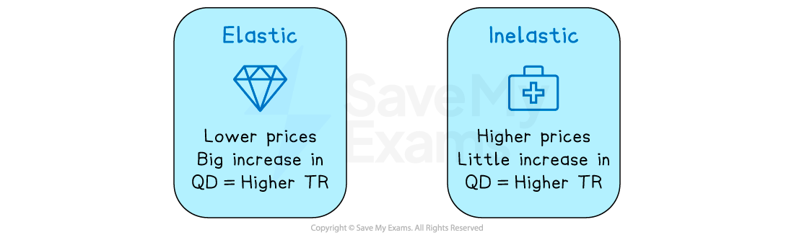

# Using Price Elasticity of Demand (PED)

## PED and total expenditure/revenue

> **Spec point** — `spcpt_MhYr7JvpVXdkWH3Z`

## PED and total expenditure/revenue

- **Revenue** is the amount of money a firm receives from selling its goods or services

  - Total revenue = price x quantity
  - Also referred to as **consumer expenditure** from the buyer’s perspective
- The **total revenue rule** states that in order to **maximise revenue**, firms should **increase** the price of products that are **inelastic** in demand, and **decrease prices** on products that are **elastic** in demand

*The total revenue rule*

### 1. Lowering price for elastic demand

- The demand curve is very **elastic** in this market

*Price elastic demand where a small decrease in price from P1→P2 causes a large increase in revnue*

#### Diagram analysis

- When a good or service is **price elastic in demand,** there is a greater than proportional increase in the quantity demanded to a decrease in price
- **Total revenue is higher **once the price has been **decreased from P****1 ****to P****2**

  - (P2 x Q2) > (P1 x Q1)

### 2. Raising price for inelastic demand

- The demand curve is very **inelastic** in this market

*Price inelastic demand where a large increase in price from P1→P2 raises revnue*

#### Diagram analysis

- The demand curve is very inelastic in this market
- When a good/service is **price inelastic in demand,** there is a smaller-than-proportional decrease in the quantity demanded to an increase in price
- **Total revenue is higher **once the price has been **increased**

  - (P2 x Q2) > (P1 x Q1)

> **Worked Example**
> A firm **raises** the price of its products from £10 to £15. Sales** have fallen** from 100 to 40 units per day. Explain if the firm has made the correct decision
> 
> **Step 1: Calculate the initial sales revenue**
> 
> `Sales space Revenue space equals space Price space of space product space straight X space Quantity space sold
> space space space space space space space space space space space space space space space space space space space space space space space space space equals £ 10 space straight x space 100
> space space space space space space space space space space space space space space space space space space space space space space space space space equals space £ 1 comma 000
> `
> 
> **Step 2: Calculate the sales revenue after the price change**
> 
> `Sales space Revenue space equals space Price space of space product space straight X space Quantity space sold
> space space space space space space space space space space space space space space space space space space space space space space space space space equals £ 15 space straight x space 40
> space space space space space space space space space space space space space space space space space space space space space space space space space equals space £ 600`
> 
> **Step 3: Explain the decision**
> 
> - By raising the price, **total revenue** has fallen by £400
> - This indicates that the product is **price elastic** in demand
> - The firm **should have lowered their price** in order to maximise revenue

> **Exam Hint**
> A common error students make is to say that when prices increase and the product is inelastic in demand, the quantity demanded does not fall.** It does**, but it is a **less than proportional change** than the increase in price.
> 
> When governments tax demerit goods such as cigarettes, the increase in price is greater than the decrease in QD, but QD still falls.

## Using PED in decision-making

> **Spec point** — `spcpt_y3bnbGFQsS65qFC6`

## Using PED in decision-making

### 1. Strategic pricing decisions

- Businesses can use PED insights to guide pricing strategies:

  - If demand is **inelastic**, raising prices can boost revenue
  - If demand is **elastic**, lowering prices may increase sales volume and overall revenue

### 2. Making demand less sensitive to price

- Firms often aim to reduce price sensitivity to strengthen revenue potential. Strategies include:

  - **Persuasive advertising:** Highlighting unique benefits or endorsements to make products more appealing than alternatives
  - **Branding:** Creating a strong brand identity to differentiate from competitors and build customer loyalty
  - **Mergers and acquisitions:** Expanding market control by joining forces with competitors
  - **Monopoly creation:** Securing exclusive rights through patents or regulation to limit competition and control pricing
- **Knowledge of PED** is important **to firms** seeking to **maximise their revenue**

  - Sales revenue will be maximised
  
    - If their product is **price inelastic in demand, **they should **raise their prices**
    - If their product is **price elastic** in demand, then they should **lower their prices**
    - Firms **lower their prices **for **elastic** sections of their market, e.g., off-peak train travel
    - Firms **increase prices** for **inelastic** sections of their market, e.g., peak hour train travel

### 3. The implications of PED for governments

- **Knowledge of PED** is important **to Governments **with regard to **taxation and subsidies**

  - If governments **tax price-inelastic products**, they can raise tax revenue without harming firms too much
  
    - Consumers are less responsive to price changes so **firms will pass on the tax** to the consumer
  - If Governments **subsidise** price-elastic-in-demand products, there can be a **greater-than-proportional increase** in the quantity demanded
  
    - This strategy is especially good for encouraging consumption of ***merit goods*** such as electric vehicles
