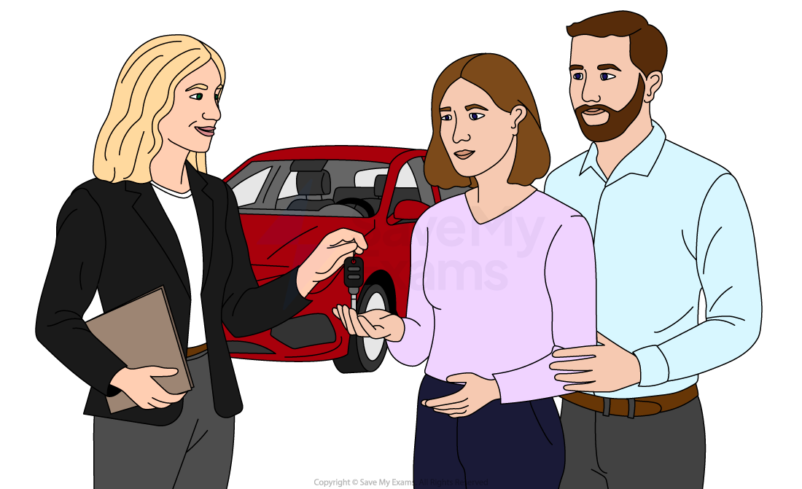

# Asymmetric Information & Moral Hazard

## Information failure

> **Spec point** — `spcpt_Qf47yCDQ96BJs5bH`

## Information failure

- Information failure occurs when buyers and sellers **do not have sufficient information** to make informed decisions in a market.

  - Perfectly competitive markets assume **perfect information**
  - This means buyers and sellers have **full knowledge of prices, quality, and product characteristics**
  - In reality, one party often has **more information than the other**
  - This creates **asymmetric information**, which can lead to **inefficient market outcomes**

### Asymmetric information

*Asymmetric information exist in every used car sale. Sellers always know more about the car than the buyers*

- **Asymmetric information occurs when one party in a transaction has more information than the other.**

  - This imbalance can distort market decisions
  - Buyers may purchase goods without fully understanding their quality or risks
  - Sellers may exploit their informational advantage

#### Pharmaceutical example

- A pharmaceutical company may know about **potential side effects of a drug** that consumers are unaware of

  - Consumers may therefore **purchase more of the product than is socially optimal**
- Asymmetric information can lead to problems such as **adverse selection** and **moral hazard**.

## Adverse selection and moral hazard

> **Spec point** — `spcpt_DkdTf6kmb43jhkRq`

## Adverse selection and moral hazard

- Adverse selection and moral hazard arise in the presence of asymmetric information, where one party has more information than the other in an economic transaction

### Adverse selection

- **Adverse selection occurs when individuals with higher risk are more likely to participate in a market.**

  - It typically occurs **before a transaction takes place**
  - The party with less information cannot accurately distinguish between **high-risk and low-risk individuals**

#### Example: Insurance markets

- Individuals who expect to make claims are **more likely to buy insurance**
- Insurers cannot perfectly identify these higher-risk individuals
- As a result, insurers may **raise premiums**
- This can lead to:

  - **Low-risk individuals leaving the market**
  - A higher proportion of **high-risk customers**
  - Further increases in premiums
- This process can cause **market failure**.

#### Reducing adverse selection

- Firms may use strategies such as:

  - **Risk assessments and background checks**
  - **Different pricing for different risk groups**
  - **Incentives for low-risk customers**

### Moral hazard

- **Moral hazard occurs when individuals take greater risks because they are protected from the consequences of those risks.**

  - It usually occurs **after a transaction has taken place**
- The protected party may change their behaviour because they do not bear the full cost of risky actions

#### Example

- A driver with **comprehensive car insurance** may drive less carefully because insurance will cover accident costs
- This can lead to:

  - **Higher claim rates**
  - Increased costs for insurers
  - **Inefficient market outcomes**

#### Reducing moral hazard

- Firms often introduce mechanisms such as:

  - **Deductibles or excess payments**
  - **No-claims bonuses**
  - **Monitoring and policy conditions**
- These measures encourage individuals to **take greater responsibility for risk**
