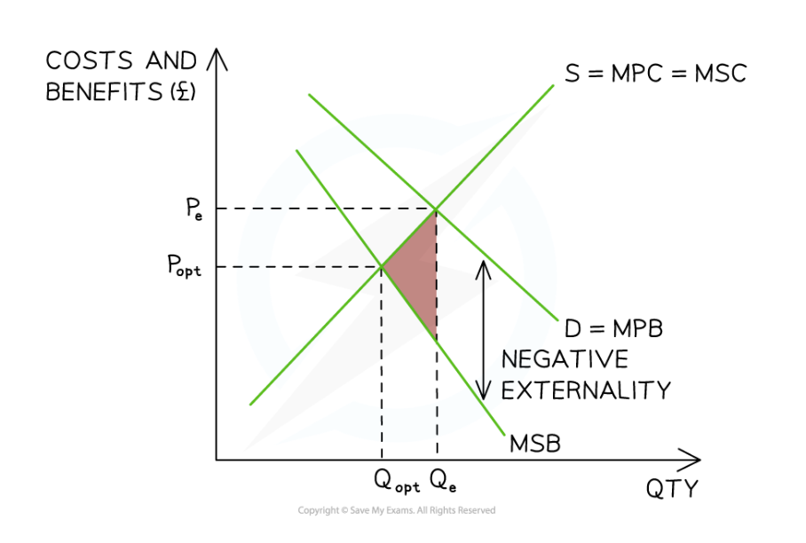

# Negative Externalities

## Negative externalities of consumption

> **Spec point** — `spcpt_CqqTCh9NH92JQSMy`

## Negative externalities of consumption

- **Negative externalities of consumption occur when consuming a good or service imposes costs on third parties who are not involved in the transaction**
- Consumers only consider their **private costs**, ignoring the **external costs to society**
- As a result, the market **over-consumes** these goods, leading to **market failure**
- If external costs were considered, the socially optimal level of output would be lower
- Examples include cigarettes, alcohol, fatty foods and single-use plastics, which impose health or environmental costs on society

*External costs of consumption result in overconsumption, as shown by the gap between Qopt and Qe*

### Diagram analysis

- The **MSC is assumed to equal the MPC**, as the externality arises from the **consumption (demand) side** of the market
- The **free-market equilibrium** occurs at **PeQe**, where **MPB = MSC**, representing the **private optimum**
- Because consumers ignore the **external costs of consumption**, the **MPB lies above the MSB**
- The **socially optimal level of output** occurs where **MSB = MSC**, at **PoptQopt**, which is **allocatively efficient**
- As a result, the market produces **too much output**, creating **over-consumption equal to Qe − Qopt**
- This generates a **welfare loss (deadweight loss)** shown by the **pink triangle**

  - To achieve **social efficiency**, output must fall so that **MSB = MSC**
  - This creates a role for **government intervention**, such as taxes, regulation or legislation

> **Worked Example**
> The existence of negative externalities in consumption results in a misallocation of resources. This is because at the **free market level of output:**
> 
> A. The marginal social benefit exceeds the marginal social cost
> 
> B. The marginal private cost equals the marginal social cost.
> 
> C. The marginal social benefit is less than the marginal social cost
> 
> D. The marginal social cost is less than the marginal private benefit
> 
> **Answer**
> 
> **C. The marginal social benefit is less than the marginal social cost**
> 
> In the free market, resources are allocated at the **private optimum**, where:
> 
> **MPB = MSC**
> 
> - Consumers only consider their **private benefits** and ignore the **external costs of consumption**
> - As a result, the **marginal social benefit (MSB)** is lower than the **marginal social cost (MSC)**
> - This leads to **over-consumption of the good**, creating a **misallocation of resources** and **market failure**

## Negative externalities of production

> **Spec point** — `spcpt_KrPprxN7NMHqxK5V`

## Negative externalities of production

- **Negative externalities of production** are often created during the production of a good or service

  - These external costs arise from the production of the good or service and result in a **negative external impact **on a **third party**
- As only the **private costs are considered** by producers and not the **external costs, **firms wil**l over-produce** these goods and services, causing ***market failure***

  - If external costs were considered, the **socially optimal level **of output would be lower
  - E.g., the impact of air pollution, water contamination, noise pollution and health problems on local communities

*External costs of production lead to over-production equal to Qe − Qopt*

### Diagram analysis

- **MSB is assumed to equal MPB**, as the externality arises from the **production (supply) side** of the market
- The **free-market equilibrium** occurs at **PeQe where MPC = MSB**, representing the **private optimum**
- Because firms ignore the **external costs of production**, the **MSC lies above the MPC**
- The **socially optimal level of output** occurs where **MSC = MSB**, at **PoptQopt**, which is **allocatively efficient**
- Since the market produces **Qe instead of Qopt**, there is **over-production equal to Qe − Qopt**
- This creates a **welfare loss (deadweight loss)** shown by the **shaded triangle**
- To achieve **social efficiency**, output must fall so that **MSC = MSB**
- **Government intervention**, such as taxes, regulation or legislation, can reduce over-production and move the market closer to the socially efficient outcome

> **Exam Hint**
> You should remember that there will be two supply curves when the external benefit or cost is on the producer side
> 
> When the benefit or cost is on the consumer side, there will be two demand curves
> 
> The direction of the triangle that shows the DWL should always point towards the social optimum equilibrium
