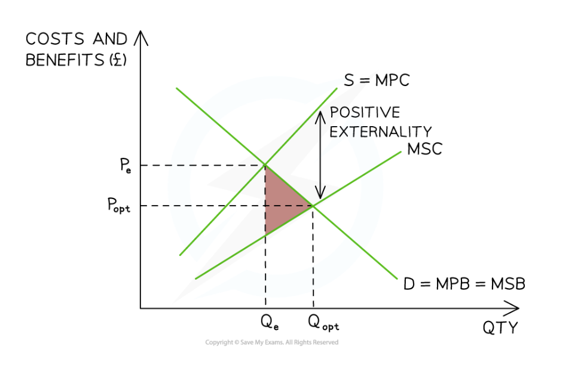

# Positive Externalities

## Positive externalities

> **Spec point** — `spcpt_NqW65NRDZp5ckH8S`

## Positive externalities

- **Positive externalities/external benefits occur when the social benefits of an economic transaction are greater than the private benefits**

  - A **private benefit** for the consumer is **what they actually gain** from consuming a good/service
  - An **external benefit (positive externality)** is the benefit not factored in to the economic activity (for example, someone who studies law enjoys private benefits but society benefits from having strong legal institutions)
- **Private benefit + external benefit = social benefits**

## Positive externalities of consumption

> **Spec point** — `spcpt_BX7M97rbvKQwbvPN`

## Positive externalities of consumption

- **Positive externalities of consumption** are created during the consumption of a good or service

  - The externalities are caused by **consumer demand **and result in** **a **positive external impact **on a **third party**
- As only the **private costs** **are considered** by consumers and not **the external** costs, individuals will **under-consume **these goods/services, causing a **market failure**

  - If the **external benefits **were considered, the demand **would increase, **and the goods would be sold at a higher price
  - An example of a **positive externality of consumption **is vaccinations. These protect those that receive them but also prevent the spread of disease to others around them. Other examples include education, healthcare and healthy eating

*External benefits of consumption (positive externality) result in an under-consumption equal to Qopt - Qe*

### Diagram analysis

- The **MSC is assumed to equal the MPC**, as the externality arises from **consumption rather than production**
- The **socially optimal level of output** occurs where **MSB = MSC**, at **Pₒₚₜ Qₒₚₜ**, which is **allocatively efficient**
- The **free-market equilibrium** occurs at **PₑQₑ where MPB = MSC**, representing the **private optimum**
- Because **MPB < MSB**, consumers ignore the **external benefits of consumption**

  - As a result, the market produces **too little output**, creating **under-consumption equal to Qₒₚₜ − Qₑ**
  - This leads to a **welfare loss (*****deadweight loss*****)** shown by the **pink triangle**
  - To achieve ***allocative efficiency***, output must increase so that **MSB = MSC**
- This creates a role for **government intervention** (e.g. subsidies or public provision) to reduce the welfare loss

## Positive externalities of production

> **Spec point** — `spcpt_MBhrBg3h5PyK6cgn`

## Positive externalities of production

- **Positive externalities of production occur when producing a good or service creates benefits for third parties who are not directly involved in the transaction**
- These **external benefits** arise from the **production process itself**
- Producers only consider the **private benefits of production**, not the external benefits to society
- As a result, the market **under-provides** these goods and services, creating **market failure**
- For example, **beekeeping increases pollination**, which can improve crop yields for nearby farmers

#### Diagram: Positive externality of production

*External benefits of production (positive externality) resulting in an under-production equal to Qopt - Qe*

### Diagram analysis

- The **MSB is assumed to equal the MPB**, as the externality arises from the **production (supply) side** of the market
- The **free-market equilibrium** occurs at **PeQe**, where **MPC = MSB**, representing the **private optimum**
- Producers do not consider the **external benefits of production**, so the **MSC is lower than the MPC**
- The **socially optimal level of output** occurs where **MSC = MSB**, at **PoptQopt**, which is **allocatively efficient**
- Because the market produces only **Qe**, there is **under-provision equal to Qopt − Qe**
- This results in a **welfare loss (deadweight loss)** shown by the **pink triangle**
- To achieve **social efficiency**, output must increase so that **MSC = MSB**
- This creates a role for **government intervention**, such as subsidies or regulation, to encourage greater production
