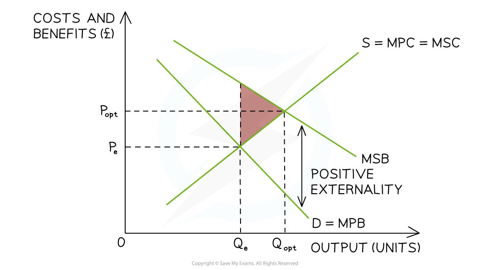
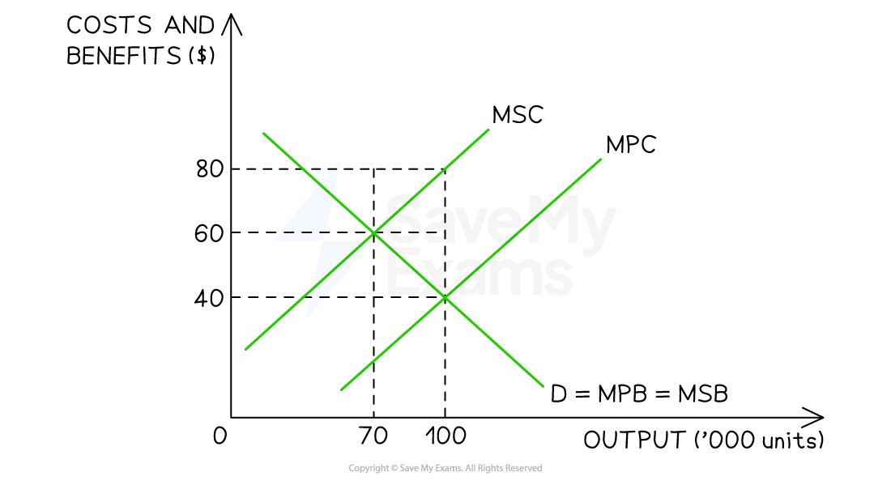

# Understanding Welfare Loss

## Understanding the deadweight welfare loss

> **Spec point** — `spcpt_HS76Xy9NmH5bPSTm`

## Understanding the deadweight welfare loss

- **Deadweight welfare loss occurs when resources are not allocated at the socially efficient level of output where MSB = MSC**

  - If **MSB > MSC**, output is **too low**, meaning society would benefit from **greater production or consumption**
  - If **MSC > MSB**, output is **too high**, meaning society would benefit from **less production or consumption**
  - In both cases, the difference between **MSB and MSC creates a welfare loss to society**

#### Calculating the welfare loss that is caused by the positive externality of consumption

**Step 1: Identify the area of welfare loss (potential welfare gain)**

- This product is **underconsumed –** there should be higher levels of consumption
- Welfare loss to society is the triangle formed by the arrowhead which points forwards towards the socially optimal quantity
- **Assume Qe = 70,000 **and **Qopt = 100,000**
- **Assume Pe = £40** and **Popt = £80**

**Step 2: Calculate the area of the triangle**

$\text{Welfare} \text{loss} ( \text{potential} \text{welfare} \text{gain} ) = 1 \frac{1}{2} \mathrm{x} \text{base} \mathrm{x} \text{height}
\text{Welfare} \text{loss} ( \text{potential} \text{welfare} \text{gain} ) = \frac{( 100 , 000 - 70 , 000 ) \mathrm{x} ( \pounds 80 - \pounds 40 )}{2}$

$\mathrm{Welfare} \mathrm{loss}(\mathrm{potential} \mathrm{welfare} \mathrm{gain})=\frac{30,000x40}{2}\,\,\mathrm{Welfare} \mathrm{loss}(\mathrm{potential} \mathrm{welfare} \mathrm{gain})=\frac{30,000x40}{2}$

$Welfare \text{loss} \text{stretchy} ( \text{potential} \text{welfare} \text{gain} \text{stretchy} ) = \pounds 600 , 000$

- **More factors of production** should be allocated to producing the optimal quantity, as **societal welfare will be gained** (pink triangle)
- There is an opportunity for **government intervention** (subsidies, partial provision, etc.) to force this market to be more **socially efficient**
- Any intervention that **gains welfare** will be beneficial

#### Calculating the welfare loss that is caused by the negative externality of production

**Step 1: Identify the area of welfare loss**

- The good is overproduced (Qe > Qopt), so output should fall to the socially optimal quantity
- Deadweight welfare loss is the triangular area between the MSC and MSB curves between Qopt and Qe

  - Qopt = 70,000 (social optimum where MSC = MSB)
  - Qe = 100,000 (free-market equilibrium where MPC = MPB)

**Step 2: Calculate the area of the triangle**

$\text{Welfare} \text{loss} = \frac{( 100 , 000 - 70 , 000 ) \mathrm{x} ( \pounds 80 - \pounds 40 )}{2} 

\text{Welfare} \text{loss} = \frac{30 , 000 \mathrm{x} 40}{2} 
 

\text{Welfare} \text{loss} = \pounds 600 , 000$

- **Less factors of production** should be allocated to producing the optimal quantity, as **societal welfare will be lost**
- There is an opportunity for **government intervention** (indirect taxes, regulation, etc.) to force this market to be more **socially efficient**
- Government intervention, such as taxes or regulation, can reduce over-production and move the market closer to the socially efficient outcome
