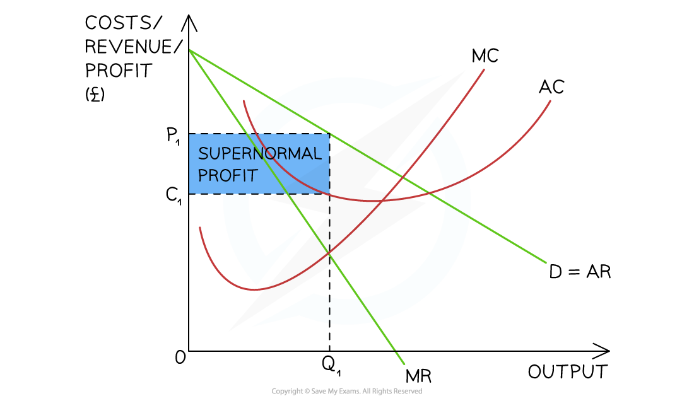

# Cartels

## Conditions for cartels

> **Spec point** — `spcpt_4WBDJQnPWMVVc4Z8`

## Conditions for cartels

- **A cartel is formed when firms engage in collusive behaviour, cooperating to fix prices and restrict output**

  - They cease to compete as vigorously as they can
  - The incentive to collude in these markets is high

### A collusive oligopoly

*When firms join together in collusion, they agree on a price and act like a monopoly in the industry by removing competition  *

#### Diagram analysis

- Five firms meet secretly and **agree to fix prices** at a particular level

  - The five firms present in the market **as a single firm**
- The firm produces at the **profit maximisation level of output,** where **MC = MR (Q****1****)**

  - At this level, **AR (P****1****) > AC (C****1****)**
  - The cartel is making higher levels of **supernormal profit**
- A ***cartel*** is the most restrictive form of collusion and is illegal in most countries

  - The consequences of overt collusion include:
  
    - **Higher prices** for consumers
    - **Less output **in the market
    - Poor quality products and/or customer service
    - Less investment in innovation
- Overt collusion often happens in the following ways:

  - ***Price fixing***
  - Setting output **quotas,** which limit supply and naturally result in price increases
  - Agreements to block new firms from entering the industry

## Conditions for an effective cartel

> **Spec point** — `spcpt_X7XfJNktB3drQPrX`

## Conditions for an effective cartel

- **Small number of firms in the market**

  - Fewer firms makes monitoring and enforcing agreements easier
  - Large numbers of firms increase the incentive to cheat
- **High barriers to entry**

  - New firms find it difficult to enter the market, reducing the threat of competition and helping existing cartel members maintain control
- **Price stability among members**

  - Members must resist the temptation to undercut each other. A price war—where one firm lowers prices to gain market share—can quickly unravel the cartel
- **Similar cost structures**

  - If all members have similar production costs, they benefit equally from the agreed price. Large cost differences can lead to dissatisfaction and defection
- **Presence of a dominant firm**

  - A strong leader within the cartel can enforce discipline, coordinate actions, and deter cheating among members
- **Legal environment that tolerates cartels**

  - In regions like the EU and USA, cartels are illegal because they restrict competition and harm consumers. Legal enforcement can dismantle cartels quickly

> **Case Study**
> **Cartels in the trucking industry**
> 
> Between **1997 and 2011**, several major truck manufacturers in Europe formed a cartel to coordinate prices for medium and heavy trucks. The firms involved included **MAN, Volvo/Renault, Daimler (Mercedes-Benz), Iveco and DAF**. Together these companies controlled around **90% of the European truck market**
> 
> 
> 
> *Cartel behaviour in the trucking industry*
> 
> **Collusive behaviour**
> 
> The firms **secretly agreed to fix truck prices** and coordinate the timing of price increases. Senior managers communicated regularly to share pricing information and avoid competing aggressively
> 
> **Outcome**
> 
> In **2016**, the **European Commission fined the companies €2.93 billion**, one of the largest cartel fines ever issued. The cartel resulted in **higher prices for transport firms and reduced competition** across the European truck market
