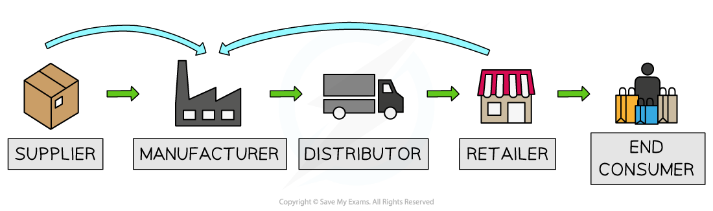

# External Growth

## External growth

> **Spec point** — `spcpt_9n243RkTcTXRrzgz`

## External growth

- External growth occurs when a firm expands by **merging with or acquiring another firm**

  - This is often faster than internal growth

### Types of external growth

- **External (inorganic) growth** usually takes place in one of three ways

  - Horizontal, vertical or conglomerate integration

*A diagram that illustrates how a firm can grow through forward or backward vertical integration*

#### 1. Horizontal integration

- **Horizontal Integration involves a merger or takeover with a firm in the same market at the same stage of production**

  - E.g., a clothing retailer takes over another clothing retailer
- **Benefits may include:**

  - increased market share
  - reduced competition
  - greater economies of scale

#### 2. Forward vertical integration

- **involves a *****merger***** or *****takeover***** with a firm further forward in the supply chain**

  - E.g., a dairy farmer merges with an ice-cream manufacturer
- **Benefits of forward vertical integration**

  - **Greater control over distribution and sales**
  
    - The firm can control how products are marketed, priced and sold to consumers
  - **Higher profit margins**
  
    - By removing intermediaries such as wholesalers or retailers, the firm keeps a larger share of the final sale price
  - **Better market information**
  
    - Direct contact with consumers provides insights into **customer preferences and demand trends**

> **Case Study**
> **Apple's growth**
> 
> Apple produces products such as the **iPhone, iPad and Mac computers**. In many technology markets, manufacturers rely on **independent retailers or network providers** to sell their products. This limits the firm’s control over **pricing, marketing and customer experience**.
> 
> 
> 
> *Apple used forward vertical integration to grow and increase profit margins*
> 
> **Growth strategy**
> 
> Apple pursued **forward vertical integration** by expanding its own network of **Apple Stores** and online retail platforms. By selling directly to consumers, Apple moved **forward in the supply chain**, taking control of the **distribution and retail stages**. This allowed the firm to manage how its products are displayed, marketed and supported.
> 
> **Outcome**
> 
> This strategy has helped Apple maintain **strong control over branding, pricing and customer experience**. Apple also benefits from **higher profit margins**, as it no longer shares revenue with independent retailers. Direct contact with consumers also provides valuable **market information about customer preferences**.

#### 3. Backward vertical integration

- **Involves a merger or takeover with a firm further backward in the supply chain**

  - E.g., an ice-cream retailer takes over an ice-cream manufacturer
- **Benefits of backward vertical integration**

  - **Greater security of supply**
  
    - The firm reduces the risk of supply disruptions from external suppliers
  - **Lower input costs**
  
    - Producing inputs internally can reduce purchasing costs and improve cost control
  - **Improved production coordination**
  
    - Better control over inputs can improve **efficiency, quality and production planning**

#### 4. Conglomerate integration

- Involves a merger or takeover with a firm in an unrelated market

  - E.g., a food manufacturer buying a football club
- **Benefits of conglomerate integration**

  - **Risk diversification**
  
    - Operating in multiple unrelated industries reduces dependence on a single market
  - **Access to new growth opportunities**
  
    - Firms can enter profitable industries and expand their sources of revenue

> **Exam Hint**
> Look carefully at the two types of businesses you have been presented with and make a judgement about the most likely reason they have chosen to grow

## Reasons for integration

> **Spec point** — `spcpt_PBx4pFTJzMjQ53gf`

## Reasons for integration

- Firms pursue mergers and takeovers for several reasons

| Reason | Explanation |
|---|---|
| **Increase market power** | - Larger firms may gain greater control over **price and output** - Horizontal mergers can reduce the number of competitors |
| **Achieve economies of scale** | - Larger firms may reduce **average costs** through increased output    - For example through bulk purchasing or specialised management |
| **Reduce competition** | - Horizontal integration may remove rival firms from the market |
| **Improve supply chain control** | - Vertical integration allows firms to control **suppliers or distribution channels** |
| **Diversify risk** | - Conglomerate mergers allow firms to spread risk across **different industries or markets** |
| **Increase market share** | - Integration can rapidly increase a firm's share of the market |

## Consequences of integration

> **Spec point** — `spcpt_2FM3Y32jbzVygksD`

## Consequences of integration

- Integration can have several outcomes, either positive or negative, or a combination of the two

| Consequence | Explanation |
|---|---|
| **Greater economies of scale** | - Larger firms may operate more efficiently and reduce average costs |
| **Increased market power** | - Firms may gain greater influence over prices and market conditions |
| **Reduced competition** | - Mergers may reduce the number of firms in the market |
| **Possible diseconomies of scale** | - Very large firms may face management or coordination problems |
| **Integration difficulties** | - Merging different firms may create organisational or cultural conflicts |
| **Regulatory scrutiny** | - Governments or competition authorities may investigate large mergers to prevent excessive market power |
