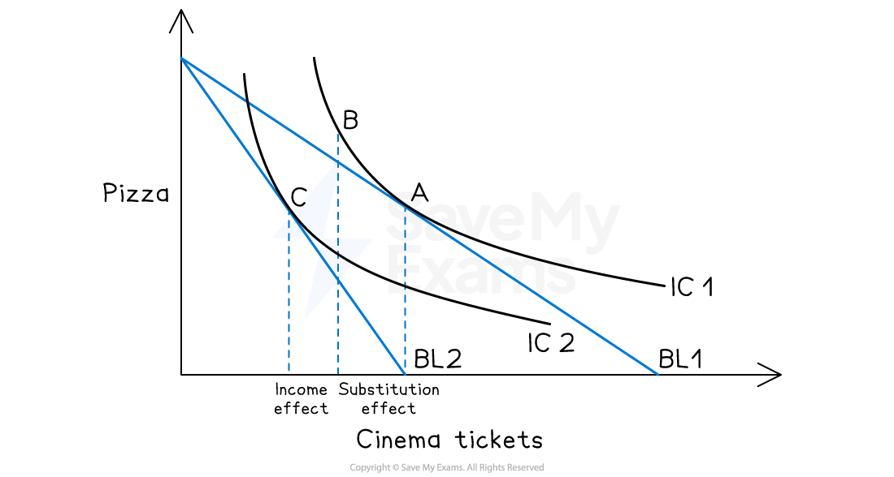

# Consumer Response to Price Changes

## Income and substitution effects 

> **Spec point** — `spcpt_wKtRJwZdP6MKwGrS`

## Income and substitution effects

- When the **price of a product changes**, two effects happen at the same time:

  - **Substitution effect**
  
    - The product becomes cheaper or more expensive relative to other goods, so **the consumer may switch towards or away from it**
  - **Income effect**
  
    - The **price change makes the consumer feel effectively richer or poorer** because their real purchasing power changes
- This can be shown with **indifference curves and budget lines** and can be understood clearly with everyday examples

## 1. Price increase for a normal good

> **Spec point** — `spcpt_vV3cYWMMJcr5gTmP`

## 1. Price increase for a normal good

- Consider a consumer choosing between:

  - **Good X:** cinema tickets
  - **Good Y:** takeaway pizza
- Both are **normal goods** (demand increases when income rises)

*Price increase for a normal good: the consumer moves from A on BL1 to C on BL2*

### Substitution effect (moving along the same indifference curve)

- If the price of cinema tickets rises:

  - Cinema becomes **more expensive relative to pizza**
  - Even if income has not changed, the cinema now gives **less “value per pound”** than before
  - This **pivots **the budget line from **BL1 to BL2**
  - The substitution effect means the consumer will **cut back on cinema tickets** and **buy more pizza instead**, holding their real level of satisfaction constant
- This **moves one combination** of cinema-and-pizza on an indifference curve from **Point A ** **to another combination **on the **same curve at Point B**, where they are **still equally satisfied **but have **adjusted the mix**

### Income effect (moving to a lower indifference curve)

- Now add the income effect:

  - As the **cinema is more expensive**, the consumer’s** income doesn’t stretch as far**
  - They feel **poorer in real terms**, even though their **income is unchanged**
  - For a **normal good** like the cinema, feeling poorer means they will usually want **less of it**, not more
  - The income effect also pushes them towards **fewer cinema tickets** and** less pizza too at Point C**

### Summary

- For a normal good, after a price increase:

  - **Substitution effect:** reduces quantity demanded of X
  - **Income effect:** also reduces quantity demanded of X
- Together, these explain why the demand curve for normal goods slopes downward

## 2. Price decrease for a normal good

> **Spec point** — `spcpt_QNWZMdrZRC4XhnHM`

## 2. Price decrease for a normal good

- Now consider the **price of cinema tickets falling**

*Price decrease for a normal good: the consumer moves from C on BL2 to A on BL1*

### Substitution effect (moving along the same indifference curve)

- Cinema tickets are now **cheaper compared to pizza**
- The consumer will tend to **swap some pizza for more cinema** because the cinema now **gives more satisfaction **per pound.
- This is the substitution effect. There will be a **movement along the same indifference curve** to a point with **more cinema and less pizza**, keeping overall satisfaction constant

### Income effect (moving to a higher indifference curve)

- Because the cinema is cheaper, the consumer's **real income has increased,** so each £ now goes further
- For a **normal good**, higher real income means they want **more cinema**, not less
- They may **also increase pizza consumption,** because feeling richer often boosts demand for many normal goods

### Summary

- For a normal good after a price fall:

  - **Substitution effect:** increases quantity demanded of X
  - **Income effect:** also increases quantity demanded of X
- Both work in the **same direction**, so demand clearly increases when the price falls

## 3. Price change for an inferior good

> **Spec point** — `spcpt_RTYx4JcBBFqp5QFZ`

## 3. Price change for an inferior good

- If we now consider:

  - **Good X:** supermarket-value noodles (cheap, basic meal)
  - **Good Y:** fresh pasta dishes (more expensive, higher quality)
- Assume **value noodles are an inferior good**: when real income rises, the consumer prefers to buy fewer noodles and more of the nicer pasta meals

### Price decrease for an inferior good

- If the price of value noodles (X) **falls**:

  - **Substitution effect:**
  
    - Noodles are **cheaper **relative to fresh pasta
    - The consumer is likely to **buy more noodles and fewer pasta dishes**, because noodles now look like better value
    - This effect **always increases demand for the cheaper good**, whether it is normal or inferior
  - **Income effect:**
  
    - The lower price means their **real income rises**
    - As noodles are **inferior**, feeling richer may make them want **fewer noodles** and **more pasta**
    - So the income effect for an inferior good goes in the **opposite direction** to the substitution effect
- In most real‑world cases, the substitution effect is stronger. The **total demand for noodles still rises** when the price falls, but not as much as it would if noodles were a normal good

## 4. The special case of a giffen good

> **Spec point** — `spcpt_rYbvvtRqDNTk7qnc`

## 4. The special case of a giffen good

- A **giffen good** is a very unusual type of inferior good where:

  - The **negative income effect** is so strong that it **more than cancels out** the substitution effect
  - As a result, when the **price rises, demand also rises**, and when **price falls, demand falls**

### Example

- **Plain bread or basic rice**

  - People are so poor that they **spend most of their income **on this cheaper staple item
  - When the **price of the staple rises,** they feel much poorer and **cannot afford better quality foods**
  - They may be forced to **cut back on meat, fruit, or vegetables**
  - They buy **more of the cheaper staple item**, even at a higher price, simply to avoid going hungry

### Summary

- **Substitution effect:** The higher price of bread should reduce quantity demanded
- **Income effect: **The higher bread price makes them much poorer, so they **cut back on higher‑quality foods and buy more bread**
- If the **income effect is bigger than the substitution effect**, the result is a **giffen good**, where the demand curve slopes upward
