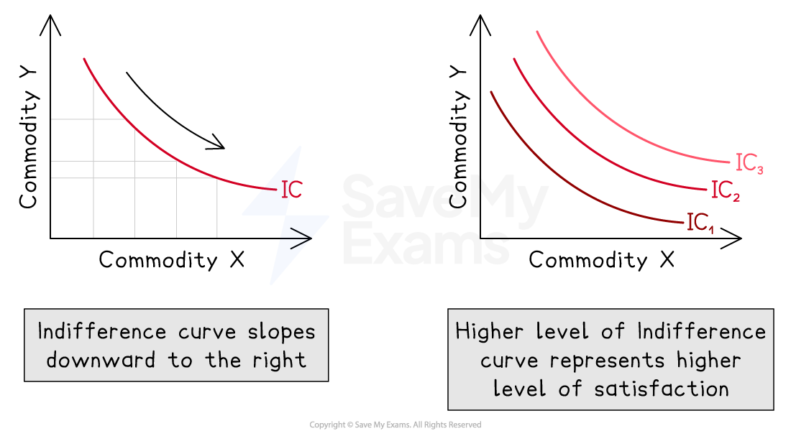

# Indifference Curves & Budget Lines

## Indifference curves

> **Spec point** — `spcpt_rnmHbh5ZHzcXBVcq`

## Indifference curves

- An **indifference curve** shows all the** combinations of two goods that give a consumer the same level of satisfaction**
- If **a person is equally happy** with **different combinations**, those **combinations lie on the same curve**

  - For example, when choosing between **cinema tickets** and **video game hours**, one combination might be **2 cinema tickets and 3 hours of gaming,** while another might be **3 tickets and 1 hour of gaming**. **If both options feel equally enjoyable, they lie on the same indifference curve**
- **Higher indifference curves** = **more happiness**
- **Rational consumers **aim for **the highest curve they can afford**

### How the curve works

- Indifference curves slope downwards. This means that if **someone gives up one unit of a good **(like a cinema ticket), **they need more of the other **(like gaming time) t**o stay just as satisfied**
- So if the **consumer moves from 3 tickets and 1 hour of gaming to 2 tickets and 3 hours of gaming**, they are still on the same curve and **their happiness has not changed**

## Budget lines: Making smart spending choices

> **Spec point** — `spcpt_x44c8GdJj64c93Nj`

## Budget lines: making smart spending choices

- A **budget line** shows all **the combinations of two goods a consumer can afford**, given their **income and the price **of the goods
- It helps explain how people **make choices** when their **money is limited**

> **Worked Example**
> Imagine a student has **£100 to spend** on two goods they enjoy:
> 
> - **Books** at £20 each
> - **Cinema tickets** at £10 each
> - The budget line includes **every combination of books and tickets that adds up to exactly £100**
> 
>   - If they spend** all their money on books, they can buy 5**
>   - If they spend it **all on cinema tickets, they can buy 10**
>   - **Any mix** in between i**nvolves giving up some of one **to gain more of the other
> 
> | Books (£20 each) | Cinema Tickets (£10 each) |
> |---|---|
> | 5 | 0 |
> | 4 | 2 |
> | 3 | 4 |
> | 2 | 6 |
> | 1 | 8 |
> | 0 | 10 |
> 
> - Each row shows a different way the student could spend their £100
> - The **budget line** connects these combinations on a graph, showing the trade-off between the two goods
> 
> 
> 
> **Analysis**
> 
> - The **slope** of the budget line reflects the relative price of books and tickets
> - A **movement along the line** means choosing a different mix of the two items
> - If income or prices change, the **budget line shifts**, allowing more or fewer combinations
> - This concept helps explain how consumers balance their spending to get the most satisfaction from their money

## What shifts the budget line?

> **Spec point** — `spcpt_P7WZRhmq8jSktkFw`

## What shifts the budget line?

- If **income decreases** the **whole line shifts **inward from BL1 to BL2 as less of both goods can be bought
- If the **price of cinema tickets increases**, the** line pivots** inward from BL1 to BL3 on the cinema tickets axis, as less tickets can be bought with the same income

> **Exam Hint**
> You should remember that a **change in income **creates a **parallel shift**
> 
> A **change in the price** of one good **causes the budget line to pivot** around the axis of the good whose price has not changed

## Limitations of the indifference curve model

> **Spec point** — `spcpt_QChXkzX5RdvNfXFP`

## Limitations of the indifference curve model

While indifference curves are useful for showing how consumers choose between two goods, the model has several real-world limitations

### 1. Real-life choices involve more than two goods

- In reality, consumers do not just choose between two items. A student deciding how to spend their weekly allowance might be weighing up **clothes, snacks, streaming subscriptions, school supplies, and transport costs**, not just two items

### 2. People often express preferences, not indifference

- The term “indifference” suggests that a person is **equally happy **with any combination of the two goods on the curve
- Consumers tend to have **clear preferences**. For example, one student might strongly prefer **three cinema tickets and one book** over **two books and one cinema ticket**, even if both combinations lie on the same curve
- This challenges the idea that people are truly indifferent between combinations

### 3. Consumers do not always behave rationally

- Indifference curves assume that people make logical decisions to maximise their satisfaction. Real behaviour does not always follow this pattern
- A student might spend all their money on **limited-edition trainers** even if they need school supplies. They might impulsively buy **concert tickets** instead of saving for a trip
- Emotional decisions, peer pressure, and habits often override rational thinking
