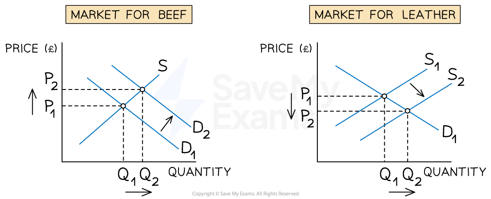

# Interrelated Markets

## Relationships between different markets

> **Spec point** — `spcpt_bWy37Gq4ffHpFXyM`

## Relationships between different markets

- Markets do not operate in isolation
- Interrelationships can exist between markets in several ways

#### Market  interrelationships

| **Relationship** | **Explanation ** | **Example ** |
|---|---|---|
| **Joint demand** | - When consumers use two products together, also known as **complementary goods** - The change in price of one good impacts the demand for the other good | - Coffee and sugar - Cereal and milk - Smartphones and mobile apps |
| **Competitive demand** | - Two goods are used for the same purpose, also known as **substitute goods** - The change in price of one good impacts the demand for the other good | - Cinema tickets and online streaming services - Tea and coffee - E-books and printed books |
| **Composite demand** | - Two or more goods require the **same input **to make them - An increase in production of one good could lead to a decrease in supply of another good, as less of the input is available | - Cheese and yogurt require the same input (milk) - Growing crops or raising livestock requires the same input (land) |
| **Derived demand** | - **Demand **for a good or service arises from the demand for another good or service    - The demand for **inputs** is derived from the demand for the final product | - Aluminium and cars - Labour and goods & services |
| **Joint supply** | - The supply of two different goods stems from the **same source** - The increase in production of one good will increase the production of another good.    - The second good may be a **by-product **of the first good | - Beef and cow leather - Poultry meat and feathers - Honey and beeswax |

### 1. Illustrating joint demand

- Changes to the price of one good **shift the entire demand curve** of a complementary good

#### Markets for mobiles and mobile apps

*Increases in price of mobile phones, shift the entire demand curve of mobile apps to the left*

#### Diagram analysis

**Market for mobiles**

- An **increase **in price for mobiles from P1→P2 leads to a movement **up** the demand curve

  - Due to the **increase **in price, there is a contraction in QD from Q1→Q2

**Market for mobile apps**

- As a result of price increase for mobile phones, there will be an** decrease in demand** for mobile apps (the complementary good) as more consumers become buy less

  - This causes a **shift in demand **from D1 to D2. The price remains unchanged at P1 but the **demand has decreased** from Q1→Q2

### 2. Illustrating joint supply

- As the production of beef increases, the supply of leather will increase (as it is a by-product of beef)

#### Market for beef and leather

*An increase in demand for beef increases the the supply of leather*

#### Diagram analysis

**Market for beef**

- If the real income of individuals of a country increase, there may be an increase in demand for beef (considered a ***normal good***)

  - This causes a **shift in demand **from D1 → D2. The price has increased from P1 → P2  and the quantity **has increased** from  Q1 → Q2

**Market for leather **

- When there is an increase of quantity of beef, there will be an increase in the supply of leather

  - This is a **shift in supply **from S1 to S2. The price decreased from P1 → P2, and the **supply has increased** from Q1 → Q2
