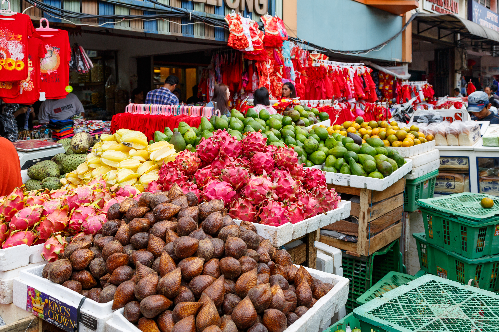
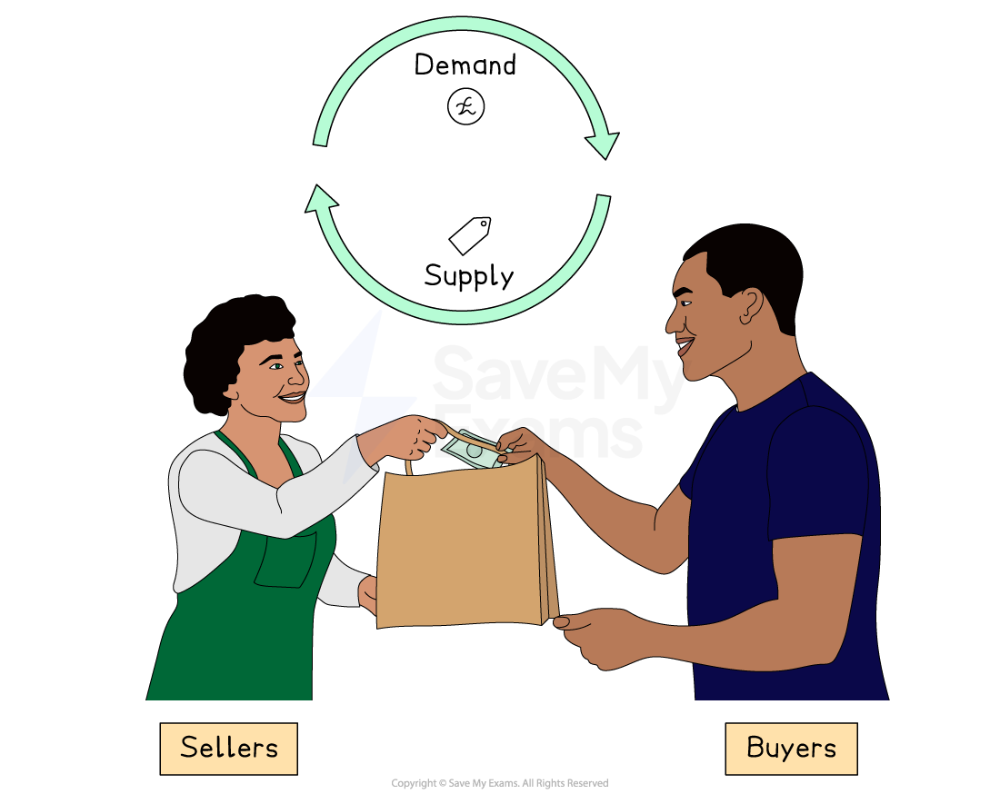
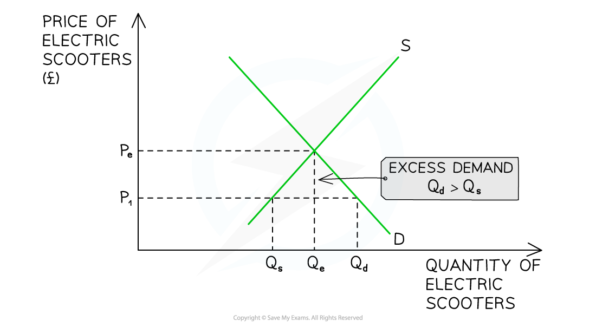
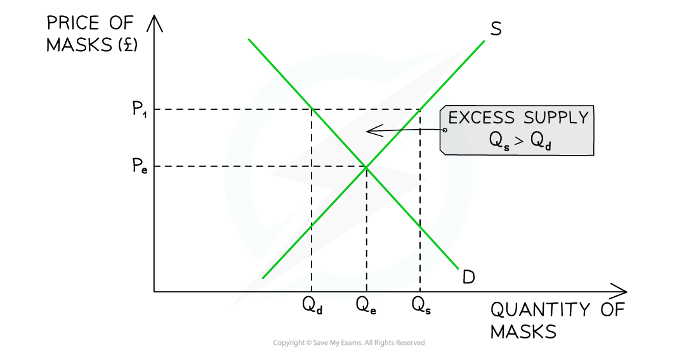

# Market Equilibrium & Disequilibrium

## Price determination in markets

> **Spec point** — `spcpt_4XFKd76PzBhctw9w`

## Price determination in markets

- **A market is any place or process that brings buyers and sellers together to exchange goods and services**

  - This exchange can happen in a **physical location** (such as a food market in Jakarta) or through a **virtual platform** (such as Alibaba or Amazon)

*Jakarta food market*

### Roles of buyers and sellers

- In any market, both buyers and sellers play essential roles

  - In an efficient market, sellers respond to what buyers want, and buyers choose between competing sellers
  - This interaction helps **determine prices and quantities**

*The buyer demands and the seller supplies*

#### Buyers

- Also known as **consumers** or **demanders**
- Their **choices and preferences** determine **demand** for goods and services
- They help to set prices by ***signalling*** how much they are willing to pay

  - For example, a buyer in Mexico City searching for the best price on mobile phones influences how firms set prices to compete

#### Sellers

- Also known as **producers** or **suppliers**
- They aim to **supply** goods or services in order to make a **profit**
- They decide **what to produce**, **how much** and at **what price** based on costs and expected demand

  - For example, a coconut farmer in the Philippines choosing whether to sell to local markets or export to Singapore

## Market equilibrium

> **Spec point** — `spcpt_wZWDCNR3swpXt5W4`

## Market equilibrium

- Equilibrium occurs in a market when **demand = supply**
- At this point, the price is called the **equilibrium or** **market-clearing price**

  - This is the **price** at which sellers are clearing (selling) their stock **at an acceptable rate**

*Equilibrium is at PQ. The market clearing price of P & quantity at Q*

### Diagram analysis

- Any price **above or below** P creates **disequilibrium **in this market

  - Disequilibrium occurs whenever there is ***excess demand*** or ***excess supply*** in a market

## Market disequilibrium

> **Spec point** — `spcpt_mDRCdVNds8JnZbqZ`

## Market disequilibrium

- Disequilibrium occurs when demand is not equal to supply

  - If demand > supply, the market is facing excess demand
  - If demand < supply, the market is facing excess supply

### 1. Disequilibrium: excess demand

- **Excess demand** occurs when the demand **is greater** than the supply

  - It can occur when **prices are too low** or when **demand is so high** that supply cannot keep up with it

*The quantity demanded is greater than quantity supplied*

#### Diagram analysis

- At a price of P1, the **quantity demanded** of electric scooters (Qd) is **greater** than the **quantity supplied** (Qs)
- There is a **shortage** (excess demand) in the market equivalent to **Q****s****Q****d**

#### Market response

- This market is in **disequilibrium**

  - Sellers are frustrated that products are selling so quickly at a **price** that is obviously **too low**
  - Some buyers are frustrated as they will **not be able to purchase** the product
- Sellers realise they can **increase prices** and generate more ***revenue*** and ***profits***
- Sellers gradually **raise prices**

  - This causes a **contraction in QD** as some buyers **no longer desire** the good/service at a higher price
  - This causes an **extension in QS** as other sellers are more **incentivised to supply** at higher prices
- In time, the market will have **cleared the excess demand** and arrive at a position of **equilibrium, P****e****Q****e**

  - Different markets take different lengths of **time to resolve disequilibrium**
  - E.g., retail clothing can do so in a few days. Whereas the housing market may take several months or even years

### 2. Disequilibrium: excess supply

- **Excess supply** occurs when the supply **is greater** than the demand

  - It can occur when **prices are too high** or when **demand falls unexpectedly**
- During the later stages of the pandemic, the market for face masks was in **disequilibrium**

*The quantity supplied is greater than quantity demanded for Covid-19 face masks during the later stages of the pandemic*

#### Diagram analysis

- At a price of P1, the **quantity supplied **of face masks (Qs) is **greater** than the **quantity demanded** (Qd)
- There is a **surplus in the market **(excess supply) equivalent to **Q****d****Q****s**

#### Market response

- This market is in **disequilibrium**

  - Sellers are frustrated that the masks are **not selling** and that the **price** is obviously **too high**
  - Some buyers are frustrated, as they **want to purchase** the masks but are not willing to **pay the high price**
- Sellers will gradually lower** prices** in order to generate more **revenue**

  - This causes a **contraction in QS** as some sellers **no longer desire** to supply masks
  - This causes an **extension in QD** as buyers are **more willing **to purchase masks at** lower prices**
- In time, the market will have **cleared the excess supply** and arrive at a position of **equilibrium, P****e****Q****e**

> **Exam Hint**
> You should memorise the rule that shortages arise when the price is **below** equilibrium, whereas surpluses arise when the price is **above** the  equilibrium
