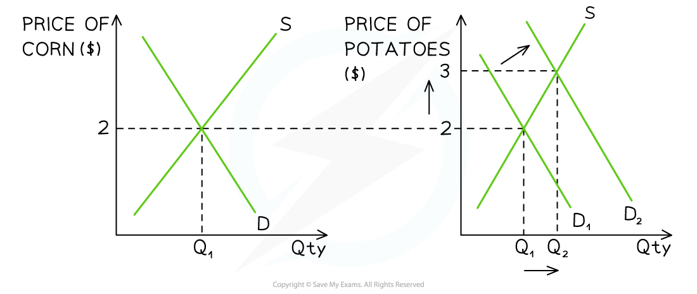

# The Functions of the Price Mechanism

## The functions of the price mechanism

> **Spec point** — `spcpt_Nq574nCD8HbTxpbd`

## The functions of the price mechanism

- **The price mechanism is the interaction of demand and supply in a market economy that allocates scarce resources amongst competing needs and wants**
- **Adam Smith** referred to the **functions** of the **price mechanism** as the **'invisible hand of the market'**
- The price mechanism fulfils **three functions** in the relationship between buyers and sellers which include** rationing, incentivising and signalling**
- **When any of these functions breaks down, *****market failure***** can occur**

### Explaining each function

#### Rationing

- When resources become **scarce,** the price will **rise**. Only those who can afford to pay for them will receive them. If there is a **surplus,** then **prices fall** and more consumers can afford them

  - E.g The price of plane tickets might rise as seats are sold, because spaces are running out. This is a **disincentive **to some consumers to purchase the tickets, which **rations** the tickets

#### Incentive

- The** incentive function **encourages producers to **increase or decrease output** to increase profits

  - When prices for a good/service rise, it **incentivises producers** to reallocate resources from a less profitable market in order to **maximise their profits**
  - Falling prices **incentivise reallocation** of resources to **new markets**

#### Signalling

- A change in price provides a** signal** to consumers and producers about where resources are wanted (markets with increasing prices) and where they are not (markets with decreasing prices)
- This allows consumers and producers to make informed decisions

  - High prices **signals** to a producer to produce more of that good/service and would signal to **other producers** to **enter the market**
  - A falling price **signals** to consumers to purchase more of a product

> **Case Study**
> **Global Coffee Prices and Producer Response in Brazil**
> 
> 
> 
> *Incentives and signals in the coffee market*
> 
> **Scenario**
> 
> In 2021, global demand for coffee surged as cafés reopened after pandemic lockdowns. At the same time, a major drought and frost in Brazil - the world’s largest coffee exporter - damaged crops and reduced supply. This caused the global price of coffee beans to **rise sharply** on commodity markets
> 
> **The incentive and signal**
> 
> - The **price rise acted as a signal** to coffee producers: global buyers were willing to pay more
> - It also served as an **incentive** -  higher prices meant potentially greater profits for farmers
> - In response, producers began planting more coffee trees, investing in irrigation systems, and prioritising coffee over other crops like maize or sugarcane
> 
> **The outcome**
> 
> - Over the next year, **supply increased** as new coffee plants matured and better weather returned
> - More **producers entered the market**, while existing farmers expanded production
> - As supply grew to meet demand, global** prices began to stabilise**, demonstrating how the price mechanism efficiently directed resources toward a highly demanded good

> **Exam Hint**
> Remember that all three functions are built on the principle of **self-interest**. This will help you to explain each function
> 
> **Lower prices incentivise consumers** to purchase **more** of the product with the same income. Conversely, the **incentive for producers** is the opposite, encouraging them to **reallocate their factors of production** to producing more profitable products

## The price mechanism in action

> **Spec point** — `spcpt_YhtWKQCkKrWht777`

## The price mechanism in action

- **Cash crops** such as wheat, oats, barley, soy, corn, sunflowers, etc. can be grown using the same **factors of production**

  - Many countries **export** excess crops into the **world market**
  - **Producers** use world prices to guide their **production decisions**

*A diagram showing the price mechanism at work in two related global markets, corn and potatoes*

### Diagram analysis

- Farmers in France have been **producing corn** for many years, and the market price is \$2/kg
- The **price **of potatoes in **global markets** has been steady at \$2/kg
- Due to a change in one of the **determinants of demand** (possibly an increase in global population), the demand for potatoes has **increased **from D1→D2 and the **price has increased** from \$2/kg to \$3/kg

#### What happens?

- The higher price serves to **ration** the potatoes

  - Those consumers who **can afford **to purchase it for \$3, receive it
- The higher price **incentivises **producers to **allocate more factors of production** to producing potatoes and this is evident from the **extension in supply** from Q1 to Q2
- The shift in global demand **signals** to producers in France that **demand for potatoes is strong** and they should consider **switching some of their production **from corn to potatoes
