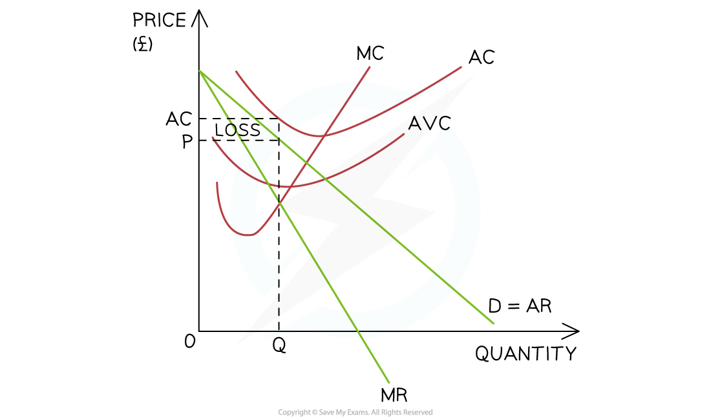

# Shutdown Price in the Short Run & the Long Run

## The shut-down rule

> **Spec point** — `spcpt_ZDFnxCjJy5tjn63m`

## The shut-down rule

- Firms do not always **make a profit** and may endure losses for a period

  - Entrepreneurs often keep firms going in the hope that **market conditions will change** and demand for their products will increase, leading to **profitability**
  - This raises the question, **'when is it the best time for a firm to shut down?**'
- The **shut-down rule **provides the answer by considering both the long-run and short-run periods

### 1. The short-run shut down point

- In the** short-run**, if the selling price **(average revenue) is higher than the average variable cost (AVC)**, the firm should keep producing (AR > AVC)

  - **If the selling price (AR) falls to the AVC it should shut down (AR = AVC)**

*A firm should shut down in the long-run if the selling price (AR) is unable to cover the AC*

#### Diagram analysis

- The firm produces at the **profit maximisation level of output (Q)** where MC=MR
- At this level, the P = AVC

  - This means that there is no ***contribution*** towards the firm's **fixed costs**
  
    - The selling price literally only covers the **cost of the raw materials** used in production
    - There is no point in continuing production and **the firm should shut down**

### 2. The long-run shut down point

- In the **long-run**, if the **selling price (AR) is higher than the average cost (AC)** the firm should remain open (AR > AC)

  - **if the selling price (AR) is equal to or lower than the average cost (AC), the firm should shut down (AR = AC)**

*A firm should shut down in the long-run if the selling price (AR) is unable to cover the AC*

#### Diagram analysis

- The firm produces at the **profit maximisation level of output (Q)** where MC=MR
- At this level, **P < AC**

  - It could continue operating in the **short-run** as the AR > AVC, but in the **long-run **they are making a loss and the firm will shut down
