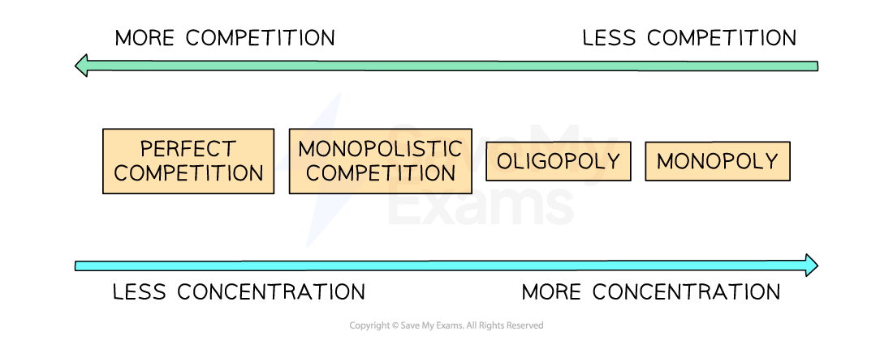
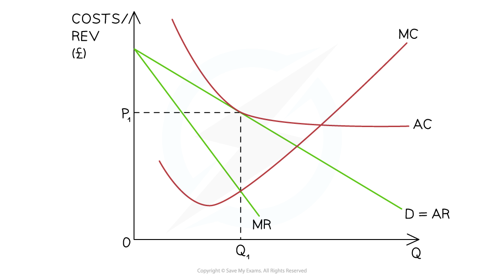
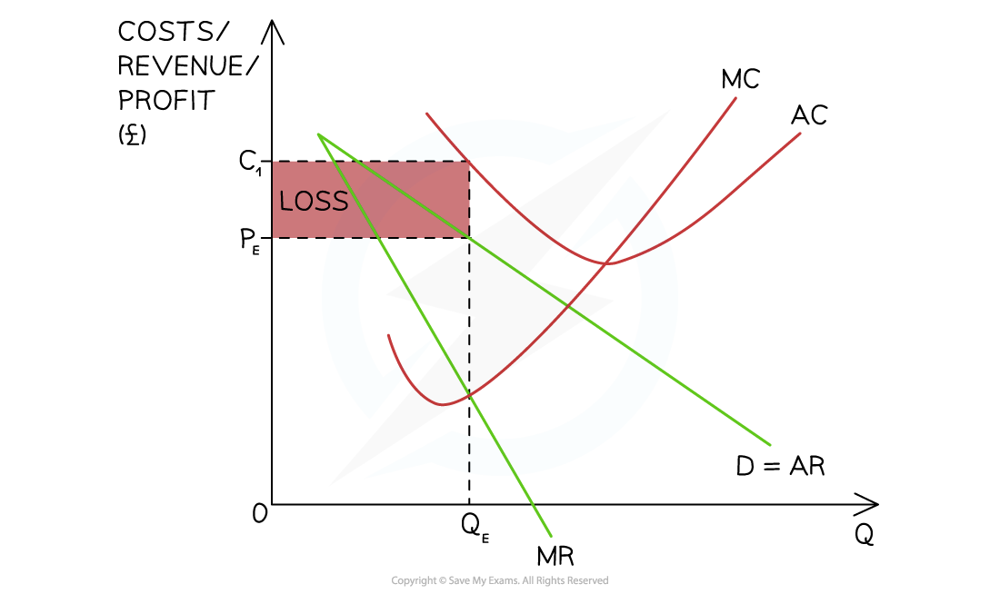
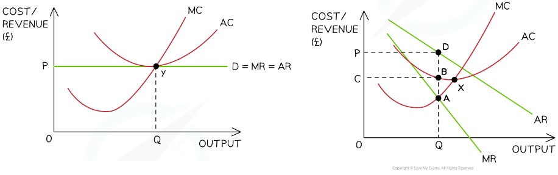
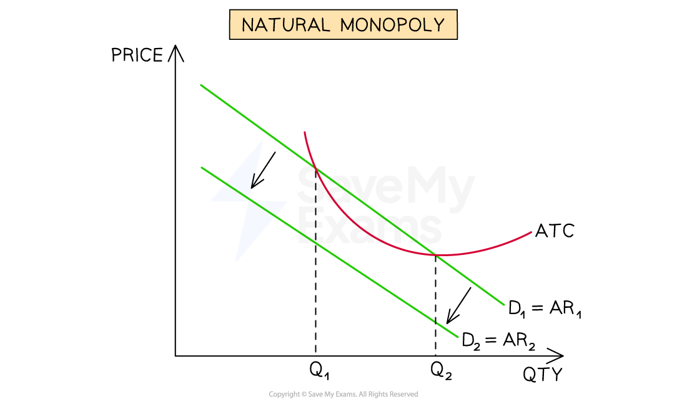

# The Performance of Firms in a Monopoly Market

## Market power in a monopoly

> **Spec point** — `spcpt_xh9TRHxVDtNpWpdM`

## Market power in a monopoly

- **Market power **refers to the ability of a firm to influence and control the conditions in a specific market, allowing them to have a significant impact on **price, output,** and other market variables

*The level of market power is high/absolute for monopoly firms  *

- Monopoly firms **have high market power,** **high/total market share** and a high/perfect industry ***concentration ratio***
- There is significant market failure in **monopoly firms**

  - Governments regulate and intervene in mergers and acquisitions in order to ensure (in many economies) that no single firm gains more than 25% market share

#### Characteristics of monopoly markets

| Characteristic | Monopoly |
|---|---|
| Number of firms | - One dominant firm in the market |
| Nature of the product | - Unique product with **no close substitutes** |
| Price behaviour | - **Price maker** with significant control over price |
| Barriers to entry | - **Very high barriers** (e.g. patents, control of resources, economies of scale, legal protection) |
| Customer loyalty | - Typically **very high** due to lack of alternatives |
| Market power | - **Very strong market power** |

#### Market outcomes in monopoly

| Feature | Monopoly outcome |
|---|---|
| Type of profit | - **Supernormal profits** possible in the long run |
| Efficiency | - Often ***allocatively***** and *****productively *****inefficient** |
| *X-inefficiency* | - Likely due to **lack of competitive pressure** |
| Demand curve | - **Downward sloping** and relatively **inelastic** |

## A monopoly making supernormal profits

> **Spec point** — `spcpt_xjjBCbQzDxHYvtCQ`

## A monopoly making supernormal profits

- As a single seller of goods or services, the firm in a monopoly market is also the **entire market**

  - There is no differentiation between the firm and the industry
- It is a ***price maker***

  - This means that its revenue curves are downward sloping
- In order to **maximise profits,** it produces at the point where marginal cost (MC) = marginal revenue (MR)

*A diagram illustrating a monopoly making supernormal profit in the short-run & long-run as the AR > AC at the profit maximisation level of output (Q1)*

#### Diagram analysis

- The firm produces at the **profit maximisation level of output** where **MC = MR (Q****1****)**

  - At this level the **AR (P****1****) > AC (C****1****)**
  - The firm is making **abnormal profit** $=(P_{1}-C_{1})\timesQ_{1}$

> **Exam Hint**
> You may be asked to draw a cost and revenue diagram to show the likely impact of a reduction in sales on profits. This requires you to shift the demand curve inwards. You will draw a second AR and MR curve to the left and then illustrate the new level of profit

## A monopoly making normal profits

> **Spec point** — `spcpt_ZVgcTcqXmjfrY22s`

## A monopoly making normal profits

- In a monopoly market, normal profit refers to the level of profit necessary to **keep the monopolist in the market in the long run**
- It represents the minimum amount of profit needed to cover the ***opportunity cost ***of the resources used by the monopolist
- At this point, total revenue( TR) equals the total cost (TC), including both ***explicit***** and *****implicit costs***
- If the monopolist is earning normal profit, it indicates that there is **no abnormal profit**
- The monopolist is simply earning a competitive return and **covering its costs of production**

*A monopoly may make normal profit in the short-run and this occurs at the profit maximisation level of output and where the price (AR) = ATC*

#### Diagram analysis

- The firm is following **the profit maximisation rule **and producing at the **level of output where MR = MC (Q****1****)**
- At this level of output, the selling price P1 **(AR) = ATC**

  - This means the firm is** breaking even** and this is considered to be normal profit

## A monopoly making losses in the short-run

> **Spec point** — `spcpt_YhdqQkJPvT8sCnZC`

## A monopoly making losses in the short-run

- In a monopoly market, a **loss minimisation position** occurs when the monopolist incurs losses but aims to **minimise those losses in the short run**
- The loss minimisation position arises when the **market price (AR) is below the average total cost (ATC) but above the marginal cost (MC) of production**
- In the long run, a monopolist cannot sustain losses indefinitely

  - If losses persist the monopolist might consider **exiting the market or changing its production strategies**

*A monopoly firm is making short-run losses as seen by the fact that at the profit maximisation level of output (MC = MR), the selling price is below the average total cost (ATC)*

#### Diagram analysis

- The firm produces at the **profit maximisation level of output** where **MC = MR (Q****E****)**

  - At this level the AR (P1) < AC (C1)
  - The firm is **making a loss **$=(C_{1}-P_{E})\timesQ_{E}$

## Side by side comparison of perfect competition and monopoly

> **Spec point** — `spcpt_VBMNKxtRxrG2dnh7`

## Side-by-side comparison of perfect competition and monopoly

- **Perfect competition** tends to **achieve both *****productive*** **and *****allocative*** **efficiency** due to the presence of competition, whereas **monopolies** generally result in **inefficiencies in both aspects**

#### Diagram analysis

**Perfect competition on the left**

- The firm produces at the **profit maximisation level** of output where **MC=MR (Y)**
- The firm is **productively efficient as MC=AC** at this level of output
- The firm is **allocatively efficient as AR (P)=MC**
- There is no welfare loss

**Monopoly market on the right**

- The firm produces at the **profit maximisation level** of output where **MC=MR (A)**
- The firm is not **productively efficient, as AC > MC** at this level of output **(B-A)**

  - **Productive efficiency **would occur at point X where MC=AC
- The firm is not **allocatively efficient as AR (P) > MC **at this level of output (D-A)

  - **Allocative efficiency** would occur where AR=MC (point F)

## Natural monopoly

> **Spec point** — `spcpt_Y9pMpqTB7wyQtd7x`

## Natural monopoly

- **A natural monopoly occurs when the most efficient number of firms in the industry is one**

  - This is often due to **associated infrastructure issues** e.g. delivery of utility services like water where it does not make sense to have multiple pipelines
  - It can also be due to the significant cost that is generated when entering the industry e.g. the ***sunk costs***
  - It can also be due to the ability of ***economies of scale**** *to lower prices for consumers e.g. it makes sense to have one firm building five nuclear power stations as opposed to five firms as average costs will be lower with one firm producing
- **Natural monopolies** usually occur in utility industries and are **regulated by the Government** to ensure that consumers are not charged higher monopoly prices

  - This regulation is often in the form of a ***maximum price***

*Natural monopolies spend large sums in production and make a profit between Q1 and Q2. If another firms enters the market, their demand will decrease and they will make a loss *

#### Diagram analysis

- Assume a utility company spends \$billions **building out a new delivery network**
- Their average total costs **(ATC) are initially very high**, but fall as they are able to gain **economies of scale**
- As they gain an increasing number of **customers (D****1**** = AR****1****)**, the firm is initially in a **loss making position** experienced between **0 → Q****1**** **customers
- Between **Q****1**** → Q****2****,***** ***the firm is now making a profit as the AR > ATC
- Should another firm enter the market, the **demand will be split between two firms** and the demand curve for this firm will **shift from D****1**** → D****2**
- This shift of demand puts the monopoly in a position where **AR < ATC and the firm is making a loss at every level** of output
- It therefore **makes no sense** to have more than **one firm in the industry**

> **Exam Hint**
> You should consider the **government failure** that may occur with the **regulation and imposition of maximum prices**
> 
> There is a lot of disagreement about the **level of profits** that natural monopolies should be allowed to make. It is a normative issue
