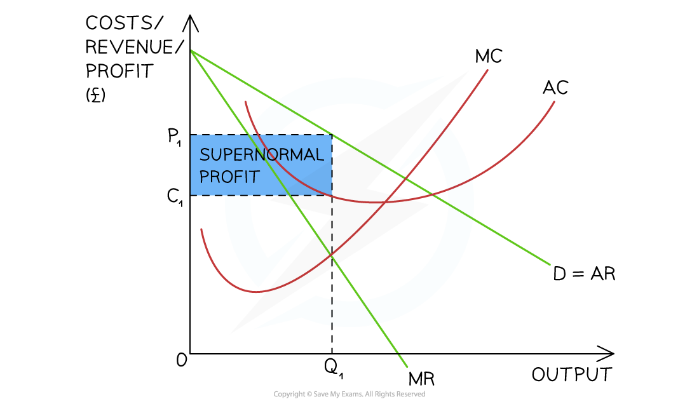
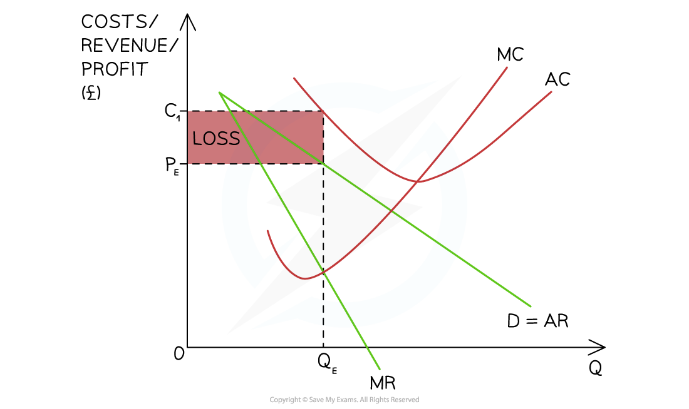
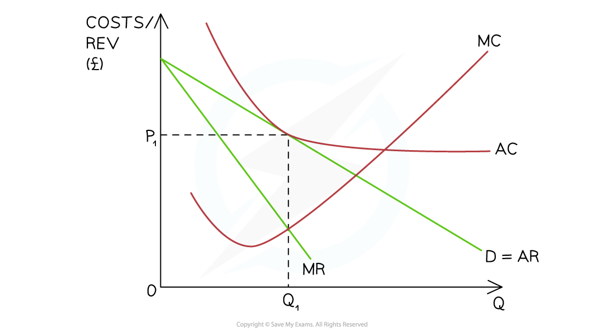
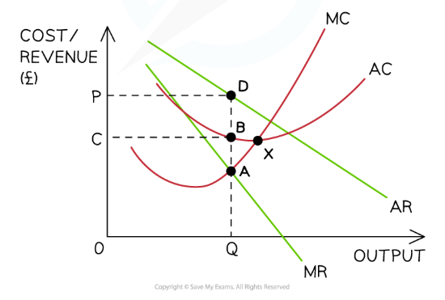

# The Performance of Firms in Monopolistic Competition

## Short-run supernormal profits in monopolistic competition

> **Spec point** — `spcpt_vrX4qc6ZFvcWcYMj`

## Short-run supernormal profits in monopolistic competition

- In order to **maximise profit**, firms in monopolistic competition produce up to the level of output where ***marginal cost*** = ***marginal revenue*** (MC=MR)

  - The firm can make ***supernormal profit*** in the short-run
- The **average revenue (AR) curve** is the **demand curve **of the firm and it is downward sloping

- The firm has some **market power** due to the level of **product differentiation** that exists

  - To sell an additional unit of output, the firm will have to decrease its price
  - The ***marginal revenue (MR)*** curve will fall twice as quickly as the average revenue curve (AR)

- A very good example of how this occurs can be seen in the **barber shop industry.**

  - Innovators may offer unique features such as free espressos, or childcare while you wait
  - This permits them to charge higher prices until such a point as competitors copy their innovative actions
  - Their abnormal profit will then be eroded

#### Short-run profits for a monopolistically competitive firm

#### Diagram analysis

- The firm produces at the **profit maximisation level of output,** where **MC = MR (Q****1****)**

  - At this level, AR (P1) > AC (C1)
  - The firm is making **supernormal profit** $=(P_{1}-C_{1})\timesQ_{1}$

## Short-run losses in monopolistic competition

> **Spec point** — `spcpt_QPb7qD7tZrTjMdVH`

## Short-run losses in monopolistic competition

- Firms in **monopolistic competition** are able to make ***losses*** in the **short-run**

#### Short-run losses in monopolistic competition

*Short-run losses occur as AR (PE ) <  AC at the profit maximisation level of output (QE) *

#### Diagram analysis

- The firm produces at the **profit maximisation level of output,** where **MC = MR (Q****E****)**

  - At this level of output, the **AR (P****E****) < ATC (C****1****)**
  - The firm's loss is =$(P_{E}-C_{1})\timesQ_{E}$

## Long-run normal profit in monopolistic competition

> **Spec point** — `spcpt_XSBFqYBKSCKfDC4x`

## Long-run normal profit in monopolistic competition

#### From supernormal to normal Profit

- If firms in **monopolistic competition** make ***supernormal profit*** in the **short-run, **new entrants are attracted to the industry, and the number of sellers increases

  - They are **incentivised** by the opportunity to make supernormal profit
  - There are low ***barriers to entry*** and It is easy to join the industry
- **Supernormal profit will be eroded,** and the firm will return to the long-run equilibrium position of making normal profit

### From losses to normal profit

- If firms in **monopolistic competition** make losses in the **short-run, **some will shut down

  - The ***shut down rule*** will determine which firms shut down
  - There are low **barriers to exit**, so it is easy to leave the industry
- **For the remaining firms, losses will be eliminated,** and the firm will return to the **long-run equilibrium** position of making **normal profit**

### Long-run normal profit position

*The firm is making a normal profit. AR (P1) = AC at the profit maximisation level of output (Q1)*

#### Diagram analysis

- The firm is producing at the **profit maximisation level of output,** where **MC=MR (Q****1****)**
- At this level of output, **P****1**** = AC** and the firm is making normal profit
- **In the long-run,** firms in **monopolistic competition** **always make normal profit**

  - Firms making a **loss** leave the industry
  - Firms making **supernormal profit **see it slowly **eradicated **as new firms join the industry

## Efficiency in monopolistic competition

> **Spec point** — `spcpt_K3nNtR5Rg5qRM9sb`

## Efficiency in monopolistic competition

- **Allocative efficiency** occurs where **average revenue = marginal cost (AR = MC)**
- In monopolistic competition firms produce where **MR = MC**, but **P > MC**

  - This means firms **do not achieve allocative efficiency**
- **Productive efficiency** occurs where **marginal cost = average cost (MC = AC)**

  - This is the point where **average costs are minimised**
- Firms in monopolistic competition **do not achieve productive efficiency**

  - They produce **to the left of the minimum point of the AC curve**, meaning there is **excess capacity**

*Monopolistic competition*

### Diagram analysis

- The firm maximises profit where **MR = MC**, which occurs at **point A**, producing **Q**
- At this level of output, the firm charges **price P** from the **AR (demand) curve**
- Because **P > MC**, the firm is **not allocatively efficient**
- **Allocative efficiency would occur **where **AR = MC**
- The firm is also **not productively efficient**, because it is **not producing at the minimum point of the AC curve (point X)**
