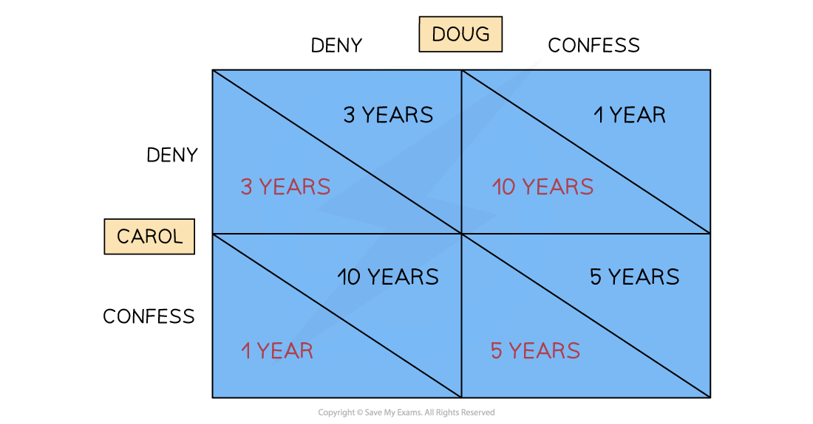
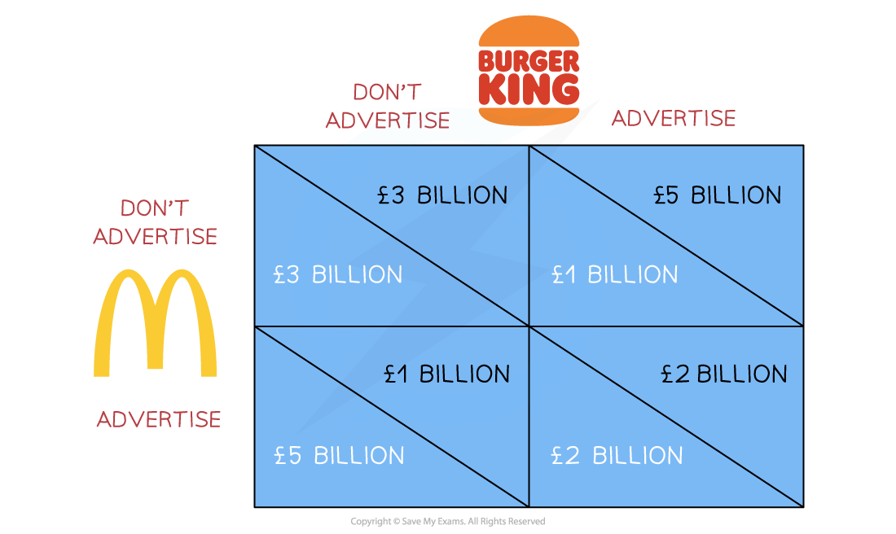

# The Performance of Firms in Oligopolies

## Characteristics of Oligopoly

> **Spec point** — `spcpt_xWCc2RcKcwYWnpq3`

## Characteristics of Oligopoly

- Most imperfectly competitive industries operate in an ***oligopoly*** market structure

  - E.g., Banks, insurance companies, department stores, supermarkets, petrol retailers, sport stores etc.

#### Characteristics of an Oligopoly Market

| **High barriers to entry and exit** | **High concentration ratio** |
|---|---|
| - **Entering the industry** is difficult due to the **existing dominance** of relatively few firms. **Start-up costs** tend to be high e.g. setting up a renewable energy company costs billions - **Leaving the industry** is difficult due to the high level of ***sunk costs*** e.g. mobile phone companies are bidding billions on 5G auctions run by the Government. They cannot recoup this if they leave the industry | - A **concentration ratio** reveals what percentage of the total market share a **specific number **of firms have - A **10-firm concentration ratio** reveals the total market share (concentration) of the top 10 firms in the industry - A **5-firm concentration** reveals the total market share (concentration) of the top 5 firms in the industry - The **higher the value** - and the **lower the number of firms** - the more concentrated the market power in the industry e.g. the UK supermarket's 5-firm concentration ratio is constantly around 67% |
| **Interdependence of firms** | **Product differentiation** |
| - With relatively few competitors, firms study each other's behaviour and are **highly interdependent** in their actions - This interdependence generates the use of ***game theory*** | - Products tend to be **highly differentiated** - Occasionally products are similar (e.g. petrol). However, the **brand** around the product is highly differentiated to the point where **consumers perceive it as different** and are extremely brand loyal |

## Calculation of concentration ratios

> **Spec point** — `spcpt_QC27rgFMkg4xjDdw`

## Calculation of concentration ratios

- The most commonly used ***concentration ratios*** in the UK are the five-firm, ten-firm, and twenty-firm concentration ratios
- A five-firm concentration ratio of around 60% is considered to be an oligopoly
- A one-firm concentration ratio of 100% would be a ***pure monopoly***

  - The UK Competition and Markets Authority (CMA) defines a monopoly as a firm with more than 25% market share
  
    - It prevents **mergers or acquisitions** from taking place which would give one firm more than 25% market share

> **Worked Example**
> #### Worked Example
> 
> **The following table shows the value of UK Supermarket sales for the 3 months to the 31st March 2022.**
> 
> | **Company** | **Value of Sales** **(£ million)** |
> |---|---|
> | Tesco | 136.5 |
> | Morrisons | 55 |
> | The Co-operative | 30 |
> | Sainsbury's | 75 |
> | Aldi | 44 |
> | Waitrose | 24 |
> | Asda | 77.5 |
> | Lidl | 33 |
> | Iceland | 15 |
> | Others | 10 |
> |   | **500** |
> 
> **Calculate the five-firm concentration ratio. Show your working.**
> 
> **Step 1: Identify the top five firms by value of sales and add the value of their sales together**
> 
> Tesco (136.5) + Asda (77.5) + Sainsbury's (75) + Morrisons (55) + Aldi (44)
> 
> `equals space 136.5 plus 77.5 plus 75 plus 55 plus 44
> equals space £ 388 space million`
> 
> **Step 2: Calculate the percentage of total sales that the top five firms have**
> 
> `388 over 500 space cross times space 100
> 
> CR 5 equals space 77.6 percent sign
> `

## Collusive and non-collusive behaviour

> **Spec point** — `spcpt_yM6N4Z6Wpt2jFd5m`

## Reasons for collusive and non-collusive behaviour

- **Collusive behaviour** in oligopolies occurs when firms cooperate to **fix prices and restrict output**

  - They cease to compete as vigorously as they can
- **Non collusive behaviour** in oligopolies occurs when firms actively compete to maintain/increase market share

### Reasons for collusion

| **Few firms/competitors** | This makes it relatively easy for each firm to understand other **competitors' actions** and responses, or to **collaborate on prices/output** |
|---|---|
| **Similar costs** | Firms face almost identical costs as any remaining competitors have all experienced ***economies of scale*** |
| **Similar revenue** | Competitors' goods/services sell for **similar prices** as there is little incentive to lower them as other firms would respond by keeping their market share the same but decreasing the profits |
| **High barriers to entry** | The ***barriers to entry*** make it unlikely that **new entrants **will emerge to disrupt the status quo |
| **Ineffective regulation** | A lack of regulation **empowers firms to collude** as there is little consequence for their actions |
| **Brand loyalty** | There is usually a **high degree of brand loyalty** in oligopoly markets and firms have an **established market share**. This decreases the benefits of competition as consumers are unlikely to change brands |

### Types of collusion

- Collusion can be **overt** or **tacit**
- The **net effect of collusion** is that a group of firms end up acting like a **monopoly** in the market

#### Overt collusion

- Occurs when firms explicitly agree to limit competition or raise prices (price fixing)
- A ***cartel*** is the most restrictive form of collusion and is illegal in most countries

- The consequences of overt collusion include:

  - Higher prices for consumers
  - Less output in the market
  - Poor quality products and/or customer service
  - Less investment in innovation
- **Overt collusion** often happens in the following ways

  - ***Price fixing***
  - Setting **output quotas** which limit supply and naturally results in price increases
  - Agreements to **block new firms** from entering the industry
  - Agreements to pay suppliers the same price thereby driving down prices in the supply chain ***(monopsony power)***

#### Tacit collusion

- Occurs when firms **avoid formal agreements **but closely **monitor** each other's behaviour usually following the lead of the largest firm in the industry

- The most common form of tacit collusion is **price leadership or price matching**

  - This occurs when firms **monitor the price** of the largest firm in the industry and then adjust their prices to match
  - It is difficult for** regulators** to prove that collusion has occurred
  - It provides **similar benefits** to firms as overt collusion, but perhaps not to the same degree
  - It has similar **consequences for consumers** as overt collusion, but perhaps not to the same degree

## Game theory

> **Spec point** — `spcpt_wHCq2X5CzKfHjqkr`

## Game theory

- **Game theory is a mathematical framework which is used by firms to ensure optimal decisions are made in a strategic setting where there is a high level of interdependence (such as in oligopoly markets)**
- **Any game has three elements**

  - The players - (firms)
  - The **strategies** available to the players
  - The **payoffs** (outcomes) that each player receives for each combination of strategies
- It was first illustrated using a simple model called ***The Prisoners Dilemma***

  - Two criminals are caught after a train robbery (Carol and Doug)
  
    - The prosecutor does not have much evidence
    - The **criminals are guilty **but have **agreed with each other** that they will deny all involvement
    - The prosector wants one (or both) to confess
  - The strategies and payoffs available to the prisoners are presented in a **payoff matrix**

*A prisoner's dilemma payoff matrix which illustrates game theory*

### Diagram analysis

- If Carol and Doug stick to their plan and deny involvement, they each get 3 years jail time
- If **Doug** confesses and indicates Carol's involvement, then Doug gets a **lenient sentence **of 1 year and Carol gets 10 years
- If **Carol **confesses and indicates Doug's involvement, then Carol gets a **lenient sentence** of 1 year and Doug gets 10 years
- There is a strong **incentive to collude** as it will yield the **most beneficial outcome** for Carol and Doug (3 years each)
- Fearing the worst, both players decide to confess and receive **5 years each**

  - This outcome is called the **dominant strategy** as it carries the least risk

### How firms use game theory

- Firms typically use **game theory **in the following situations:

  - When making decisions to** raise or lower prices**
  - When making decisions about new **advertising and branding initiatives**
  - When making decisions about **investment in product innovation**
  - When making decisions on **product bundling** e.g. combined phone and broadband package
- Below is a **payoff matrix **representing the strategic options available to Burger King and McDonald's when making advertising decisions

  - The £ payoffs represent **the likely profits** for each combination of choices selected

*A payoff matrix which illustrates the strategies and payoffs available to firms when they are deciding to advertise or not to advertise*

#### Diagram analysis

- If Burger King and McDonald's **collude** and agree not to advertise (top left), they can each enjoy £3 bn. in profits

  - There is a **strong incentive **to collude
- If **Burger King advertises and McDonald's does not**, then Burger King's profits are £5 bn. and McDonald's are £1 bn.
- If **McDonald's advertises and Burger King does not**, then McDonald's profits are £5 bn. and Burger King's are £1 bn.
- Both firms decide to advertise and receive **£2 bn. of profits each**

  - This outcome is called the **dominant strategy** as it carries the least risk
  - The **risk of collusion **is that one player will cheat and by doing so, get ahead

> **Worked Example**
> **The grid below shows the possible pricing strategies of two coffee companies. *****The Bean***** and *****Black Gold*****. Assuming that demand is price inelastic.**
> 
> |   | **The Bean: High** | **The Bean: Low** |
> |---|---|---|
> | **Black Gold: High** | A | B |
> | **Black Gold: Low** | C | D |
> 
> **Which of the following strategies in the grid would maximise the revenue of the two firms? Explain your answer.**
> 
> **Step 1: Use the information provided to select the correct option**
> 
> A
> 
> **Step 2: Explain your answer using economic knowledge**
> 
> With reference to the **revenue rule**, firms whose demand is **price inelastic should raise price to increase total revenue**. When price rises and demand is inelastic, the **percentage fall in quantity demanded is smaller than the percentage increase in price**, so **total revenue increases**.
> 
> Therefore, the strategy that **maximises the joint revenue of the two firms is A**, where **both firms charge a high price**.
> 
> If one firm lowered its price while the other kept prices high (B or C), the price reduction would **reduce revenue because demand is price inelastic**.

## Price competition

> **Spec point** — `spcpt_7Sh6mjxSQqBB4YGS`

## Price competition

- Firms in an oligopoly market engage in three types of price competition

1. **Price wars:** occur when competitors **repeatedly lower prices** to undercut each other in an attempt to gain or increase market share. This often occurs when there is a lower level of ***non-price competition*** and where firms find it difficult to collude (either formal or tacit)
2. **Predatory pricing:** this is the practice of **lowering prices** when a new competitor joins the industry in order to drive them out. Prices are often lowered to a point below the **cost of production**. Once they have left the market, prices are raised again. This pricing strategy is usually illegal as it is **anticompetitive**
3. **Limit pricing: **occurs when firms set a limit on how **high the price** will go in the industry. A lower price reduces profit and disincentivize other firms from joining the industry. The greater the ***barriers to entry*** the higher the limit price is likely to be as firms are already disincentivized

## Types of non-price Competition

- Firms engage in a wide range of ***non-price competition*** strategies

  - The aim is to increase product differentiation, develop or increase brand loyalty, and to increase market share

#### Strategies used in non-price competition

| Loyalty cards and rewards | Branding | Packaging | Celebrity/influencer endorsement |
|---|---|---|---|
| - Corporate sponsorship e.g. Nike sponsoring Rafael Nadal | - After sales service | - Delivery policies | - Product warranties |
