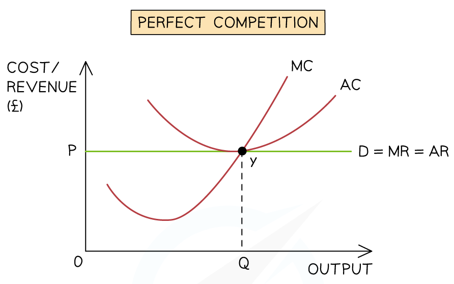
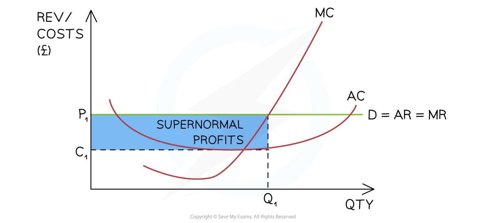
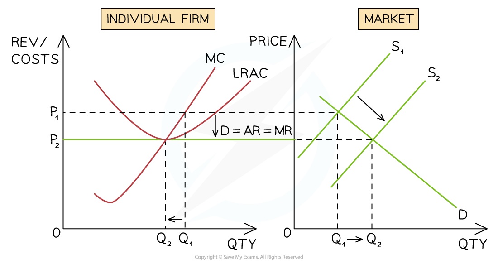
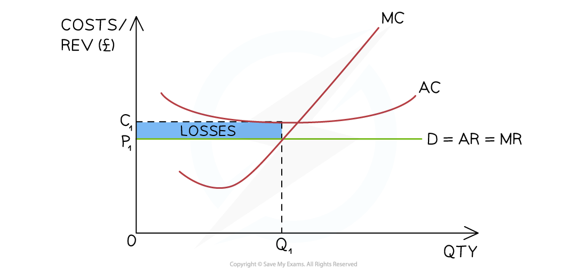
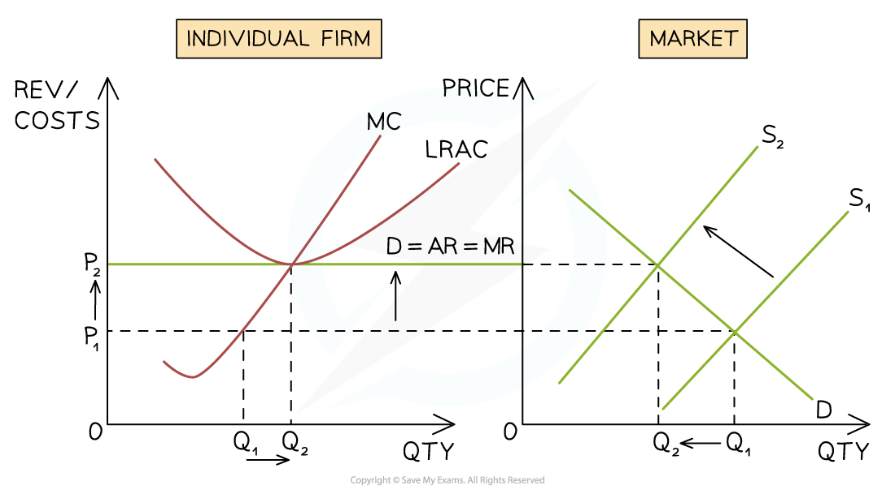
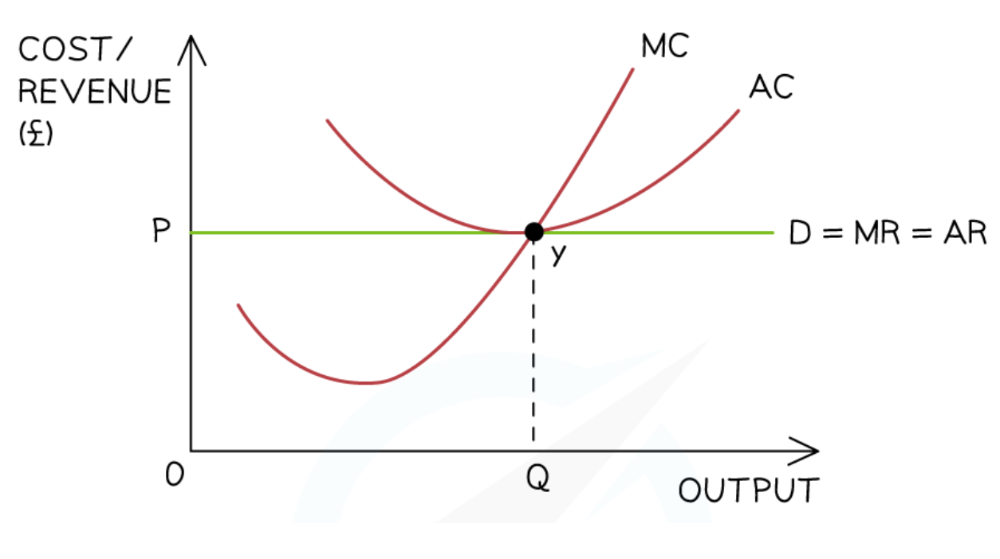

# The Performance of Firms in Perfect Competition

## Revenue in perfect competition

> **Spec point** — `spcpt_rtBkxqGxChhfrNbj`

## Revenue in perfect competition

- The firm does not have any **market power** so it is unable to influence the price and quantity

  - The firm is a ***price taker*** due to the large number of sellers
  - The firm's **selling price** is the same as the market price, **P****1**** = MR = AR = Demand**

#### The relationship between TR, AR & MR when price = \$8

| **Q** | **TR **$(P\timesQ)$ | **AR **$\frac{\mathrm{TR}}{Q}$ | **MR **$\frac{\Delta\mathrm{in} \mathrm{TR}}{\Delta\mathrm{in}Q}$ |
|---|---|---|---|
| 5 | 40 | 8 | 8 |
| 6 | 48 | 8 | 8 |
| 7 | 56 | 8 | 8 |
| 8 | 64 | 8 | 8 |

- The situation in the table above is illustrated in the diagram below

*An illustration of the relationship between AR, MR & TR in a perfectly competitive market*

#### Observations

- The firm is a ***price taker*** at P1 (\$8)

  - Every unit of output is sold at the same price
  - A higher price would decrease sales to zero
  - A lower price would result in all sellers lowering their price
- TR increases at a constant rate
- **MR = AR = Demand**

## The role of the MC curve

> **Spec point** — `spcpt_NQYzgNvk2sRF6rQD`

## The role of the MC curve

- The **MC curve shows the cost of producing one additional unit**
- As price changes, the firm changes output to the point where **P = MC**
- This means the **MC curve determines the quantity supplied at each price**

### Deriving the supply curve

- For every possible price, the firm produces the output where **P = MC**
- Plotting these output decisions across different prices traces the **firm’s supply curve**

### Long run equilibrium in perfect competition (normal profit)

### Diagram observations

- The **MC curve represents the cost of producing one additional unit of output**
- In a **perfectly competitive market**, the firm maximises profit where **MC = MR**
- Because the firm is a **price taker**, **MR = AR = P**, which is shown by the horizontal demand curve
- The profit-maximising output is therefore **Q**, where the **MC curve intersects the price line**
- If **MC were below price**, producing an additional unit would add more revenue than cost, so the firm would increase output
- If **MC were above price**, producing an additional unit would increase costs more than revenue, so the firm would reduce output
- Therefore, the **MC curve determines the output supplied at each market price**
- For this reason, **the upward-sloping section of the MC curve represents the firm’s short-run supply curve**

## Profits

> **Spec point** — `spcpt_ggV5Dv3J65rfJfrc`

## Profits

- In order to **maximise profit**, firms in perfect competition produce up to the level of output where ***marginal cost*** = ***marginal revenue*** (MC=MR)
- The firm does not have any **market power** so it is unable to influence the price and quantity

  - The firm is a ***price taker*** due to the large number of sellers

### Firms in perfect competition making supernormal profits

- Firms in **perfect competition** are able to make ***supernormal profit*** in the **short-run**

  - A seller may gain a competitive advantage for a short period of time, which allows them to make supernormal profit
- However, they will always return to the long-run equilibrium (see diagrm above) where they make ***normal profit***

*This firm is making abnormal profit in the short-run as the AR > AC at the profit maximisation level of output (Q1)*

#### Diagram analysis

- The marginal cost curve (MC) is the **supply curve **of the firm
- The firm is producing at the **profit maximisation level of output,** where **MC=MR (Q****1****)**

  - At this point, AR (P1) > AC (C1)
  - The firm is making **supernormal profit** $=(P_{1}-C_{1})\timesQ_{1}$

### Supernormal profit eliminated in the long run

- If firms in **perfect competition** make ***supernormal profit*** in the **short-run, **new firms are attracted to the industry

  - They are **incentivised** by the opportunity to make supernormal profit
  - There are no ***barriers to entry***
  
    - It is easy to join the industry

*New entrants shift the industry supply curve to the right (S1→S2 ) which changes the industry price from P1→P2. The firm can now only sell its products at P2 *

#### Diagram analysis

- The firm is initially producing at the **profit maximisation level of output,** where **MC=MR (Q****1****)**

  - At this level of output, AR (P1) > AC (P2) and the firm is making **supernormal profit**
- **Incentivised by profit,** new firms join the industry and **supply increases from S****1****→S****2**

  - Overall quantity in the industry increases from Q1→Q2
  - The** industry price falls** from P1→P2
- The firm has to now sell its products at the industry price of P2

  - The **output of the firm falls** from Q1→Q2 as it now has a **smaller market share** of the larger industry
- At the profit maximisation level of output (MC=MR) the firm is now producing at the point where AR= AC

  - The firm is making ***normal profit***
- **In the long-run,** firms in **perfect competition** always make **normal profit**

### Short-run losses in perfect competition

- Firms in **perfect competition** are able to make ***losses*** in the **short-run**

  - Periods of intense competition can cause prices to fall below the average costs
  - New firms may enter the industry. This results in the **market share being divided up between more competitors** and some individual firms may start making a loss

*This firm is making losses in the short-run as the AR < AC at the profit maximisation level of output (Q1)*

### Diagram analysis

- The firm is producing at the **profit maximisation level of output,** where **MC=MR (Q****1****)**

  - At this level of output, the **AR (P****1****) < AC (C****1****)**
  - The firm's loss is equivalent to $(P_{1}-C_{1})\timesQ_{1}$

## Losses are eliminated in the long run

- If firms in **perfect competition** make losses in the **short-run, **some will shut down

  - The ***shut down rule*** will determine which firms shut down
  - There are no **barriers to exit**, so it is easy to leave the industry

* Firms leaving the industry shift the industry supply curve to the left (S1→S2 ) which changes the industry price from P1→P2. Remaining firms can now sell products at P2 which returns it to a position of normal profit*

#### Diagram analysis

- The firm is initially producing at the **profit maximisation level of output,** where **MC=MR (Q****1****)**

  - At this level of output, the AR (P1) < AC (C1) and the firm is making a loss
- Some firms leave the industry, and **supply decreases from S****1****→S****2**

  - Overall quantity in the industry **falls from Q****1****→Q****2**
  - The** industry price increases** from P1→P2
- The firm now has to sell its products at the industry price of P2

  - The **output of the firm increases **from Q1→Q2 as it now has a **larger market share** of the smaller industry
- At the **profit maximisation level of output (MC=MR)** the firm is now producing at the point where AR= AC

  - The firm is making ***normal profit***
- **In the long-run,** firms in **perfect competition** always make **normal profit**

  - Firms making a **loss** leave the industry
  - Firms making **supernormal profit **see them slowly **eradicated **as new firms join the industry

## Efficiency in perfect competition

> **Spec point** — `spcpt_N7PgcnKxC9Hxn487`

## Efficiency in perfect competition

- Allocative efficiency occurs at the level of output where average revenue = marginal cost **(AR = MC)**

  - At this point, **resources are allocated** in such a way that consumers and producers get the **maximum possible benefit**
  - **No one can be made better off **without making someone else worse off
  - There is **no excess** demand or supply
- Productive efficiency occurs at the level of output where marginal cost = average cost **(MC=AC)**

  - At this point **average costs are minimised**
  - There is **no wastage** of scarce resources & a high level of factor productivity

*A perfectly competitive market benefits from both productive and allocative efficiency in the long-run   *

#### Diagram analysis

- The firm produces at the **profit maximisation level** of output where **MC=MR (Y)**
- The firm is **productively efficient as MC=AC** at this level of output
- The firm is **allocatively efficient as AR (P)=MC**

> **Exam Hint**
> You should look to demonstrate your awareness that perfect competition provides a benchmark for judging the extent to which real-world markets perform efficiently or inefficiently
> 
> Wherever relevant, critically assess the proposition that perfectly competitive markets lead to an efficient allocation of resources
