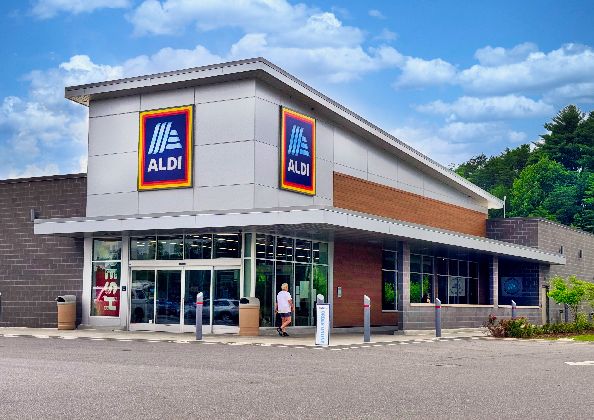

# Types of Market Structures

## Perfect competition

> **Spec point** — `spcpt_jJQ3WYS7TRMvb54f`

## Perfect competition

### Market structures

- **Market structures** are the **characteristics of the market** in which a firm or industry operates

- Market structures can be separated into ***perfect competition*** and ***imperfect competition***

### Perfect competition

- Perfect competition describes a market structure where **no individual firm has control over price**

  - Typical examples include fruit sellers on a street market

#### Characteristics of perfectly competitive markets

- **Large number of buyers and sellers**

  - Each firm produces a very small share of total market output
  - No firm can influence the market price
- **Homogeneous products**

  - Goods produced by different firms are **identical**
- **Free entry and exit**

  - Firms can easily enter or leave the market
- **Perfect information**

  - Consumers and firms have **full knowledge of prices and products**
- **Price takers**

  - Individual firms must accept the **market-determined price**

## Imperfect competition

> **Spec point** — `spcpt_whDzVjzvXmqd6T92`

## Imperfect competition

- Imperfect competition occurs when **firms have some control over price** and competition is not perfect
- Several imperfect market structures exist

### 1. Monopoly

- A monopoly is a market structure where **a single firm dominates the market**

  - A  **pure monopoly **market structure is when there is a single supplier of a particular product and has the power to influence the market supply and price
  - A **natural monopoly **is when the optimum number of firms in the market is one as the LRAC minimum efficient scale is unobtainable

*Two firms domintae the smart phone market and each is a technical monopoly i the USA - Samsung and Apple*

#### Characteristics of monopoly

- **Number of firms**

  - One dominant firm
- **Product differentiation**

  - The product has **no close substitutes**
- **Barriers to entry**

  - Very high barriers prevent new firms entering the market
- **Information**

  - Information may be **imperfect**
- Because there is only one firm, the monopolist is a **price maker**.

### 2. Monopolistic competition

- Monopolistic competition is a market structure where **many firms compete but sell differentiated products**
- Typical examples include hair or nail salons, tattoo artists, pizza takeaways, etc.

#### Characteristics of monopolistic competition

- **Number of firms**

  - Many firms
- **Product differentiation**

  - Products are similar but **not identical**
- **Freedom of entry**

  - Firms can **enter and exit the market relatively easily**
- **Information**

  - Information is **not perfect**
- Firms have **some price-setting power** due to product differentiation.

### 3. Oligopoly

- An oligopoly is a market structure dominated by **a small number of large firms**

  - Many industries are oligopolies, e.g., banking, retail, supermarkets, insurance, petrol

*Budget supermarkets in the UK act in an oligopoly industry*

#### Characteristics of oligopoly

- **Number of firms**

  - Few large firms dominate the market
- **Product differentiation**

  - Products may be **differentiated or homogeneous**
- **Barriers to entry**

  - High barriers to entry protect existing firms
- **Information**

  - Information is usually **imperfect**
- Firms in an oligopoly are **interdependent**, meaning their decisions affect competitors

#### Comparison of market structures

| Characteristic | Perfect competition | Monopolistic competition | Oligopoly | Monopoly |
|---|---|---|---|---|
| Number of firms | Very many | Many | Few | One |
| Product differentiation | None (homogeneous) | Differentiated | May be differentiated or homogeneous | Unique product |
| Barriers to entry | None | Low | High | Very high |
| Availability of information | Perfect | Imperfect | Imperfect | Imperfect |
| Price control | Price takers | Some price control | Considerable market power | Price maker |
| Type of profit in long run | Normal profit | Normal profit | Supernormal possible | Supernormal possible |
| Shape of demand curve | Perfectly elastic | Downward sloping | Downward sloping | Downward sloping |
