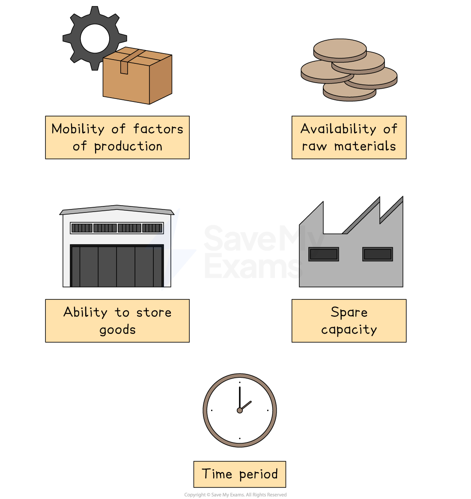

# Price Elasticity of Supply (PES)

## Defining and calculating PES

> **Spec point** — `spcpt_R977Wv6d2Q9d4SfD`

## Defining and calculating PES

- The **law of supply** states that when there is an increase in price (***ceteris paribus***), producers will increase the quantity supplied and vice versa

  - Economists are interested **by how much** the **quantity supplied will increase**
- **Price elasticity of supply** **(PES)** reveals how **responsive** the change in **quantity supplied** is to a change in **price**

  - The responsiveness is different for different types of products

### Calculation of PES

- **PES can be calculated** using the following formula:

`text PES =  end text fraction numerator percent sign space change space in space quantity space supplied over denominator percent sign space change space in space price end fraction space equals space fraction numerator percent sign triangle space in thin space QS over denominator percent sign triangle in space straight P end fraction`

- **To calculate a % change**, use the following formula

`percent sign space Change space equals space fraction numerator new space value space minus space old space value over denominator old space value end fraction space cross times space 100`

> **Worked Example**
> In recent months, the **price of avocados** has increased from £0.90 to £1.45. *Bewdley Farm Shop* in the Severn Valley have sought to **maximise their profits** by increasing the **quantity supplied **to market. They have been able to increase sales from 110 units a week to 120 units a week. Calculate the **PES of avocados** and explain one reason for the value
> 
> **Step 1:  Calculate the % change in QS**
> 
> **  **`percent sign triangle Q S space equals space fraction numerator 120 minus 110 over denominator 110 end fraction space cross times 100
> 
> percent sign triangle Q S space equals plus 9.1 percent sign`** **
> 
> **Step 2: Calculate the % change in P**
> 
> `percent sign triangle straight P space equals space fraction numerator 1.45 space minus space 0.90 over denominator 0.90 end fraction space straight x space 100
> 
> percent sign triangle straight P space equals space plus 61 percent sign`
> 
> **Step 3: Insert the above values in the PES formula**
> 
> `PE S space equals space fraction numerator percent sign triangle space in thin space Q S over denominator percent sign triangle in space straight P end fraction
> 
> PE S space equals space fraction numerator 9.1 percent sign over denominator 61 percent sign end fraction
> 
> PE S space equals space plus 0.15
> `
> 
> **Step 4: Explain one reason for the value**
> 
> The PES value of **+0.15** indicates that **avocados are very price inelastic in supply**. Even with a significant increase in price, suppliers are **less able to supply more** due to the time it takes to grow additional avocados

> **Exam Hint**
> All** PES **values are** positive**, reflecting the relationship between price and quantity on the supply curve. It is a measure of the extent to which the quantity supplied **moves along the supply curve **after a price change
> 
> When undertaking any **elasticity calculations,** make sure that your final answer is **not** expressed as a **percentage**. This is a common error and loses marks

## Interpreting the PES coefficient

> **Spec point** — `spcpt_PcQknmZQ3mRHKsRw`

## Interpreting the PES coefficient

- The values of PES vary from 0 to infinity (∞) and they are classified as follows:

| **Value** | **Explanation** |
|---|---|
| **0**  **Perfectly price inelastic**    *Perfectly inelastic supply* | - The QS is **completely unresponsive** to a change in P (e.g. fixed number of seats in a theatre) so the supply curve is vertical |
| **0→1**  **Relatively price inelastic**    *Price inelastic supply* | - The %∆ in QS is **less than** proportional to the %∆ in P (e.g., agricultural products) |
| **1→ ∞**  **Relatively price elastic**    *Price elastic supply* | - The %∆ in QS is **more than** proportional to the %∆ in P (e.g., t-shirts) |
| **∞**  **Perfectly price elastic**    *Perfectly price elastic supply* | - The %∆ in QS will **fall to zero** with any %∆ in P - However, supply is unlimited at a particular price - This is a very theoretical scenario but is evident when examining international trade diagrams where the supply curve is horizontal |
| **1**  **Unitary elasticity of supply**    *Unitary elasticity of supply* | - The value of PES: **1** - The percentage change in quantity supplied is **exactly equal** to the percentage change in price - Any supply curve that starts at **the origin** has unitary elasticity    - S1, S2 and S3 all have a PES value equal to 1   - The** %∆ in P = %∆ in QS** |

## What affects PES?

> **Spec point** — `spcpt_84v75CshvgDf3j7P`

## Factors that influence the PES

- Some products are more **responsive to changes in price** than others
- This responsiveness is known as **Price Elasticity of Supply (PES)**
- The **factors that affect how responsive supply is,** are called the **determinants of PES**

*The determinants of PES include the ability to store goods and the mobility of factors of production*

### 1. Mobility of the factors of production

- If producers can **quickly switch resources** (e.g., labour, capital) between products, then **PES will be higher (elastic)**
- If resources are **specialised or fixed**, then supply is **less responsive (inelastic)**

  - For example, if the price of hiking boots rises, a shoe manufacturer who can easily shift workers and machinery from making trainers to boots will have **elastic supply**

### 2. Availability of raw materials

- If **raw materials are easily available**, producers can respond quickly to price changes → **elastic supply**
- If materials are **scarce or hard to obtain**, supply cannot increase easily → **inelastic** supply

  - For example, a chocolate producer with limited access to cocoa beans may find it harder to increase supply when prices rise.

### 3. Ability to store stock

- If goods can be **stored easily**, producers can build up inventory and **release more when prices rise** → **elastic supply**
- If goods **cannot be stored** (e.g., fresh flowers), supply will be **more inelastic**

  - For example, producers of tinned food can respond quickly to price increases because the products can be stored for long periods

### 4. Spare capacity

- If a firm has **unused capacity** (idle machines, underused staff), it can **increase output quickly** when prices rise → **elastic supply**
- If operating at **full capacity**, it cannot easily raise production → **inelastic supply**
- For example, a car factory with extra machinery and space can respond rapidly to rising demand

### 5. Time period

- In the **short run**, supply is usually **more inelastic** because firms need time to adjust production
- In the **long run**, supply becomes **more elastic** as firms can invest in more resources and change production processes
- For example, avocado farmers cannot instantly grow more avocados when prices rise — but over time, they can plant more trees and expand supply

> **Exam Hint**
> You must not **confuse PES with PED** and inadvertently answer questions using **knowledge from PED**
> 
> When faced with **PES questions**, make yourself **think like a producer** and it will help you stay focused on providing the correct answer

## Using PES to predict supply responses

> **Spec point** — `spcpt_YW4YnC2BYMhbWZCN`

## How PES affects business reactions to market changes

- **Price Elasticity of Supply (PES)** helps explain how quickly and easily businesses can adjust their output when market conditions shift
- A product with **elastic supply** can be increased quickly when prices rise, while **inelastic supply** means production is slower or harder to change

### Manufactured goods: More flexible supply

- In the short term, businesses that produce manufactured items like trainers, headphones, or stationery, often have more flexibility
- If demand suddenly increases, they can **release stock **from warehouses or ramp up production with existing machinery.

  - For example, if a surge in demand for reusable water bottles occurs due to a sustainability trend, manufacturers can respond quickly by increasing output
- Over time, if the demand remains high, firms may invest in more equipment or hire additional staff to expand capacity

### Agricultural products: Slower to respond

- Farming and food production tend to be **less responsive **in the** short run**
- Crops like strawberries or wheat cannot be grown overnight, and supply is affected by unpredictable factors such as weather, pests, or seasonal cycles

  - If demand for avocados spikes due to a health craze, farmers cannot instantly grow more. They must wait for the next harvest
- External influences also play a role. Disease outbreaks in livestock, droughts, or trade restrictions can disrupt supply. **These factors make agricultural PES more inelastic **compared to manufactured goods

### Global impact of PES differences

- When supply is inelastic, even small changes in demand can cause big price swings

  - If global demand for cocoa rises and supply cannot keep up, prices may soar, affecting chocolate producers and consumers worldwide
  - In contrast, if demand for mobile phone cases increases, prices may stay stable because supply can adjust more easily

### Comparing the PES of agricultural products and manufactured products

#### 1. Mobility of the factors of production

| **Agricultural products: inelastic in supply** **(PES = 0-1)** | **Manufactured goods: elastic in supply** **(PES = >1)** |
|---|---|
| - If the price of a specific agricultural commodity increases, it's not possible for farmers to quickly **switch to producing a different crop** | - There is generally more flexibility to **switch production to alternative goods** in response to price changes, leading to a higher PES - E.g. a car manufacturer may be able to **adjust its factors of production** from producing family car to sports models relatively easily |

#### 2. The rate at which costs of production (marginal costs) increase

| **Agricultural products: inelastic in supply** **(PES = 0-1)** | **Manufactured goods: elastic in supply** **(PES = >1)** |
|---|---|
| - The PES for agricultural commodities is **typically lower ** - The production of agricultural commodities is often **subject to inherent constraints**, (e.g. longer production cycles) - The cost to produce one more unit of output is** relatively high** | - The PES for manufactured products is **typically higher** - The additional costs of supplying **mass produced manufactured products **is generally lower as it is **easy to add on extra units** to production output |

#### 3. The ability to store goods

| **Agricultural products: inelastic in supply** **(PES = 0-1)** | **Manufactured goods: elastic in supply** **(PES = >1)** |
|---|---|
| - Perishable agricultural products have limited storage capabilities - This reduces the **short-term supply responsiveness** and contributes to a lower PES for primary commodities | - Manufactured products can be stored for longer periods without significant deterioration or spoilage - This allows firms to **respond to price changes** by adjusting the quantity supplied** from existing stock** |

#### 4. Spare production capacity

| **Agricultural products: inelastic in supply** **(PES = 0-1)** | **Manufactured goods: elastic in supply** **(PES = >1)** |
|---|---|
| - Output is relatively** labour- or land-intensive,** which places limits on the amount of spare production capacity, leading to a low PES | - Output is often generated using machinery and so there is **more capacity when producing manufactured products,** leading to a higher PES |

#### 5. Time period

| **Agricultural products: inelastic in supply** **(PES = 0-1)** | **Manufactured goods: elastic in supply** **(PES = >1)** |
|---|---|
| - The time period to **grow or extract primary commodities is much longer** than that required to manufacture products | - Many products are manufactured in a **relatively short time period** |
