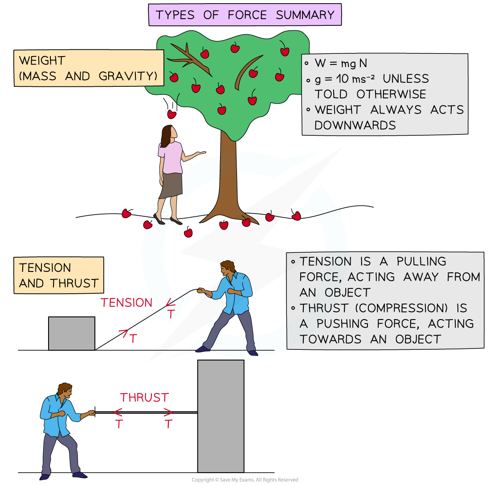
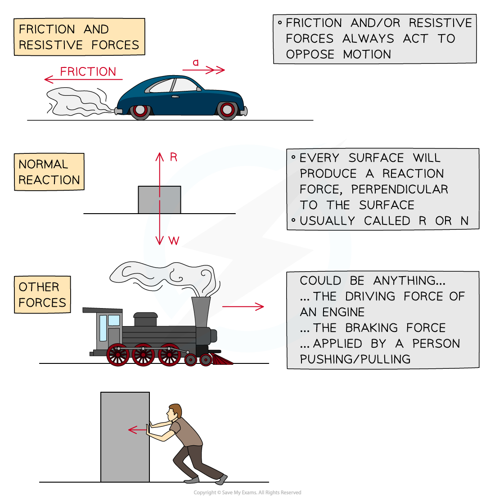

# Types of Force

## Types of Force

> **Spec point** — `spcpt_5z55DhmSTdcR8BY8`

## Types of Force

#### What is a force?

- A force is a **vector **quantity, it has both **magnitude **and **direction**
- A force is a push or a pull on an object
- A force is measured in **Newtons**
- In A level mathematical models, forces act at a **single** **point** called a **particle** which occupies a single point in space

#### What types of force are used in mechanics?

- **Weight **is the effect of** mass **and** gravity, **it always acts downwards
- **Tension **is a pulling force, it always acts away from an object
- **Thrust **is a pushing force, it always acts towards an object
- **Friction** is a resistive force, it acts to oppose the motion of an object
- Every surface will produce a **reaction force**, it will always act **perpendicular** to the surface

#### Mass, Gravity and Weight

- **Mass** is a measure of the amount of matter in an object

  - **Mass **is a **scalar** quantity, measured in **kilograms**, **kg**
  - **Mass** is universal, it does not change based on location
- **Gravity** is the force by which a body (usually a planet or a star) pulls objects towards its centre

  - **g **is the **acceleration** due to **gravity, measured in m s****-2**
  - On Earth, **g **is approximately **10** **m s****-2** , although its exact value varies with location
  - **g **is different elsewhere in the universe
- **Weight** is the product of **mass** and **gravity**, it is a** force **measured in** Newtons**

  - **Weight **is a **vector **quantity
  - **Weight **varies with location
  - **Weight **always acts vertically downwards towards the ground

> **Worked Example**
> The diagram below shows a car towing a trailer by a light inextensible string.
> 
> Forces *D, R, F* and *T N* act on the car and caravan as shown.
> 
> Write a brief description of which each force represents.
> 
> 
> 
> **Answer:**
> 
> 
> 
> 

> **Exam Hint**
> - Always sketch a diagram and mark the forces on the diagram clearly, it will help you to understand the problem. Add more things to the diagram as you progress through the question. You may not even need all the forces from your diagram but it is useful to have them there.
> - You should always round your answers to three significant figures.
