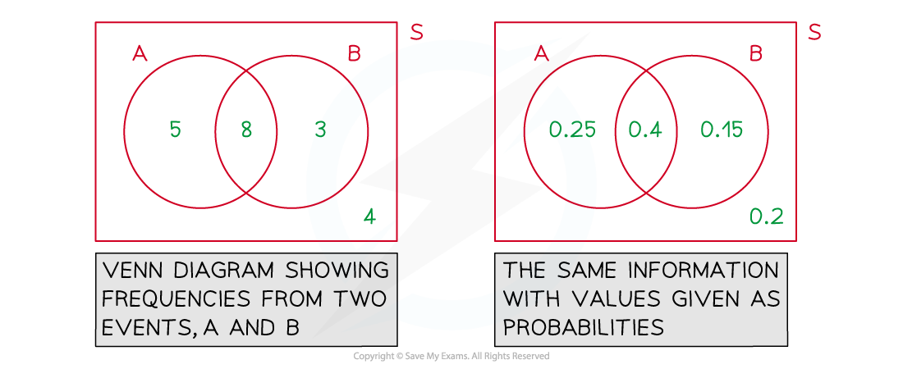
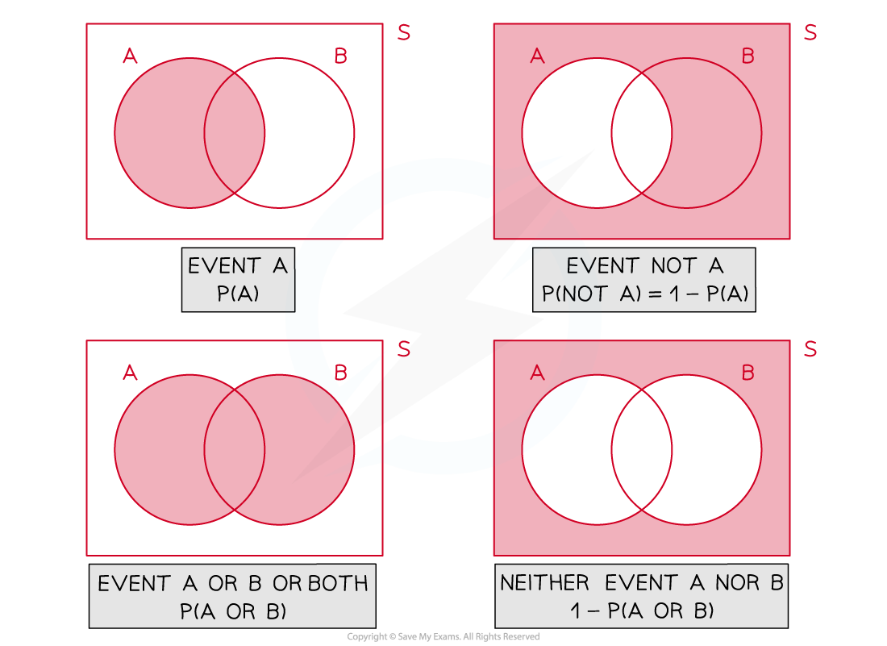

# Venn Diagrams

## Venn Diagrams

> **Spec point** — `spcpt_KPTCzXxPJc56vjtQ`

## Venn Diagrams

#### What is a Venn diagram?

- A **Venn** diagram is a way to illustrate **events** and are particularly useful when **outcomes** **overlap**
- Venn diagrams are mostly used for 2 or 3 events
- A Venn diagram consists of a **box** (rectangle) and a **bubble** (circle/ellipse) for each **event**

  - Bubbles may or may not overlap
  - Bubble(s) is not a technical term, but we like it!
- The box represents **all** **outcomes**

  - It is often referred to as the Universal Set and is commonly labelled with the symbols $E$ (Kunstler script font uppercase letter E)$S,U\mathrm{or}ξ$  (Greek lowercase letter Xi)
  - There is no standardised symbol for this purpose
- Bubbles are labelled with their event name (*A, B, etc)*
- The numbers inside a Venn diagram (there should be one in each region) will represent either a **frequency** or a **probability**

  - In the case of probabilities being shown, all values should total 1

#### What do the different regions and bubbles overlapping mean on a Venn diagram?

- This will depend on how many events there are and how the outcomes overlap
- Venn diagrams show ‘**AND’** and ‘**OR’** statements easily

> **Worked Example**
> 40 people were surveyed regarding which games consoles they owned.
> 
> 8 people said they owned a Playstation 5 ($P$) and an Xbox Series X ($X$).
> 
> 5 people said they owned neither of these consoles.
> 
> Of those people that owned only one games console, twice as many owned an Xbox Series X as a Playstation 5.
> 
> One of the 40 people is chosen at random.  Find the probability that this person
> 
> (i) owns both consoles,
> 
> (ii) owns exactly one console,
> 
> (iii) doesn’t own a Playstation 5.
> 
> **Answer:**
> 
> 

> **Exam Hint**
> - The rectangle in a Venn diagram is a key part of the diagram
> 
>   - it represents all possible outcomes of the experiment
>   - the bubbles merely represent the events we are particularly interested in
>   - there is usually a few possibilities that fall outside of these events so this would be the section outside the bubbles but inside the rectangle
> - A quick ‘mini-Venn’ diagram shading the parts required to answer the question can be useful rather than always drawing a full Venn diagram with all its values
