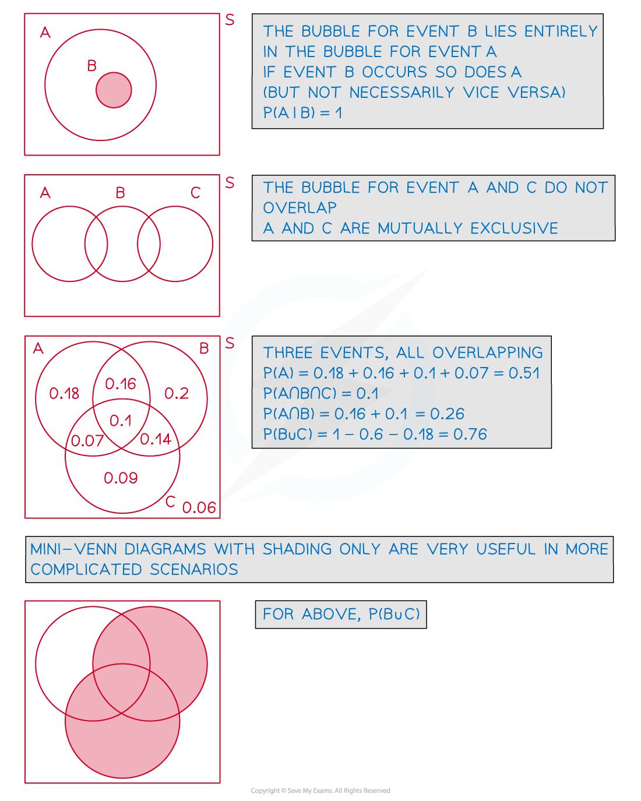
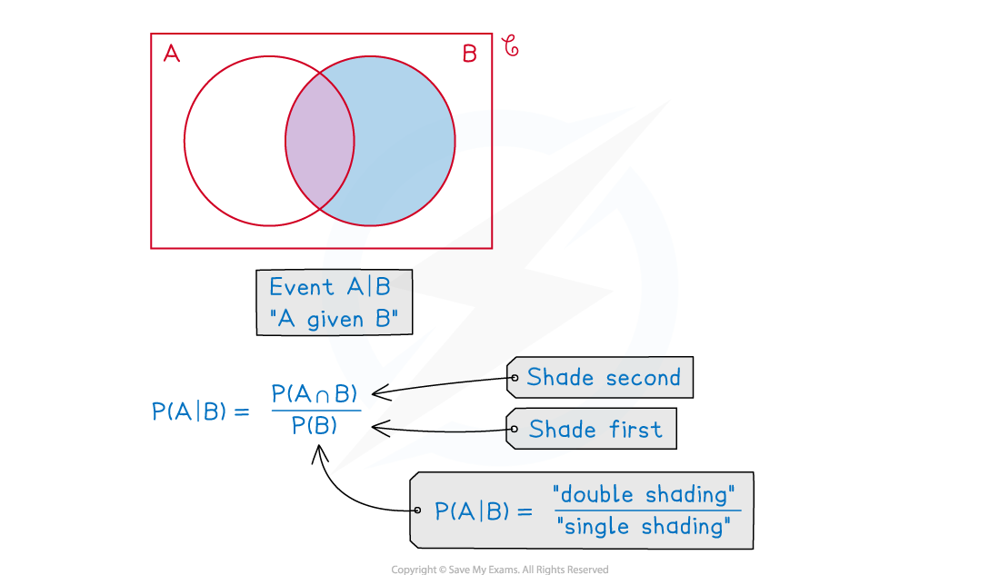

# Venn Diagrams with Conditional Probability

## Further Venn Diagrams

> **Spec point** — `spcpt_FZtYScDC38fJ2CY2`

## Further Venn Diagrams

#### What do you mean by further Venn diagrams?

- The Venn diagrams used here are no more complicated than those in the first **Venn Diagrams **revision note, however

  - questions may use **set** **notation** as well, or alongside contextual questions
  - there may be more detailed use of **conditional probability**
  - **mutually** **exclusive**, three events and other unusual Venn diagram setups may be involved

#### How do I solve conditional probability problems using Venn diagrams?

- Interpreting questions in terms of **AND** ($\cup$), **OR** ($\cap$),** complement** ( ‘ ) and
**“given that”** ( | )
- Use mini-Venn diagrams to sketch and shade the regions you are dealing with – use different colours if available or different styles of shading if not

  - Shading can help you see the answer

since $\mathrm{P} ( A \vert B ) = \frac{ \mathrm{P} ( A \cap B )}{ \mathrm{P} ( B )}$ shade *B*  first, then shade $A\capB$

the answer will then be $\frac{"\mathrm{double} \mathrm{shading}"}{"\mathrm{single} \mathrm{shading}"}$

> **Worked Example**
> Three events, $A,B$ and $C$ are such that
> 
> events $A$ and $C$ are mutually exclusive
> 
> $P(A\capB)=0.2\,P(B\capC)=0.3\,P((A\cupB\cupC)')=0.1\,P(B)=0.7\,P(A')=0.75.$
> 
> Find
> 
> (i) $\mathrm{P} ( A \vert B )$
> 
> (ii) $\mathrm{P} ( A ' \vert C ' )$
> 
> (iii) $\mathrm{P} ( C \vert ( A \cup B ) ' )$
> 
> **Answer:**
> 
> 
> 
> 

> **Exam Hint**
> - Although very versatile, Venn diagrams may not always be the best option
> 
>   - use a tree diagram if one event follows another
> 
> e.g.  two beads drawn from a bag without replacement
> 
> - use a two-way table for showing how many items/people are in associated categories
> e.g.  A school year group split by gender selecting which sport they wish to play
