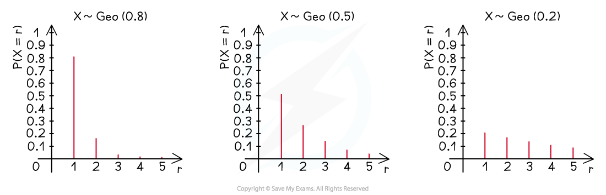

# The Geometric Distribution

## Properties of Geometric Distribution

> **Spec point** — `spcpt_7RxxhPNkwYwmz3vV`

## Properties of Geometric Distribution

#### What is a geometric distribution and its notation?

- A **geometric** **distribution** is a **discrete probability distribution**
- The discrete random variable $X$ follows a geometric distribution if it counts the number of trials until the first success occurs for an experiment that satisfies the conditions

  - **Each trial has only two outcomes** Broadly labelled as “success” and “failure” - these are *mutually exclusive*

Such trials may be referred to as **Bernoulli** **trials** – named after the Swiss mathematician Jacob Bernoulli (1655-1705)

- **The outcomes of trials are independent **The outcome of one trial does not affect the outcome of another trial

  - **The probability of each outcome is constant across all trials**

i.e.   The probability of “success” does not change between trials

- *p* is the probability of “**success**” in a **single** **trial**

  - The probability of “**failure”** in a **single** trial is *1- p* ; often denoted by *q*
- If *X*  follows a geometric distribution, it is denoted by $X \sim \text{Geo} ( p )$
- The formula for finding the probability that the first success occurs after *r* trials (or after *r* -1 failures) is

$P(X=r)=(1-p)^{r-1}p$

- e.g. If the probability of success in a single trial is 0.3, then the probability it will take 6 trials to obtain the first success is given by

$P ( X = 6 ) = ( 1 - 0.3 )^{6 - 1} ( 0.3 ) = ( 0.7 )^{5} ( 0.3 ) = 0.050421$

#### What does a geometric distribution look like?

- If represented visually, using a vertical line graph, the probabilities in a geometric distribution decrease but **never** reach zero

  - The probabilities form a **geometric** **progression**
  
    - Question: What would the first term (“a”), the common ratio (“r”) and the sum to infinity be (“$S_{\infty}$”)?                          (Answer below diagram)
    - The probabilities decrease exponentially; drawing a curve through the tops of the lines would produce a decreasing exponential curve
  - The graphs also show how 1 is the **mode** for **every** geometric distribution

- Answer: $a=p,r=q=1-p,S_{\infty}=1$

#### What are the properties of a geometric distribution?

- $P(X=r)>0$ for all r

  - Every geometric distribution has an infinite (discrete) **sample** **space** which is the set of natural numbers ($ℕ$) or positive integers ($ℤ^{+}$)
- $\mathrm{P} ( X = r ) < \mathrm{P} ( X = r - 1 )$ for all r

  - The **mode** of **every** geometric distribution is **1** (the value of r that has the highest probability)
- Geometric distributions are ***memoryless***

  - The number of trials needed for the first success is not dependent on the number of trials that have already occurred e.g.   If 5 (failed) trials have already occurred, the probability of the first success happening after 7 trials is the same as the probability of it happening after 2 trials which would be $( 1 - p ) p$
  - Mathematically this is written as

$\mathrm{P} ( X = r \vert X > k ) = \mathrm{P} ( X = r - k )$  where $k$ is the number of trials that have already occurred

e.g.   $P ( X = 7 \vert X > 5 ) = \mathrm{P} ( X = 7 - 5 ) = P ( X = 2 )$

- Geometric distributions have the **recurrence** **relation **$P(X=r)=qP(X=r-1)$
- The **mean**, or **expected** **value**, of a geometric distribution is $E(X)=\frac{1}{p}$

## Modelling with Geometric Distribution

> **Spec point** — `spcpt_VxJMMF37MG3rQ92M`

## Modelling with Geometric Distribution

#### How do I set up a geometric model?

- **Identify** what a **trial** is in the **context** of a problem

  - Flipping a coin, rolling a dice, a football match
- **Identify** a **successful** **outcome**

  - Heads, a square number, a win
- **Identify** the probability of “**success**”

  - $0.5 , 1 \frac{1}{3} , 42 \%$
- Define your **random** **variable** using the correct **notation**

  - Let *X* be the number of trials required to obtain the first heads when flipping a fair coin,  $X \sim \text{Geo} ( 0.5 )$

#### What can be modelled using a geometric distribution?

- Anything where the **first** occurrence of a **successful** **outcome** is of significance

  - Rolling a double with two dice before being allowed to start a game
  - The number of on/off presses a switch can withstand before wearing out

(In which case the first “success” would be the first failure of the switch!)

- In addition, the scenario must satisfy the t**hree conditions**

  - Trials only have two outcomes of interest
  - Trials are independent
  - Probability of success is constant for all trials
  - These are also three of the four conditions for a **binomial** **distribution** so are not enough on their own – it will also depend on the context
- Many scenarios may appear as having more than two outcomes but in the context of the question only two are of significance

  - e.g. A light that randomly flashes in 8 different colours, but the only colour of interest is blue          So “blue” is “success” and all other colours, regardless of whether it  is red, yellow, etc – i.e. “not blue” - is “failure”
- Sometimes a sample may be taken from a population

  - As long as the population is large enough and the sample is random the probability of “success” in the sample is the same as the probability of “success” in the population

#### What cannot be modelled using a geometric distribution?

- Be careful not to confuse **binomial** and **geometric** distributions/models

  - **Binomial** is for the number of **successes** in a **fixed** number of **trials**
  - **Geometric** is for the number of **trials** up to and **including** the **first** **success**
- Anything where a trial would have **more** **than** **two** **outcomes** of interest

  - e.g. Outcome of a football match – win, draw or lose
- Where the **probability** of an **outcome** of a **trial** is **influenced** by a previous trial

  - i.e. trials are **not** **independent**
  - e.g. drawing counters from a bag **without** replacement
- Anything where the **probability** of “**success**” **changes** with time – or practice

  - e.g. a skateboarder performing a trick - the probability of success should increase after practising the trick

## Calculating Geometric Probabilities

> **Spec point** — `spcpt_CrCq4jsdbsJthgqb`

## Calculating Geometric Probabilities

#### How do I calculate geometric probabilities?

- Identify *p*, the probability of “success” and *1- p*, the probability of “failure” (q)
- For **exact** probabilities use $P(X=r)=(1-p)^{r-1}p$
- For **inequalities **use

  - $P(X>r)=(1-p)^{r}$
  
    - This means the first success occurs ***after r*** trials, therefore the first $r$  trials all ended in failure
    - Similarly, $P(X\geqr)=P(X>r-1)=q^{r-1}$
  - $P(X<r)=1-P(X>r-1)=1-q^{r-1}$
  
    - Similarly, $P(X\leqr)=1-P(X>r)=1-q^{r}$
  - $P(a\leqX\leqb)=P(X\leqb)-P(X<a)$
  
    - If *a* and *b* are close it may be easier to use

$P(X=a)+P(X=a+1)+...+P(X=b)$

- Logic can be used to deduce most geometric distribution questions so memorising these formulae is not essential
- Beware of questions that exploit the ***memorylessness*** property of geometric distributions – loosely called “given that” questions

  - e.g.  $P ( X = 8 \vert X > 6 )$ means         “the probability that  equals 8 given that  is greater than 6” or          “the probability of 8 trials given that 6 trials have already occurred”               $P ( X = 8 \vert X > 6 ) = P ( X = 8 - 6 ) = P ( X = 2 )$
- The **mean** (**expected** **value**) or **mode** of a geometric distribution may be required

  - ** **$E(X)=\frac{1}{p}$
  - The **mode** is **1** for all geometric distributions

> **Worked Example**
> Given that $X \sim \text{Geo} ( 0.4 )$ find
> 
> (i)  $P(X=5)$
> 
> (ii) $P(X>5)$
> 
> (iii) $P(3\leqX<8)$
> 
> (iv) $\mathrm{P} ( X = 8 \vert X > 5 )$
> 
> (v) The mode of  $X$.
> 
> **Answer:**
> 
> 

> **Exam Hint**
> - Try not to get bogged down with formulae for the geometric distribution, most questions can be deduced using logic
> - If you are asked to criticise a geometric model always consider whether trials are independent
> 
>   - especially if it involves “practising” or “performing” a skill
>   - most people will improve after they’ve made several attempts at a skill
>   - so the probability of success should gradually increase over time
> - If finding the number of trials required ($r$) then be careful counting calculator presses; remember you are likely to be finding $r-1$(the number of failures *before* success) in the first instance
