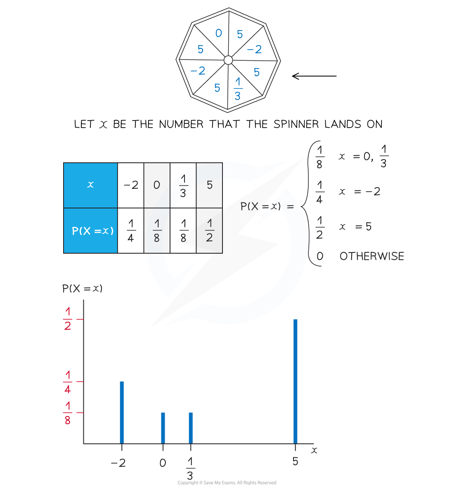

# Discrete Probability Distributions

## Discrete Random Variables

> **Spec point** — `spcpt_gNXFxJ55T59nCGk5`

## Discrete Random Variables

#### What is a discrete random variable?

- A** random variable **is a variable whose value depends on the outcome of a ***random event***

  - The value of the random variable is not known until the event is carried out (this is what is meant by 'random' in this case)
- **Random variables** are denoted using **upper case letters** (X , Y , etc )
- **Particular outcomes** of the event are denoted using **lower case letters** ( x, y, etc)
- $P(X=x)$ means "the probability of the random variable *X* taking the value $x$"
- A discrete random variable (often abbreviated to DRV) can only take **certain values** within a set

  - Discrete random variables **usually count** something
  - Discrete random variables usually can only take a finite number of values but it is possible that it can take an infinite number of values (see the examples below)
- **Examples** of discrete random variables include:

  - The number of times a coin lands on heads when flipped 20 times (this has a finite number of outcomes: 0,1,2,…,20)
  - The number of emails a manager receives within an hour (this has an infinite number of outcomes: 1,2,3,…)
  - The number of times a dice is rolled until it lands on a 6 (this has an infinite number of outcomes: 1,2,3,…)
  - The number on a bingo ball when one is drawn at random (this has a finite number of outcomes: 1,2,3…,90)

## Probability Distributions (Discrete)

> **Spec point** — `spcpt_Gfcm92qtDBJvFpw2`

## Probability Distributions (Discrete)

#### What is a probability distribution?

- A** discrete probability distribution **fully describes **all the values** that a discrete random variable can take along with their **associated probabilities**

  - This can be given in a **table**
  - Or it can be given as a **function** (called a probability mass function)
  - They can be represented by **vertical line graphs** (the possible values for *X*  along the horizontal axis and the probability on the vertical axis)
- The **sum of the probabilities** of **all the values** of a discrete random variable is **1**

  - This is usually written $\mathrm{ΣP}(X=x)=1$

## Cumulative Probabilities (Discrete)

> **Spec point** — `spcpt_BzMXR87dNgwF3Dfv`

## Cumulative Probabilities (Discrete)

#### How do I calculate probabilities using a discrete probability distribution?

- First **draw a table** to represent the probability distribution

  - If it is given as a function then find each probability
  - If any probabilities are unknown then use algebra to represent them
- **Form an equation** using $\sumP(X=x)=1$

  - Add together all the probabilities and make the sum equal to 1
- To find $P(X=k)$

  - If *k* is a possible value of the random variable *X*  then $P(X=k)$ will be given in the table
  - If $k$is not a possible value then $P(X=k)=0$
- To find $P(X\leqk)$

  - Identify all possible values, $x_{i}$, that *X* can take which satisfy $x_{i}\leqk$
  - Add together all their corresponding probabilities
  - $P(X\leqk)=\underset{x_{i}\leqk}{\sum}P(X=x_{i})$
  - Some mathematicians use the notation F(x) to represent the cumulative distribution
  
    - $F(x)=P(X\leqx)$
- Using a similar method you can find $P(X<k),P(X\geqk)$and $P(X>k)$
- As all the probabilities add up to 1 you can form the following equivalent equations:

  - $P(X<k)+P(X=k)+P(X>k)=1$
  - $P(X>k)=1-P(X\leqk)$
  - $P(X\geqk)=1-P(X<k)$
- To calculate more complicated probabilities such as $P(X^{2}<4)$

  - Identify which values of the random variable satisfy the inequality or event in the brackets
  - Add together the corresponding probabilities

#### How do I know which inequality to use?

- $P(X\leqk)$would be used for phrases such as:

  - At most k, no greater than k, etc
- $P(X<k)$would be used for phrases such as:

  - Fewer than *k*
- $P(X\geqk)$would be used for phrases such as:

  - At least *k*  , no fewer than *k*, etc
- $P(X>k)$would be used for phrases such as:

  - Greater than *k*, etc

> **Worked Example**
> The probability distribution of the discrete random variable  is given by the function
> 
> `straight P left parenthesis X equals x right parenthesis equals open curly brackets table row cell k x squared space space space space space x equals negative 3 comma negative 1 comma 2 comma 4 end cell row cell 0 space space space space space space space space space otherwise. end cell end table close`
> 
> (a)     Show that  $k$ = $\frac{1}{30}$.
> 
> (b)      Calculate $P(X\leq3).$
> 
> (c) Calculate $P(X^{2}<5)$
> 
> **Answer:**
> 
> 
> 
> 

> **Exam Hint**
> - Try to draw a table if there are a finite number of values that the discrete random variable can take
> - When finding a probability, it will sometimes be quicker to subtract the probabilities of the unwanted values from 1 rather than adding together the probabilities of the wanted values
> - Always make sure that the probabilities are between 0 and 1, and that they add up to 1!
